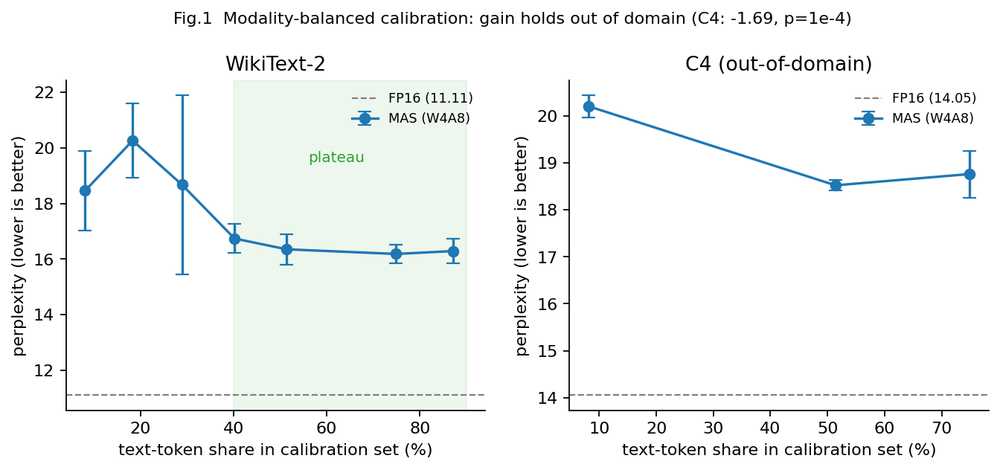
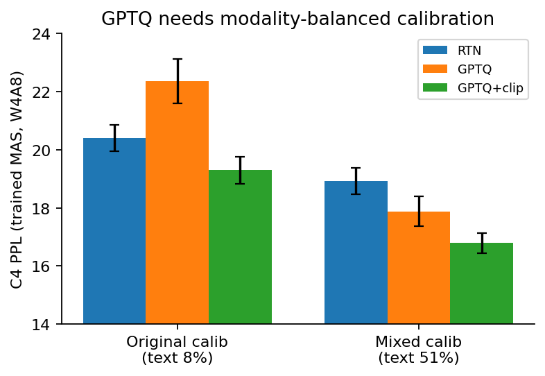

# MASQuant 复现与改进 · 书面报告

> 《多模态学习》Final Project。按评分要求组织：**所选论文简介 → 改进原因 → 改进方案 → 实验结果 → 小组成员分工**。
> 本文件为交付主文档；详细实验记录见 [`复现与改进_实验报告.md`](复现与改进_实验报告.md)，论文推导与代码逐行对照见
> [`MASQuant_论文精读.md`](MASQuant_论文精读.md)，改进 F 的完整报告见 [`改进F_平滑后GPTQ.md`](改进F_平滑后GPTQ.md)，
> 环境与一键脚本见 [`复现与改进_使用说明.md`](复现与改进_使用说明.md)。
> 每个数字对应的脚本与原始结果文件见 [`RESULTS_MAP.md`](RESULTS_MAP.md) 与仓库 [`results/`](../results/)。
> 最后更新：2026-11-24。

---

## 摘要

我们在 **Qwen2.5-VL-3B-Instruct** 上复现了 MASQuant（模态感知平滑量化），并在其基础上做了 6 项改进；
随后换模态到 **Qwen2.5-Omni-3B（音频 / LibriSpeech）** 对核心结论做了一次跨模态复核（§6.7）。

**复现结论**：W4A8 下 MAS 显著优于 SmoothQuant（benchmark 上 +3.40 / +2.42 点，配对 bootstrap $p=2\times10^{-4}$ / $1.8\times10^{-3}$，口径 A；全量口径 B 为 +3.17 / +3.41），与论文方向一致；但 W4A8 **未追平 FP16**（−2.15 / −12.38 点，均显著）。

**改进的主线是一条因果链**，而不是六个并列的点：

1. **发现归因问题**：控制校准数据与初始化统计后，「分模态平滑」与「统一平滑 + 同样的训练」
   在 PPL（$p=0.97$）、两个全量 benchmark、KL 保真度三组独立证据上**完全打平**。
   论文的增益来自"**从闭式解变成可学习**"，而不是"分模态"这个结构。
2. **找到真正的瓶颈 ①**：原校准集 128 个样本里文本 token 只占 **8.1%**（43658 图像 vs 3873 文本，且多为重复对话模板），
   MAS 的文本平滑因子几乎没有监督。**混合校准**后 PPL $19.09\pm1.45\to17.42\pm1.24$（14 vs 9 次），
   换到不同领域的 **C4** 上仍降 1.53（$20.40\to18.88$，$p<10^{-4}$）——**跨领域验证排除了同域作弊**。
3. **找到真正的瓶颈 ②**：平滑只决定"**量化什么**"，权重仍用 RTN 逐元素舍入。
   把 RTN 换成**在平滑空间、按模态统计 Hessian 的 GPTQ**，再加**按 Hessian 误差逐行选裁剪系数（clip）**：
   TextVQA **$63.47\to70.98$（+7.51，CI [+5.77,+9.21]）**，格式不变、推理零开销；C4 PPL 在 8 个 checkpoint 上**每个都降约 2.1**。
   归因说明（TextVQA，`doc_id<2000` 口径）：这 7.5 点里 **GPTQ 单独就占 +7.4**，clip 只再加 0.1
   （5000 题口径为 +7.2 / +0.5，结论相同）；
   坐标下降（cd）实测**下游无一致收益，默认关闭**，它的价值是结构性的（把码字侧推到 1-opt），不贡献这 7.5。
4. **两者的连接点（本工作最反直觉的结论）**：**GPTQ 的 Hessian 也需要模态平衡的校准集**。
   在原校准集上，同样的 GPTQ 让 **9/9 个 checkpoint 全部变差**（C4 +1.96）；只把 Hessian 换成混合校准集，
   C4 从 19.29 降到 17.39。也就是说——**不先修校准集，更强的方法反而有害**。
5. **否证论文的另一核心机制**：补做 CMC 的 4000 题下游后发现，论文默认配置（rank 0.05）让
   TextVQA **显著下降 6.9 点**；而**不加任何旁路、所有 token 只用文本尺度**与理想上界打平。据此**撤回**我们自己的
   "自适应秩省 7.8% 参数"这条改进。
6. **格式拓展**：实现 NVFP4（E2M1 + FP8 块缩放）W4A4，在 ScienceQA 上与 FP16 **统计上无差异**
   （80.45 vs 80.80），TextVQA 仅差 2.2；而同为 4-bit 权重的 INT W4A8 在 TextVQA 上差 12.4 点。
   **瓶颈不是位宽，是格式能否装下视觉 token 的离群分布。**

**跨模态复核（音频）**：同一套结论换到 ASR 上成立，而且更硬——SmoothQuant / RTN 在 LibriSpeech 上直接崩溃
（WER 301% / 114%），论文方法只差 FP16 0.39~1.14 点；「分模态 vs 统一 scale」在音频上 **6.58 vs 6.58（$p=0.999$）**，
与 VL 上的 $p=0.97$ 一致；混合校准的收益跨模态复现（$8.03\to6.58$，$p=0.0002$），
而"把音频校准补够"的直觉被否证（纯音频校准反而差 2.01 点）——**校准集要的是模态与文本的多样性，不是某一种模态的比例**。

此外修复 **7 个实现 bug**（含原仓库中使视频模态完全失效、LWC 从未生效的两个），
实现按模态 gather 的单遍前向，单层 **prefill 3.84× / decode 9.24×**，输出逐位一致。

**最终部署建议**：混合校准训练 MAS，换用 GPTQ+clip 求解权重，部署时**一份 4-bit 权重、零旁路、所有 token 共用文本尺度**。

---

## 1. 所选论文简介

**论文**：*MASQuant: Modality-Aware Smoothing Quantization for Multimodal Large Language Models*（阿里云，arXiv 2603.04800；官方代码 [alibaba/EfficientAI](https://github.com/alibaba/EfficientAI)）。

### 1.1 背景：PTQ 的难点是离群通道

训练后量化（PTQ）只用少量校准数据确定量化参数，不改训练流程。其难点在于**激活中的离群通道**：
某一维的激活值比其它维大数百倍，而 per-token 量化一行只有一个步长，步长被离群值决定后，其余维全部被压成 0。

SmoothQuant 用一个**逐通道缩放**做等价变换

$$Y = (XS^{-1})(SW),\qquad s_i=\frac{\max_t|x_{t,i}|^\beta}{\max_j|w_{j,i}|^{1-\beta}},\quad \beta=0.5$$

把激活的离群值"搬"到权重上。这在浮点下是**恒等变换、数学上无损**；但量化之后不同 $s$ 决定激活与权重各自落在什么动态范围，
误差就不同了。可以认为 **MASQuant = SmoothQuant 的多模态版**：SmoothQuant 用一套 $s$，MASQuant 给每个模态各一套。

### 1.2 多模态为什么会出问题：Smoothing Misalignment

MLLM 中视觉 token 的激活量级比文本大 1–2 个数量级，一套统一的 $s$ 只能迁就其中一方：

- $s$ 跟着视觉走 → 文本被一个"为视觉量身定做"的尺度除，信号被过度压缩；
- $s$ 跟着文本走 → 视觉的离群值把量化步长撑爆。

论文称之为 **Smoothing Misalignment（平滑错位）**，并给出 Theorem 1 量化这一损失。令
$\alpha_i=R_i^{\text{强}}/R_i^{\text{弱}}$ 为强弱模态在第 $i$ 通道上的范围比，$d$ 为通道数，则统一平滑相对最优平滑的 SQNR 损失为

$$\Delta = 10\log_{10}\Big[\frac{(\min_i\alpha_i)^2}{d}\sum_{i=1}^{d}\frac{1}{\alpha_i^2}\Big]\le 0,$$

当且仅当所有 $\alpha_i$ 相等时为 0。论文在 Qwen2.5-Omni 上给出最触目的一例：SmoothQuant W4A8 让 Librispeech **WER 从 3.9 恶化到 77.4**。

### 1.3 MAS：每个模态一套可学习平滑因子

每个模态 $m$ 一套 $S_m=\mathrm{diag}(s_m)$，用**该模态自己的激活统计**做闭式解初始化（max 只在该模态的 token 上取），
然后逐层训练最小化重建误差：

$$\min_{\{S_m\}}\sum_m \lambda_m\big\|Q(X^mS_m^{-1})\cdot Q(S_mW)-X^mW\big\|_1 .$$

用 L1 而非 MSE 的理由是"对离群值不敏感"。实现上 down_proj 不做平滑（沿用 OmniQuant 的传统）。

### 1.4 CMC：只存一份权重 + 低秩补偿

分模态的直接代价是每个模态都要一份量化权重 $Q(S_mW)$，显存 ×模态数，4-bit 的压缩意义就没了。
CMC 只保留文本的 $Q(S_tW)$，其它模态加一条低秩旁路：

$$Y = Q(X_mS_m^{-1})\cdot Q(S_tW) + X_mS_m^{-1}L_1^mL_2^m .$$

**Theorem 2** 的思路很漂亮：先对输入做白化（$T$ 由视觉激活协方差特征分解得到），此时
$\|X(\Delta W-L)\|_F=\|T\Delta W-TL\|_F$，"加权的低秩逼近"退化为**标准低秩逼近**，
于是对 $T\Delta W$ 做截断 SVD 即为最优（Eckart–Young）。由于 decode 阶段只有文本 token，
该旁路只在 prefill 触发，论文声称额外开销约 2% FLOPs。

### 1.5 论文声称的结论

Qwen2.5-VL W4A8 上 MASQuant 平均 64.7 分（SmoothQuant 57.4、RTN 5.1，后者基本崩溃）；Omni 上把 ASR 救回 3.6 WER；
消融 Table 3 声称"**可学习优化会放大分模态相对统一平滑的优势**"——这一条我们**未能复现**，见 §3.3 与 §7。

### 1.6 精读发现：Eq.(17) 的分子分母写反了

论文正文 Eq.(17) 把 $(\min_i\alpha_i)^2$ 放在了分母、$d$ 放在了分子。检验极端情况即可发现错误：
当所有 $\alpha_i$ 相等（即各模态在每个通道上的动态范围一致，不存在错位）时，损失必须为 0，
而按原式会算出 $d\cdot\alpha^2\cdot d/\alpha^2$ 一类与 $d$ 相关的非零值。
按论文自己的推导链（Eq.20）重推，正确的形式是 §1.2 中给出的那一个：
$\frac{(\min_i\alpha_i)^2}{d}\sum_i\frac{1}{\alpha_i^2}$，此时 $\alpha_i\equiv\alpha$ 代入得 $10\log_{10}(\alpha^2/d\cdot d/\alpha^2)=0$。

这是"读懂了推导"而不是"跑了代码"的证据；同时它也是一个提示：**论文的定量论证部分不如它的定性直觉可靠**——
这与我们后面得到的两条结论（§7、§8）是同一个方向。

---

## 2. 复现设置

| 项 | 内容 |
|---|---|
| 模型 | Qwen2.5-VL-3B-Instruct（**官方示例脚本的默认配置**，非我们自选） |
| 主配置 | W4A8：权重 per-channel 对称 4-bit，激活 per-token 对称 8-bit；另有 W4A6、NVFP4 W4A4 |
| 校准 | ShareGPT4V-COCO 128 张"图像 + 描述"（官方口径）；我们的改进是 `text-vision-mix` |
| PPL | wikitext2 + **C4（跨领域，用于排除同域作弊）** |
| 下游 | ScienceQA-IMG test **全量 2017 题** + TextVQA val **前 2000 题**；batch=1，`max_pixels=401408` |
| 统计 | 所有 benchmark 差异用**同题配对 bootstrap**（10000 次）给 95% CI 与 $p$ 值 |
| 重复 | 训练路径有 kernel 级非确定性，**每个训练配置至少 3 次**（部分配置 9~14 次），报 mean ± std |
| 硬件 | 原实验机 8×RTX PRO 6000；交付前在 4×B200 上整套复核 |

### 2.1 为什么必须做重复与配对检验

同一张卡、同一个种子，连续两次训练得到的 PPL 可以差 1.6（19.19 / 17.57），四次跨度 3.8。
来源是训练时 attention 反向的**非确定性原子累加**（归约顺序不固定）：开
`MAS_DETERMINISTIC=1`（禁用 flash / mem-efficient SDPA、固定 cuBLAS workspace）后两次 PPL 逐位相同。
所以**报单次结果没有意义**；我们所有"显著"都由 CI/p 给出，所有"不显著"都同时给出能排除的效应量
（例如 SQA 上分模态与统一 scale 的差异 CI 为 $[-1.35,+1.25]$，即能排除 1.3 个点以上的差异）。

这条方法学原则来自一次真实的踩坑：官方脚本默认只跑 10%（约 200 题），我们最早跑 60 题时
CI 宽到 ±6 点，据此写下过"MAS 全面胜出"的错误结论；改成全量后才稳定。

### 2.2 两套数字口径（阅读本报告时必须注意）

| 口径 | 机器 | 题量 | 用在 |
|---|---|---|---|
| **A** | 4×B200 | SQA 2000 + TextVQA 2000（同题配对） | §6.2 改进 F、§6.5 CMC、§6.3 NVFP4 下游、PPL 的 14/9 次重复 |
| **B** | 8×RTX PRO 6000 | SQA 全量 2017 + TextVQA 2000 | §3 复现主表、§6.1 混合校准的下游 |

跨机器有 1~2 点的系统偏移。**同一张表内不混用**；每张表都标了口径。
（偏移的来源可以定位：`act_scales` 是"取最大值"统计，对前向的微小差异极敏感——同数据重算仅 255/1008 个张量逐位相同。
详见 [`复现性诊断.md`](复现性诊断.md)。）

---

## 3. 复现结果

### 3.1 PPL（口径 B）

| 配置 | wikitext2 PPL | 说明 |
|---|---|---|
| FP16 | 11.11 | 上界 |
| RTN（不平滑） | 约 $6\times10^{3}$ | 完全崩溃 |
| SmoothQuant（统一，闭式解） | 22.63 | 3 次，完全确定 |
| MAS 仅初始化（分模态闭式解，不训练） | 19.43 | 3 次，完全确定 |
| **MAS 训练（论文配置）** | **18.46 ± 1.43** | 3 次；论文 Table 5（epoch=2）报 18.6 |

复现均值与论文几乎一致；且 MAS **即使不训练**也优于 SmoothQuant——这一点很重要：
它说明论文方法的一半收益来自"给每个模态一套尺度"这个初始化，而不是训练本身。

### 3.2 下游（口径 B，全量 2017 / 2000，配对 bootstrap）

| 配置 | ScienceQA | TextVQA |
|---|---|---|
| FP16 | **80.61** | **75.78** |
| SmoothQuant | 75.51 | 62.58 |
| MAS + 混合校准 | **79.38** | **65.98** |
| 统一 scale + 同校准同训练 | 78.98 | 65.45 |

| 配对差异（95% CI） | ScienceQA | TextVQA |
|---|---|---|
| MAS − SmoothQuant | **+3.17 [+1.54, +4.81]** | **+3.41 [+1.74, +5.10]** |
| MAS − FP16 | **−1.93 [−3.32, −0.55]** | **−9.79 [−11.42, −8.18]** |
| MAS − 统一 scale | −0.15 [−1.64, +1.34] | +1.02 [−0.55, +2.56] |

口径 A（B200，2000/2000）给出同样的方向：MAS − SQ = **+3.40 [+1.70, +5.05]，$p=2\times10^{-4}$** / **+2.42 [+0.84, +4.00]，$p=1.8\times10^{-3}$**。

### 3.3 复现的三条结论

1. **复现成功**：MAS 显著优于 SmoothQuant，方向与论文一致，两台机器上都成立。
2. **W4A8 未追平 FP16**：SQA 差 1.93 点且显著、TextVQA 差约 10 点。
   （早期 n=1000 时 SQA 不显著，那是 CI 太宽，不是"已追平"；全量后 CI 不含 0。）
3. **"分模态 vs 统一 scale"打平**：这是本工作最重要的发现，见 §7。论文 Table 3 声称的
   "优化会放大分模态优势"在本设置下**未复现**。

---

## 4. 改进的出发点：8 条观察

我们没有"为改进而改进"，每一项改进都对应一个在复现中**实际观察到的问题**。下表是完整的映射关系。

| # | 观察 | 证据 | 带来的改进 |
|---|---|---|---|
| 1 | **MAS 训练结果方差异常大**：同一配置 3 次为 17.03 / 18.46 / 19.89（std 1.43），而统一平滑只有 std 0.15 | 实验报告 §1.2 | 追查方差来源 → #2 |
| 2 | **校准集模态严重失衡**：128 个样本里图像 token 43658、文本 token 3873（**仅 8.1%**），且文本基本是重复的对话模板。MAS 要给文本单独学一个尺度，等于几乎没有监督 | 统计 `custom_dataset.py` 生成的 mask | **改进 A：混合校准** |
| 3 | 论文只评估 INT。W4A4 下 INT4 直接崩溃（PPL 96377），而新一代 GPU（Blackwell）原生支持 NVFP4 | 实测 | **改进 B：NVFP4** |
| 4 | Qwen2.5-VL 有独立的 `video_token_id`，但论文与代码都没有处理视频；原代码甚至在 `modeling_qwen2_5_vl.py` 里丢弃了 `video_mask` | 读代码 | **改进 C：视频模态** |
| 5 | CMC 对所有层用同一个秩比例（`--rank 0.05`，下限硬编码 32），而各层 $\Delta W$ 的有效秩差异很大 | 有效秩统计 | **改进 D：自适应秩**（后被下游实验推翻，撤回） |
| 6 | 原实现对每个模态各跑一遍完整 GEMM 再按 mask 相加（3–4× 计算量）；`--lwc` 一开就崩、纯文本样本会触发 "backward twice"、视频 mask 丢失 | 读代码 + 实测 | **改进 E：正确性修复与快路径** |
| 7 | 论文只报单次结果、无置信区间；纯文本 PPL 与多模态下游可能背离 | 实测（LWC：PPL 最低但两个下游都显著变差） | 评测改为多次重复 + 配对 bootstrap |
| 8 | **平滑之后的权重仍用 RTN**（逐元素独立舍入，不看激活统计）。无平滑 RTN 崩到 PPL $6\times10^3$，而单层 SQNR 只比 MAS 低 0.3 dB；W4A8 与 FP16 在 TextVQA 上仍差约 12 点 —— **剩余误差像是在权重侧** | 读代码 + 实测 | **改进 F：多模态感知 GPTQ + clip** |

观察 #8 值得多解释一句，因为它是本工作最重要的一次"从矛盾里找方向"：
单层 SQNR 只差 0.3 dB，端到端 PPL 却是 6103 vs 18.46。**均值指标看不见崩溃**（崩溃来自少数离群通道打穿个别 token，
在均值里被稀释）。既然激活侧的代理指标已经饱和，而端到端还差 12 点，那么误差主体大概率在 4-bit 权重上。
后续的改进 F 证明这个推断是对的。

---

## 5. 改进方案

### 5.1 改进 A：模态平衡的混合校准（`text-vision-mix`）

- 新增校准集类型 `text-vision-mix`：一部分样本是原来的"图像 + 描述"，另一部分替换为 wikitext 的连续文本片段。
  纯文本样本占比由 `MAS_CALI_TEXT_RATIO` 控制（默认 0.5）。
- **关键工程细节**：激活统计（`act_scales`）与 dataloader 缓存文件名都带上比例标签，
  保证**初始化统计与训练数据匹配**。这一条我们踩过坑：用 0.5 的统计初始化 0.75 的训练，
  曾得到"分模态显著优于统一（$p=0.004$）"；换成匹配统计后差异塌缩到 $-0.01$（$p=0.97$），该结论当场撤回。
- 代码：`custom_dataset.py`、`generate_act_scale_shift.py`、`main.py`。

### 5.2 改进 B：NVFP4 量化格式

- 新增 `quantize/nvfp4.py`：元素 E2M1（码字 $\{0,\pm0.5,\pm1,\pm1.5,\pm2,\pm3,\pm4,\pm6\}$），
  每 16 个元素共享一个 FP8(E4M3) 块缩放，外加每张量 FP32 全局缩放；接口与 `UniformAffineQuantizer` 兼容。
- `int_linear.py` 抽象出 `build_quantizer`，命令行 `--wfmt nvfp4 --afmt nvfp4` 即可切换。
- **注意**：这是**伪量化**（量化-反量化后用高精度算），只验证精度，未实现真实 kernel、未测速（见 §10）。

### 5.3 改进 C：视频模态（4 模态 MAS）

- `models/modeling_qwen2_5_vl.py`：把 `video_mask` 透传给语言模型（原代码写的是 `(None, image_mask, text_mask)`，
  **视频 token 被当成文本，视频模态完全失效**）；
- `generate_act_scale_shift.py`：统计视频 token 的激活范围；
- `quantize/int_linear.py` / `masquant.py`：新增 `video_smooth_scale`，loss 与前向支持 4 元组 mask；
  `MAS_VIDEO_SHARE_VISION` 控制视频是否复用图像尺度；
- `tools/make_videos.py`：用 COCO 图像合成 32 段 4 秒短视频作为视频校准源。

> 论文只做了图/文/音，我们把它扩到图/文/**视频**。结论是"独立视频尺度不显著"（§6.4），
> 但**修复这个 bug 本身是有价值的**：不改的话任何视频相关的实验都是无效的。

### 5.4 改进 D：CMC 的按层自适应秩（**已撤回**）

> ⚠️ 这一项只在 PPL 上验证过，而**纯文本 PPL 根本不经过 CMC 的视觉旁路**。补做下游后它显著更差
> （TextVQA −12.3），因此**撤回**。实现保留，用于复现这个阴性结果。

`quantize/rank_alloc.py`：在总秩预算 $\sum_l r_l\le B$ 下，每步把一单位秩分配给边际能量增益
$\sigma_r^2/\sum\sigma^2$ 最大的层（Eckart–Young 下即重构误差的下降量）；另提供按累计能量阈值定秩的策略。
`infer_mas.py --adaptive_rank greedy|energy` 启用。

**为什么这是一个值得写进报告的失败**：它暴露了一个方法论错误——我们用了一个**结构上不可能证伪该改进的指标**
（纯文本 PPL 不经过视觉旁路），而且我们自己已经在报告里写过这一点，却仍然下了结论。
这与 CMC 的"平均 SQNR 掩盖坏模块"是同一类错误（§8）。

### 5.5 改进 E：正确性修复与推理快路径

| 问题 | 位置 | 修复 | 影响 |
|---|---|---|---|
| LWC 裁剪参数从未加入优化器；且 fp32 裁剪因子与 bf16 输入 matmul 崩溃 | `quantize/masquant.py` | 注册参数 + dtype 对齐 | `--lwc` 原**完全不可用** |
| 纯文本样本复用上一个样本已 backward 的 `vision_diff` | `quantize/masquant.py` | 按样本重置 | 触发 "backward twice" |
| `video_mask` 被丢弃 | `models/modeling_qwen2_5_vl.py` | 透传 | **视频模态完全失效** |
| `reuse_scale` 漏拷 `video_smooth_scale` | `quantize/utils.py` | 补拷 | k/v/gate 视频尺度一直全 1 |
| 每个模态一遍完整 GEMM | `quantize/int_linear.py` | 按模态 gather 只算本模态行 + 量化权重缓存（`MAS_FAST=1`） | prefill 3.84× / decode 9.24×，逐位一致 |
| 硬编码作者机器路径 `/nas/yuehu/...`、在线依赖 | `custom_dataset.py`、`datautils.py` | 环境变量 + 本地 parquet 离线加载 | 可复现性 |
| （我们自己的工具）`snr_probe.py` 构造了权重量化器却从未调用 | `tools/snr_probe.py` | 补上权重量化 | 曾导致"视频掉 7 dB"的错误结论 |
| （我们自己的工具）uniform 模式读错 key、`fidelity_eval.py` 加载顺序错误 | `tools/` | 修正 | "统一 scale"一列算错；KL 虚高 3.6 倍 |

**加速的由来**：原实现对每个模态各跑一遍完整 GEMM 再按 mask 相加，实际部署是 3–4× 计算量（论文未讨论）。
我们按模态 gather 只算本模态的行，并缓存量化后的权重：单层 prefill **3.84×**、decode **9.24×**，
**输出与逐位一致**（文本行输出逐位相同，全模型 PPL 完全相同）。

此外新增分析工具：配对 bootstrap（`tools/paired_bootstrap.py`）、按模态 SQNR 探针（`tools/snr_probe.py`）、
无标签 KL 保真度（`tools/fidelity_eval.py`）、ScienceQA 题型拆分（`tools/sqa_breakdown.py`）、
CMC 逐模块诊断（`tools/cmc_probe.py`）。

### 5.6 改进 F：平滑之后的多模态感知 GPTQ

这是本工作下游收益最大的单项改进。它同时有"方法创新"和"多模态特有的设计问题"两层，下面分开写。

#### 5.6.1 动机：平滑只换了题目，没换解法

MAS 的前向是 $Q_a(X/s_m)\cdot Q_w(W\!\cdot\!s_m)^\top$，其中 $Q_w$ 是 **per-channel 对称 RTN**。
平滑决定了 $Q_w$ 的输入，但 $Q_w$ 本身对每个元素**独立舍入，完全不看输入激活的统计**。
而 PTQ 文献里权重侧的标准做法是 GPTQ：最小化输出误差

$$\min_{Q}\ \mathrm{tr}\big[(W-Q)H(W-Q)^\top\big],\qquad H=\sum_t x_tx_t^\top .$$

三条线索都指向权重侧：① 无平滑 RTN 的 W4A8 直接崩溃，但单层 SQNR 只低 0.3 dB；
② W4A8 与 FP16 在 TextVQA 上仍差 12 点；③ 分模态与统一 scale 打平。
**既然换平滑方式（激活侧）没有收益，剩下的误差就只能来自 4-bit 权重。**

#### 5.6.2 方法：在平滑空间、按模态统计 Hessian

在已确定的平滑尺度 $s_m$ 下，对第 $m$ 份权重求解

$$\min_{Q\in\mathcal{G}}\ \mathrm{tr}\big[(W s_m-Q)\,H_m\,(W s_m-Q)^\top\big],\qquad
H_m=\sum_{t\in\mathcal{T}_m}\tilde x_t\tilde x_t^\top,\quad \tilde x_t=x_t/s_m .$$

四个设计决定：

1. **在平滑空间里统计**：$\tilde x=x/s_m$ 才是这份权重真正看到的输入。在未平滑空间统计 Hessian 是错的
   （等价于假设权重看到原始激活）。
2. **只用本模态 token**（`--gptq_hsrc own`，默认）：$\mathcal{T}_m$ 是该份权重实际服务的 token。
   分模态平滑下，文本权重只看文本 token、视觉权重只看视觉 token。可选 `--gptq_hsrc all`
   让每份权重都看全部 token（某模态 token 太少时补统计量）。
3. **模态均衡合并**（`--gptq_hmode balanced`）：一份权重服务多个模态时，原始 GPTQ 的 $H$ 按 token 数加权，
   视觉 token 会主导；balanced 先按模态各自归一化再平均。
4. **格点不变**：$\mathcal{G}$ 与原来的 RTN **完全同一个格点**（INT4 per-channel 对称步长 $\max|w|/7$；
   NVFP4 的 E2M1 码字 + E4M3 块缩放）。**部署格式、kernel、显存都不变，推理零开销。**
   实现上 $\gamma=1$ 时与原量化器逐位一致（自检：NVFP4 100% 一致；INT4 99.66% 一致，
   差异来自 bf16 下步长计算的舍入，属同一格点的等价实现）。

平滑尺度相同的 tag 自动合并成同一份权重（例如 down_proj 不平滑、`MAS_SINGLE_SCALE=text` 的单权重部署）；
逐组顺序求解（qkv → o → gate/up → down），每组的输入来自前面已 GPTQ 过的组，与 GPTQ 原论文的顺序量化一致。

#### 5.6.3 总纲：量化只有两个自由度

在已经确定的格式（INT4 per-channel 对称）下，量化一层权重真正能调的只有两样东西：

| 自由度 | 含义 | 默认做法（RTN） | 隐含的假设 | 我们的工具 |
|---|---|---|---|---|
| **步长 scale** | 每个输出通道用多大的格距 | $\max|w|/7$ | 「这一行的最大值必须无损」 | **clip**（§5.6.5） |
| **码字 code** | 每个权重落在哪个格点上 | 就近取整 | 「每个权重独立，互不相关」 | **GPTQ**（§5.6.4）+ **cd**（§5.6.6） |

这张表把改进 F 的结构讲清楚了：

- **论文的平滑（MAS / SmoothQuant）不在这张表里**。它改的是"输入怎么缩放"，相当于给权重换了一个坐标系，
  但在新坐标系里，步长和码字仍然按 RTN 的方式确定。因此改进 F 与平滑**不冲突、可以叠加**——它在平滑的下面一层动手。
- **两个默认假设都不成立**。"最大值必须无损"让整行格距被一个离群值撑粗；"权重互不相关"忽略了输入通道之间的相关结构
  （这正是 Hessian $H$ 描述的东西）。
- **每个自由度各配一个工具**，二者正交。消融也印证了这一点：只做 clip 有效、只做 GPTQ 有效，叠加后进一步增益（§5.6.5）。

#### 5.6.4 GPTQ（码字）：误差反馈量化

理解 GPTQ 最省力的方式是**图像里的误差扩散抖动**（Floyd–Steinberg）：逐像素量化，把每个像素的舍入残差
扩散给周围还没处理的像素，于是保住局部平均亮度，把误差变成人眼不敏感的高频噪点。
GPTQ 是同一家族，一一对应：

| | 误差扩散抖动 | GPTQ |
|---|---|---|
| 量化对象 | 像素 | 权重列 |
| 残差去向 | 前馈给未处理的邻近像素 | 前馈给未量化的权重列 |
| 扩散核 | 固定手工核 $(7,3,5,1)/16$ | 从数据统计出的逆 Hessian $H^{-1}$ |
| 保住的东西 | 局部平均亮度 | **层的输出** |

具体到公式：量化掉第 $q$ 列并产生舍入误差后，最优补偿是把它按
$\delta_{\text{剩余列}}=-\dfrac{w_q-\hat w_q}{[H^{-1}]_{qq}}H^{-1}_{:,q}$ 推给还没量化的列。
$H$ 描述通道之间的相关结构，$H^{-1}$ 告诉你"要抵消这一列的误差，该往哪些邻居列上各推多少"；
分母 $[H^{-1}]_{qq}$ 只是归一化。整个过程里 **16 个码字一个都没变，变的只是每个权重最终落到哪个码字上**——
而这个选择第一次是被联合、加权地优化出来的。

这个视角在多模态里格外有用：它说明**误差反馈需要一个"往哪儿推"的方向**，
而这个方向完全由 $H$ 决定——于是"$H$ 从哪些 token 估计"就从一个实现细节变成了方法设计的核心，
这正是 §6.2.3 那个反直觉结论的来源。

#### 5.6.5 clip（步长）：按 Hessian 误差逐行选裁剪系数

默认步长 $\max|w|/7$ 隐含一个假设："**每行绝对值最大的那个元素必须无损**"。
代价是为了这一个值，把其余元素的格距撑粗了。我们引入裁剪系数 $\gamma$，令步长为 $\gamma\cdot\max|w|/7$：
让最大值轻微削顶，换大多数元素更细的格距——**一行上千个元素，1 个亏、其余都赚**。

实现上对每行在 $\gamma\in\{1.0,0.95,0.9,0.85\}$ 下各解一次 GPTQ（并行成一个大矩阵求解），
**按 $H$ 加权误差逐行选优**（不同行在该目标下相互独立，所以逐行选择是精确的），
并把 RTN 也放进候选，**保证逐行不劣于 RTN**。代价是 GPTQ 次数 ×$|\gamma|$（实测仍约 6 分钟）。

**为什么这笔账能算平**：这与缩放的**粒度**直接相关。
本项目 INT4 是**逐输出通道**一个步长，一行有上千个元素——削掉 1 个、换其余上千个更细的格距，稳赚；
而在我们另一个工作（视频扩散模型的 NVFP4）里，步长是 **block-16 共享**的，一个 block 里只有 15 个邻居能受益，
削顶单独做就是净损失，必须靠 GPTQ 的误差反馈把损失摊到后面的列上才划算。
**同一技巧在两种粒度下结论相反，说明 clip 的收益取决于"一行有多少元素陪它一起赚"。**

本项目的消融正好验证了前半句：`--gptq_rtn_only`（只做 $H$ 感知裁剪、不做 GPTQ）在 4 个 MAS checkpoint 上
C4 **18.52 → 17.17（4/4）**，再加 GPTQ 到 **16.48（4/4）**——**单独有效，且与 GPTQ 叠加后进一步增益，两者互补**。

#### 5.6.6 cd（码字）：坐标下降抛光到 1-opt（默认不开）

GPTQ 是**单遍贪心的求解器，并不是它自己目标函数的最优解**。解完后对每个元素固定其余变量、
枚举全部格点、只接受降 loss 的改动（固定其余变量时目标对该单变量是二次的，可闭式求值），
严格单调，收敛到 **1-opt 局部极小**。

从算法层面收口：这个问题本质是**离散二次规划**，最坏情况下没有多项式时间算法（NP-hard）。
注意 NP-hard 只说最坏情况的复杂度，**不表示不存在精确解**；只是在本项目的规模下
（一行约 1.1 万个元素 × 16 个取值）枚举不现实，所以只能比较「局部最优的深度」。
在这个视角下几种方法是逐级变强的局部最优：

| 方法 | 局部最优的深度 | 说明 |
|---|---|---|
| RTN | 无（完全不协同） | 每个权重各自取整，谁也不管谁 |
| GPTQ | 连 1-opt 都不满足 | 一次定一列、定完不回头 |
| **GPTQ + cd（本项目实现）** | **1-opt** | 任意单独改一个码字都不能再降 |
| 2-opt（本项目未实现） | 2-opt | 任意同时改两个也不行；组合数过多、代价高 |

**实测**：cd 把 $H$ 加权误差的恢复率从 76% 升到 87%，但端到端 PPL 没有一致收益
（MAS 训练的 4 个 checkpoint 上 16.48 → 16.53），成本 ×5；因此**默认不开 cd**。
本仓库只实现到 1-opt，没有再往 2-opt 走；我们在另一个工作（视频扩散模型的 NVFP4 W4A4）上观察到
1-opt 之上再上 2-opt 基本没有额外收益，说明这类问题在 1-opt 已经是较强的吸引子。
**结论：求解器这一侧已经饱和，收益应该去另一个自由度（步长）上找。** 这也是 §8 里"代理误差与端到端脱钩"的第三个例子。

#### 5.6.7 用法

```bash
# 在已训练的 MAS checkpoint 上：RTN（对照） / GPTQ / GPTQ+clip
bash scripts/gptq_ppl.sh mas_rtn  0 split_scales outputs/<ckpt>/mas_parameters.pth
bash scripts/gptq_ppl.sh mas_gptq 0 split_scales outputs/<ckpt>/mas_parameters.pth --gptq
bash scripts/gptq_ppl.sh mas_clip 0 split_scales outputs/<ckpt>/mas_parameters.pth --gptq --gptq_clip 1.0,0.95,0.9,0.85
# 不平滑，只用 GPTQ+clip
LET=0 bash scripts/gptq_ppl.sh plain_clip 0 merged_scales none --gptq --gptq_clip 1.0,0.95,0.9,0.85
# 加下游 + 汇总
TASKS=scienceqa_img,textvqa_val LIMIT=1.0 bash scripts/gptq_ppl.sh ...
python tools/gptq_summary.py logs --json results/gptq/ppl_summary.json
```

其它开关：`--gptq_cd N`、`--gptq_hmode balanced`、`--gptq_hsrc all`、`--gptq_actq`（用量化后的激活统计 $H$）、
`--gptq_rtn_only`（只做 $H$ 感知 clip、不做 GPTQ，消融用）、`--gptq_fp32_bs`（NVFP4 求解时不量化块缩放）、
`--gptq_cache`（缓存求解结果，每 run 约 9 GB）。

---

## 6. 实验结果

### 6.1 改进 A：混合校准



| 纯文本样本占比 | 文本 token 占比 | MAS PPL（wikitext2，口径 B） | 次数 |
|---|---|---|---|
| 0（原校准） | 8.1% | 18.46 ± 1.43 | 3 |
| 0.125 | 18.3% | 20.26 ± 1.33 | 3 |
| 0.25 | 28.9% | 18.67 ± 3.21 | 3 |
| 0.375 | 40.2% | 16.74 ± 0.52 | 3 |
| **0.5（默认，推荐）** | 51.4% | **16.35 ± 0.54** | 6 |
| 0.75 | 74.9% | **16.19 ± 0.34** | 3 |
| 0.875 | 87.1% | 16.29 ± 0.45 | 3 |

**跨领域验证**（排除"补充的 wikitext 文本与 wikitext 测试集同域"的质疑，口径 A，14 vs 9 次重复）：

| 配置 | wikitext2 | C4 |
|---|---|---|
| FP16 | 11.11 | 14.05 |
| MAS 原校准（9 次） | 19.09 ± 1.45 | 20.40 ± 0.46 |
| **MAS 混合校准 0.5（14 次）** | **17.42 ± 1.24** | **18.88 ± 0.50** |
| 收益 | −1.67（$p=0.012$） | **−1.53（$p<10^{-4}$，Welch $t=-7.56$）** |

结论：

1. 文本占比 ≥40% 后 PPL 进入 16.2~16.7 的**宽平台**，比例不需要精调（0.5 与 0.75 在两领域上都不显著，方向还相反）；
2. 换到 C4 后收益**基本保留**（−1.67 → −1.53）且高度显著 —— **改进是真实的，不是同域匹配**；
3. **波动变小**：标准差从 1.45 降到 1.24（口径 A，14 次 vs 9 次）/ 从 1.43 降到 0.54（口径 B，6 次 vs 3 次）——MAS 训练不再频繁跑飞；
4. 下游 benchmark 对比例不敏感（0.5 / 0.75 / 0.875 两两不显著），不会掉点。

> **这个改进的成本是零**：只改校准数据，不改模型、不改推理、不加参数。
> 相比之下，论文的两个设计（MAS 的训练、CMC 的低秩旁路）都需要额外的训练时间和显存。

### 6.2 改进 F：平滑后的多模态感知 GPTQ

所有 PPL 都来自**冻结的平滑尺度**（已训练的 checkpoint 或闭式解），GPTQ 求解本身是确定性的，
因此同一 checkpoint 上 RTN vs GPTQ 是**严格配对**的比较。

#### 6.2.1 PPL：每种平滑方式 × 三种求解器（W4A8，混合校准，口径 A）


| 平滑方式 | RTN | GPTQ | GPTQ + clip | + cd2 |
|---|---|---|---|---|
| 不平滑 | 6103 / 5004 | 14.05 / 18.18 | 13.70 / 17.24 | 13.46 / 17.09 |
| SmoothQuant（闭式解） | 23.11 / 22.04 | 15.45 / 18.61 | 15.10 / 16.94 | 13.36 / 16.90 |
| MAS 闭式解（不训练） | 22.91 / 21.82 | 13.96 / 18.07 | **12.93 / 16.85** | 13.00 / 16.99 |
| 统一 scale + 训练（12 ckpt） | 18.56±2.06 / 19.16±0.69 | 14.59±1.50 / 18.23±0.91 | 13.52±1.00 / 16.87±0.57 | — |
| **MAS + 训练（8 ckpt）** | 18.08±2.40 / 18.92±0.45 | 15.23±2.29 / 17.88±0.51 | 14.24±1.93 / **16.79±0.35** | — |

（格式：wikitext2 / C4；FP16 = 11.11 / 14.05。MAS 训练组排除了 1 个训练早期发散的 checkpoint，
它在 GPTQ/clip 下同样改善：35.5 → 25.6 → 18.4。）

同一 checkpoint 上的配对差（C4，负 = 变好）：

| 对比 | MAS 训练 | 统一 scale 训练 |
|---|---|---|
| GPTQ − RTN | −1.78（**9/9** 变好） | −0.93（11/12） |
| GPTQ+clip − GPTQ | −1.90（**9/9**） | −1.36（**12/12**） |
| GPTQ+clip − RTN | −2.13（**8/8**，每个 ckpt 在 −1.95 ~ −2.24） | −2.29（**12/12**） |

三个要点：

1. **GPTQ 救活了"不平滑"**：RTN 下 6103 的崩溃模型，GPTQ 后 14.05，加 clip 后 13.70，
   **已经优于论文方法 MAS + RTN（18.08）**。
2. **clip 是独立的增益**：只做 $H$ 感知裁剪（不做 GPTQ）在 4 个 ckpt 上 C4 18.52 → 17.17（4/4），
   再加 GPTQ 到 16.48（4/4）——互补。
3. **"分模态"在新求解器下依然无增益**：MAS 训练 16.79±0.35（8）vs 统一训练 16.87±0.57（12），
   差 0.08，远小于 std。**换更强的求解器不会让论文的原始结论回来**，这是对 §7 结论的第二次独立验证。

#### 6.2.2 下游：全量配对 bootstrap（口径 A）

| 配置 | ScienceQA | TextVQA | 与 FP16 差（TVQA） |
|---|---|---|---|
| FP16 | 80.80 | 75.85 | — |
| SmoothQuant + RTN | 75.25 | 61.05 | −14.8 |
| 统一 scale 训练 + RTN | 78.70 | 64.39 | −11.5 |
| **MAS 训练 + RTN（论文方法 + 我们的混合校准）** | 78.65 | 63.47 | −12.4 |
| MAS 训练 + GPTQ | 78.30 | 70.91 | −4.9 |
| MAS 训练 + GPTQ + clip | 79.15 | 70.98 | −4.9 |
| MAS 训练 + GPTQ + clip，只用文本尺度单权重部署 | **79.70** | 71.88 | −4.0 |
| SmoothQuant + GPTQ + clip | 77.90 | 71.76 | −4.1 |
| 不平滑 + GPTQ | 76.10 | 72.19 | −3.7 |
| 不平滑 + GPTQ + clip | 78.70 | 72.95 | −2.9 |
| MAS 闭式解 + GPTQ + clip | 78.75 | 73.05 | −2.8 |
| **统一 scale 训练 + GPTQ + clip** | 79.30 | **73.53** | **−2.3** |

关键配对差（95% CI）：

| 对比 | ScienceQA | TextVQA |
|---|---|---|
| MAS+GPTQ+clip − MAS+RTN | +0.50 [−0.85, +1.90] | **+7.51 [+5.77, +9.21]** |
| MAS+GPTQ − MAS+RTN（全量 5000 题） | — | **+7.24 [+6.22, +8.30]** |
| 不平滑+GPTQ+clip − MAS+RTN | +0.05 [−1.40, +1.55] | **+9.49 [+7.75, +11.26]** |
| 不平滑+GPTQ+clip − SQ+RTN | **+3.45 [+1.65, +5.25]** | **+11.90 [+10.13, +13.70]** |
| 不平滑+GPTQ+clip − 不平滑+GPTQ | **+2.60 [+1.10, +4.10]** | +0.77（不显著） |
| 不平滑+GPTQ+clip − MAS 训练+GPTQ+clip | −0.45（不显著） | **+1.98 [+0.58, +3.37]** |
| FP16 − 统一训练+GPTQ+clip | **+1.50 [+0.30, +2.75]** | **+2.31 [+1.09, +3.54]** |
| FP16 − MAS 单权重+GPTQ+clip | +1.10（不显著） | **+3.98 [+2.70, +5.22]** |

四条结论：

1. **换求解器是本工作下游收益最大的单项改进**：TextVQA **+7.5 ~ +9.5 点**，
   把与 FP16 的差距从 **12.4 缩到 2.3 ~ 4.9**。相比之下，"分模态"对"统一"、训练对闭式解，
   在 RTN 下都只差 1 点以内。**量化的瓶颈在权重求解器，不在平滑的粒度。**
2. **clip 对 ScienceQA 很重要**：不平滑时只用 GPTQ 的 SQA 掉到 76.10，加 clip 回到 78.70（**+2.6，显著**）。
3. **平滑方式在好的求解器下基本不重要**：无平滑 / MAS 闭式解 / 统一训练 + GPTQ+clip 两两不显著。
   唯一显著的是"MAS 训练"这个 checkpoint 在 TextVQA 上比其它低约 2 点——**只有单个 checkpoint**，
   可能是该尺度与 GPTQ 的配合问题，需要更多 checkpoint 才能下结论（§10 已列为后续）。
4. **单权重部署可行**：MAS + 只用文本尺度的单权重 + GPTQ+clip 在 ScienceQA 上与 FP16 无显著差异，
   TextVQA 差 4.0。这一配置**一份 4-bit 权重、零旁路**，与 §6.5 对 CMC 的结论一致。

#### 6.2.3 多模态特有的发现：Hessian 也需要模态平衡的校准集



| 原校准（文本 8.1%）训练出的 9 个 MAS checkpoint | wikitext2 | C4 |
|---|---|---|
| RTN | 19.09 ± 1.45 | 20.40 ± 0.46 |
| 分模态 GPTQ（`hsrc=own`） | 20.35 ± 2.03 | **22.36 ± 0.77（0/9 变好）** |
| 共享 Hessian（`hsrc=all` + balanced） | 19.33 ± 2.29 | 22.03 ± 1.01（0/9） |
| GPTQ + clip（4 个） | 17.38 ± 2.76 | 19.29 ± 0.46 |
| **同样 4 个 checkpoint，只把 Hessian 换成混合校准集** | **13.61 ± 0.50** | **17.39 ± 0.16** |

- 原校准集里文本只有 3873 个 token，且大多是重复的对话模板。文本权重的 GPTQ 在**校准集上**恢复了 95% 的误差
  （混合校准时只有 47–49%），但这是**过拟合**：文本 Hessian 秩不足、方向单一，
  GPTQ 把误差推到了"模板里不出现、真实文本里大量出现"的方向上。
- 让每份权重都看全部 token（`hsrc=all`）只能部分缓解（视觉 token 的分布与文本不同）。
- **最干净的证据**：同一批（原校准训练出的）平滑尺度，只把 GPTQ 的 Hessian 换成混合校准集，
  C4 从 19.29 降到 17.39，wikitext 从 17.38 降到 13.61。
  **校准集的模态平衡对"求解器"比对"平滑尺度"更重要。**
- 这一条是改进 A 与改进 F 的连接点：论文的校准集对 MAS 训练**已经不够**，
  对更强的权重求解器则是**有害的**。这也解释了为什么"更强的工具不一定更好"——
  工具越强，越会忠实地拟合你喂给它的统计量，包括里面的错误。

#### 6.2.4 NVFP4（W4A4）下几乎无收益

| NVFP4 W4A4 | RTN | GPTQ | GPTQ（求解时 FP32 块缩放） | GPTQ + clip + cd |
|---|---|---|---|---|
| MAS 闭式解，原校准 | **11.73** / 15.21 | 12.35 / 15.28 | 11.97 / 15.17 | 12.65 / 15.38 |
| MAS 闭式解，混合校准 | 11.81 / 15.14 | 11.81 / 15.07 | **11.73 / 14.99** | 12.07 / 15.10 |
| 不平滑，混合校准 | 12.23 / 15.58 | 12.09 / 15.19 | 12.26 / 15.24 | 12.47 / 15.27 |

- NVFP4 的 RTN 本身已经很接近 FP16（11.11 / 14.05），GPTQ 最多改善 C4 0.15~0.4，**clip 与 cd 一律变差**；
- 原校准集上 GPTQ 又一次变差（11.73 → 12.35），换成混合校准后才中性/略好——与 §6.2.3 同一现象；
- 块缩放的 E4M3 舍入会扰动 GPTQ 的格点（`--gptq_fp32_bs` 让求解在 FP32 缩放上进行，原校准下 12.35 → 11.97）；
- **结论**：NVFP4 的 16 元素块缩放已经吸收了 GPTQ 想解决的大部分权重误差。
  **W4A4-NVFP4 下继续用 RTN 即可；改进 F 针对的是 INT 的 per-channel 粗粒度格点。**

#### 6.2.5 γ 的选择：代理误差与端到端脱钩

GPTQ+clip 在 INT4 下 **94–97% 的行选了原网格的下界 $\gamma=0.85$**（$H$ 加权误差最小）。
把网格加宽到 $\{1.0,0.95,0.9,0.85,0.8,0.75,0.7\}$，选择立刻继续下移：**80–83% 的行选 $\gamma=0.70$（新的下界）**。
说明"逐行按 $H$ 误差选 $\gamma$"会把 $\gamma$ 一路推到边界——这是逐层代理目标的固有缺陷。

固定 $\gamma$ 的扫描（同一配置只改 $\gamma$）：

| 固定 γ | 不平滑（wikitext2 / C4） | MAS 混合校准（wikitext2 / C4） |
|---|---|---|
| 0.95 | 14.48 / 17.06 | 14.22 / 16.86 |
| 0.90 | 13.02 / 16.65 | 13.88 / 16.70 |
| 0.85 | 13.44 / 16.94 | 13.38 / 16.52 |
| 0.80 | 13.12 / 16.32 | 13.93 / 16.43 |
| 逐行选（原网格 1.0~0.85） | 13.70 / 17.24 | 14.24 / 16.79 |
| 逐行选（宽网格 1.0~0.70） | **12.78 / 16.43** | 13.27 / **16.36** |

- $\gamma<1$ 确实有效（固定 0.8~0.9 都比逐行选原网格好）：**"最大值必须无损"这个假设在 W4A8 上不成立**；
- **但逐行按 $H$ 误差选 $\gamma$ 的结果与端到端不一致**：原网格的逐行选择（集中在 0.85）比任何单个固定 $\gamma$ 都差。
  这与我们在视频扩散模型的 NVFP4 上观察到的"$H$-proxy 在约 70% 处饱和、之后与感知脱钩"是同一现象；
- **实用建议**：用宽网格（下探到 0.7）。表中训练 checkpoint 的数字用的还是保守的原网格。

#### 6.2.6 阴性 / 中性的消融（如实记录）

| 尝试 | 结果 |
|---|---|
| 用量化后的激活统计 $H$（`--gptq_actq`，4 ckpt） | C4 +0.02（不显著），不需要 |
| 单权重部署下模态均衡的 $H$（`--gptq_hmode balanced`，4 ckpt） | C4 −0.06（不显著）；混合校准下文本/视觉 token 数接近，按 token 加权已近似均衡 |
| 原校准下共享 Hessian（`hsrc=all`） | 比分模态 GPTQ 好 0.34（C4，5/9），但仍比 RTN 差 1.6；不如换校准集 |
| cd 抛光（2 遍 / 4 遍） | 代理误差恢复率 +10pp，PPL 无一致改善；成本 ×5 |
| 加宽 γ 网格 | 见 §6.2.5，代理与端到端脱钩 |

### 6.3 改进 B：NVFP4（W4A4）

| 配置 | 位宽 | wikitext2 PPL | ScienceQA | TextVQA |
|---|---|---|---|---|
| FP16 | 16/16 | 11.11 | **80.80** | **75.85** |
| INT4A4 RTN | 4/4 | 96377（崩溃） | — | — |
| NVFP4 RTN | 4/4 | 12.25 | 80.25 | 73.72 |
| NVFP4 + SmoothQuant | 4/4 | 12.06 | — | — |
| **NVFP4 + MAS 闭式解（不训练）** | 4/4 | **11.75** | **80.45** | **73.64** |
| NVFP4 + MAS 训练 | 4/4 | 12.14 ± 0.03（3） | — | — |
| MAS（INT W4A8，混合校准） | 4/8 | 17.42 | 78.65 | 63.47 |

| 配对差异（相对 FP16，口径 A） | ScienceQA | TextVQA |
|---|---|---|
| FP16 − NVFP4 RTN | +0.55 [−0.40, +1.55] **不显著** | **+2.14 [+1.20, +3.08] 显著** |
| FP16 − NVFP4 + MAS 闭式解 | +0.35 [−0.65, +1.40] **不显著** | **+2.21 [+1.23, +3.22] 显著** |
| FP16 − MAS（INT W4A8） | **+2.15 [+0.85, +3.50] 显著** | **+12.38 [+10.72, +14.03] 显著** |

三点：

1. **W4A4 的 NVFP4 在 ScienceQA 上与 FP16 统计上无差异**，TextVQA 只差 2.2 点；
   而 INT W4A8（激活 8-bit，位宽更高）在 TextVQA 上差 12.4 点。
   **FP4 用一半的位宽，在视觉密集任务上比 INT 高约 10 个百分点。**
   这直接说明：多模态量化的瓶颈不只是"多少个 bit"，而是**格式是否适应视觉 token 的离群分布**——
   per-token 量化的步长被离群值撑大，而块级缩放把离群值隔离在自己的 16 元素块里。
2. **FP4 下训练反而略差**（12.14 vs 闭式解 11.75）。我们做过端到端否证：直接给 checkpoint 的尺度乘
   $k\in\{0.5,0.75,1.0,1.25\}$ 重测 PPL，得到 12.155 / 12.081 / 12.138 / 12.008——
   **缩小尺度反而略差、放大反而最好**，与"训练把尺度推大导致量化变差"的假设相反，跨度也只有 0.15，
   远小于"训练 vs 仅初始化"的 0.39。**机制仍未查清**（候选：优化动力学、128 样本上的过拟合）。
   **实用建议：FP4 下直接用闭式解初始化，不要训练。**
3. 这两个下游结果都是**单次**（RTN 与闭式解本身是确定性的，不是训练产物，重复无意义）。

### 6.4 改进 C：视频模态，以及 W4A6 的下游

| 项目 | 结果 |
|---|---|
| **视频**：独立视频尺度 vs 复用图像尺度（各 3 次） | KL 1.46 vs **1.30**、top-1 一致率 45.5% vs **48.9%**、video SQNR 17.43 vs **17.65**、纯文本 PPL 19.93 vs **19.03**，**全部不显著**（$p$ 0.12~0.78）→ 默认复用图像尺度（参数更少、方差更小、指标持平偏优） |
| **W4A6 下游** | SQ 71.60 / 53.32，MAS 75.85 / 53.12：ScienceQA 上 MAS 显著更好（**+4.25**），TextVQA 两者都崩到 53（−0.19，不显著）。**激活从 8-bit 降到 6-bit，PPL 只从 16.3 涨到 24.5，但 TextVQA 崩了 10 个点** |

W4A6 这一条值得多强调一句：如果只看 PPL，会以为 W4A6"只是稍差"；下游一测才发现 TextVQA 已经完全失效。
**PPL 与 MLLM 下游能力之间存在结构性的背离**（§8）。

### 6.5 改进 D：CMC 的下游评测（论文核心机制之一，结果显著有害）

论文的 CMC 只存一份 $Q(S_tW)$，视觉 token 用自己的尺度 $S_v$，再加低秩旁路 $XS_v^{-1}LR$ 补偿 $S_vW-Q(S_tW)$。
此前我们只有 $n=500$ 的结果（无显著差异）。本轮用 MAS+混合校准的 checkpoint 在 4000 题上完整评测（口径 A）：

| 部署方式 | 低秩参数 | ScienceQA | TextVQA |
|---|---|---|---|
| **不补偿**（所有 token 用文本尺度，一份权重） | 0 | **79.55** | **63.35** |
| 理想上界（视觉单独一份 $Q(S_vW)$，即训练路径） | 多一份权重 | 78.65 | 63.47 |
| CMC，rank 0.05（**论文默认**） | ~1 GB | 78.45 | **56.48** |
| CMC，rank 0.2 | ~4 GB | 79.30 | 62.24 |
| CMC + 自适应秩（我们原来的"改进"） | ~0.96 GB | 75.40 | 51.04 |

| 配对差异（不补偿 − X） | ScienceQA | TextVQA |
|---|---|---|
| − CMC r0.05 | +1.10 [−0.30, +2.50] | **+6.86 [+5.19, +8.54] 显著** |
| − CMC r0.2 | +0.25 [−0.90, +1.35] | +1.10 [−0.24, +2.45] |
| − CMC 自适应秩 | **+4.15 [+2.60, +5.65] 显著** | **+12.30 [+10.39, +14.27] 显著** |
| − 理想上界 | +0.90 [−0.15, +1.95] | −0.13 [−1.45, +1.21] |

同一 checkpoint 的 CMC 评测独立跑两次，**逐题结果逐字节相同**——差异不是噪声。

**结论**：

1. 论文默认 rank 0.05 的 CMC 让 TextVQA **掉 6.9 个点**；加大到 rank 0.2（参数 4 倍）才回到"不补偿"的水平，
   但仍不超过它。**加低秩旁路没有意义。**
2. **"不补偿"与理想上界打平**：混合校准之后，文本尺度对视觉 token 已经够用，CMC 想逼近的上界本身没有收益空间。
3. **撤回**"自适应秩省 7.8% 参数、PPL 不变"这条改进——PPL 不变是因为纯文本 PPL 根本不经过视觉旁路。

**机制诊断**（`tools/cmc_probe.py`，72 个模块，真实视觉 token）：

| checkpoint | 数据 | 不补偿 | 理想上界 | CMC r0.05 | CMC 更差的模块数 |
|---|---|---|---|---|---|
| 原校准（旧） | 未见 | 15.16 dB | 17.29 dB | 17.17 dB | 10 / 72 |
| 混合校准（新） | 未见 | **16.82 dB** | 17.17 dB | **18.05 dB** | **23 / 72** |

最差的几个模块（混合校准，未见数据）：`layers.3.k_proj` 12.12 → **3.52** dB、`layers.9.v_proj` 16.24 → 13.98、
`layers.33.k_proj` 14.12 → 11.92。

- **CMC 的平均 SQNR 反而最高（18.05 dB，甚至高于理想上界）**——因为 `quant_cmc=0` 时低秩项顺带补了
  $Q(S_tW)$ 的 4-bit 量化误差。**只看平均值会得出"CMC 有效"的结论，而下游掉了 7 个点。**
- 平均值被多数正常模块拉高，掩盖了 **23 个被补偿坏的模块**；K 投影出错会直接破坏注意力分布。
- 不是数值问题（低秩因子最大 $|L|$ 仅 0.13，fp32 下重算坏模块依旧），也不是过拟合白化校准集
  （校准集上同样有 18 个模块变差）。说明论文的假设——"白化后模态间的权重差是低秩的"——
  在这些模块上不足以覆盖残差：**截断后剩下的高秩部分比"不补偿"的量化误差还大。**

**对论文的意义**：论文 Fig.6 用**平均 SQNR** 论证"rank 0.08 就够"，本实验说明平均 SQNR 不足以支持这个结论，
应该报逐模块最差值或直接报下游。

### 6.6 改进 E：工程与诊断工具

| 项目 | 结果 |
|---|---|
| 快路径 | 单层 prefill **3.84×**、decode **9.24×**，文本行输出逐位一致，全模型 PPL 完全相同（18.122478） |
| LWC（修复后） | PPL 18.46 → **15.45**（最低），但两个下游**都显著变差**（SQA −2.88、TVQA −7.91）——"PPL 好、下游差"的极端反例 |
| 按模态 SQNR（288 配对，CI 均不含 0） | MAS − 统一 scale：text **+0.97** [+0.74,+1.19]、image **+1.12** [+1.02,+1.23]、video **+0.26** [+0.20,+0.31] dB。方向与论文一致，但幅度约 1 dB，传到端到端后被吸收（KL 1.53 vs 1.55） |
| 题型拆分（SciQA 全量） | 有文字提示 1257 题：FP16 − MAS = **+0.64（不显著）**；必须读图 760 题：**+2.24 [+0.13,+4.34]（显著）**。MAS − SQ 两类都显著且幅度相近（+3.74 / +4.08）→ MAS 是整体降误差，不是专门保护视觉 |
| λ_v 消融 | 论文称 $\lambda_v=1.0$；实测代码默认 0.5 更优（18.46±1.43 vs 20.73±2.46）。**论文描述与代码默认不一致** |
| auto α 搜索 | 108 个模块中 **49 个停在下界 0.5**；PPL 15.91±0.64 vs 16.19±0.34（$p=0.56$），慢 5–10 倍 → 不推荐 |
| 平滑因子负值 | 训练出的尺度有 0.2~0.4% 通道为负（既无符号约束也无投影）。全部翻正后 PPL 差 0.06，**实测可忽略**；加约束也无收益 |
| 按模态归一化 loss | 文/图两个比例上不显著，视频+共享尺度上显著变差（+4.88，$p=0.033$）→ 默认关闭 |

题型拆分这一条值得特别说明（它是唯一一张"回答 MLLM 特有问题的图"）：
**文字题上 W4A8 已经追平 FP16，剩下的损失全在读图题上**——量化伤的是视觉通路。
但要诚实补充：「必须读图」这一组里 41% 是"看地图答州首府"的题，与另一组题型分布不同，
所以准确表述是"依赖地图/视觉定位的题"，不能推广成"所有视觉任务"。

### 6.7 跨模态验证：音频（Qwen2.5-Omni-3B）

前面的结论全部来自视觉-语言。**论文最有力的证据却在音频**（SmoothQuant 让 Omni 的 LibriSpeech ASR WER
从 3.9 崩到 77.4），所以这一节换模态、换模型、换评测指标把 §7 的归因结论再检验一次。

**设置**：Qwen2.5-Omni-3B（thinker）、W4A8、LibriSpeech **test-other 全量 2676 条 / 47790 词**，
语料级 WER + 配对 bootstrap；训练配置各 3 次重复；**评测集与校准集按说话人切分**（评测 30 人、校准另 3 人，
无重叠），比论文"校准=测试同源"更严。校准集为 50% 纯文本混合的 128 样本（与原校准同超参）。

| 配置 | WER ↓ | wikitext2 | C4 |
|---|---|---|---|
| FP16 | **4.78** | **9.49** | **13.30** |
| SmoothQuant W4A8 | 崩（40 条即 301%） | — | — |
| RTN 不平滑 | 崩（316 条即 114%） | — | — |
| MAS 闭式解（不训练） | 7.02 | 16.02 | 20.08 |
| **统一 scale + 同样的训练（3 次）** | **6.58 ± 0.03** | 14.18 ± 0.24 | 18.19 ± 0.11 |
| **MAS + 同样的训练（3 次）** | **6.58 ± 0.38** | 13.81 ± 0.17 | 18.07 ± 0.12 |
| MAS 训练 + GPTQ | 5.49 ± 0.27 | 11.68 ± 0.16 | 16.31 ± 0.04 |
| 闭式解 + GPTQ | 5.92 | 12.47 | 17.44 |
| 闭式解 + GPTQ + 逐行 $\gamma$ + 坐标下降 | **5.17** | **11.31** | **16.08** |

**四条结论**

1. **归因结论跨模态成立，而且更强**：统一 scale 与分模态在音频上差 **−0.01 点**
   （95% CI $[-0.61,+0.51]$，**$p=0.999$**）。加上 VL 上的 $p=0.97$ 与两个全量 benchmark，
   "分模态本身无增益"现在有两个模态、两个模型、三类指标的一致证据。
   另外**统一 scale 的重复方差小一个量级**（$\pm0.03$ vs $\pm0.38$）：分模态那套逐模态训练的不稳定性
   是真实代价，不只是噪声。
2. **论文的动机也跨模态复现**：SQ 和 RTN 在 ASR 上直接崩（输出退化成复读/闲聊），
   而 MAS 闭式解差 2.24 点、最好的 W4A8 配置只差 0.39 点。"可学习平滑对长序列、高动态范围模态是必需的"
   这条在音频上比 VL 上更硬。
3. **改进 A 跨模态复现，效应还更大**：训练路径 8.03 → 6.58（**−1.45，$p=0.0002$**），方差同时降到 1/4。
   但**"把音频补够"的直觉被否证**：纯音频校准（音频 token 65.2%）反而差 2.01 点（$p=0.0001$）、方差最大（$\pm3.84$）。
   真正的变量是**模态与文本的多样性**，不是某一种模态的比例——这条把改进 A 从"VL 上的 PPL 调参"
   变成**普适的校准集构造原则**。
4. **改进 F 在音频上价值更大**：最好配置 5.17，只差 FP16 0.39 点（$p=0.0001$，但绝对量很小），
   比该模态的闭式解低 1.85 点。而且**音频上 GPTQ 在原校准上就有效**（6.12，$p=0.011$），
   与 VL 上"原校准 9/9 变差"相反——Omni 原校准文本 token 占 38.7%、VL 只占 8.1%，
   正好支持"GPTQ 需要足够多样的文本 token"这个前提，是改进 F 依赖改进 A 的**跨模型证据**。

**两个顺带的方法论发现**：① 音频上 **PPL 与 WER 方向相反**（闭式解 WER 好 0.65，训练 PPL 好 2.8），
与 §8 的主题同源；② 失效样本几乎全是"复读/跑题"，闭式解 7 条、训练 8.7 条而 FP16 只有 1 条，
单条能贡献 100+ 错误词，**尾部样本决定音频指标**——与"均值 SQNR 看不出 RTN 崩"是同一类教训。

细节与逐条转写见 `docs/Omni_音频实验.md`、`results/omni/`。

---

## 7. 归因再审视：论文为什么得到了"分模态有效"

这是本工作的核心结论，也是我们唯一一处直接质疑论文的地方，因此需要把证据链写清楚。

### 7.1 控制变量后的结果

| 对比 | ScienceQA | TextVQA | PPL | 音频 WER |
|---|---|---|---|---|
| MAS − 统一 scale（**匹配**校准与初始化统计） | −0.15 [−1.64,+1.34] | +1.02 [−0.55,+2.56] | 16.19 vs 16.20，**$p=0.97$** | 6.58 vs 6.58，**$p=0.999$** |
| KL 保真度（无标签） | 1.53 vs 1.55 | | | |

口径 A（4×B200）上同样打平：SQA −0.05（$p=0.97$）、TextVQA −0.92（$p=0.25$）、
C4 PPL 18.88 ± 0.50（14 个 checkpoint）vs 19.16 ± 0.69（12 个），$p=0.20$。
**三组独立证据一致：分模态平滑相对"统一平滑 + 同样的训练"没有可测量的增益。**

### 7.2 那增益来自哪里

来自"**从闭式解变成可学习**"这一步。证据是：MAS **仅初始化**（分模态闭式解，完全不训练）就已经
19.43 vs SmoothQuant 22.63（口径 B）；而训练把它推到 18.46。给**统一** scale 同样的训练，
它同样从闭式解的 22.63 降到 16.20（口径 B 上为 17.20）—— **降幅来自训练，不是来自"分开学"。**
换句话说，MAS 的两半贡献里，"可学习"这一半是实的，"分模态"这一半在端到端上看不见。

音频上同一结构再次出现：闭式解 7.02，训练后 MAS 6.58、统一 scale 也是 6.58（§6.7）。
**两个模态、两个模型都是"训练有用、分开学没用"。**

一个佐证：单层 SQNR 上分模态确实好约 1 dB（+0.97 / +1.12 / +0.26），方向与论文一致。
但这 1 dB 经过 36 层后在端到端被吸收了（KL 1.53 vs 1.55，两个 benchmark 打平）。
**单层代理上的"正确方向"不等于端到端收益**——这是本工作反复出现的主题（§8）。

### 7.3 为什么论文没发现：一个可复现的混杂因子

我们自己先踩过这个坑，所以能定位它。若**初始化统计与训练数据不匹配**（例如用 0.5 混合的 `act_scales`
去初始化 0.75 混合的训练），会得到"分模态显著优于统一（$p=0.004$）"；换成匹配统计后，
差异从 **−1.24 塌缩到 −0.01**（$p=0.97$）。

也就是说：**分模态与统一 scale 的对比对"两者是否用了同一套初始化统计与同一套校准数据"极其敏感**。
论文没有报告这些细节（`act_scales` 的来源、统一 scale 的构造方式、两者是否共享训练超参），
我们无法确认它的 Table 3 是否控制了这一点。
**我们的表述因此是"论文归因缺少公平对照"，而不是"论文在造假"。**

### 7.4 这个结论的边界

- 在 **Qwen2.5-VL-3B（视觉-语言）+ Qwen2.5-Omni-3B（音频）** 两个模型、W4A8 上成立。
  音频曾是本结论最可能被推翻的地方（论文的 ASR 崩溃证据正来自那里），**现已检验：仍打平，$p=0.999$**（§6.7）。
  但两者都是 3B，7B 未测；视频模态只有合成数据，没有独立结论。
- 结论是"**没有可测量的增益**"，不是"证明没有增益"。我们给出的是能排除 1.3 个点的 CI。
- **换更强的求解器不会让论文的结论回来**（§6.2.1：MAS 训练 16.79 vs 统一 16.87），
  这算是对该结论的第二次独立验证。

---

## 8. 三个"代理指标骗人"的教训（方法论总结）

这是本工作最值得记录的部分，因为三个错误都发生在**我们自己**身上，而且都指向同一个模式：
**均值型/单层型的代理指标，看不见少数通道的崩溃。**

| # | 代理指标说了什么 | 端到端说了什么 | 真相 |
|---|---|---|---|
| 1 | 无平滑 RTN 的单层 SQNR 只比 MAS 低 **0.3 dB** | PPL **6103 vs 18.46** | 崩溃来自少数离群通道打穿个别 token，在均值里被稀释。**不能只用均值 SQNR 判断** |
| 2 | CMC 的平均 SQNR **18.05 dB，比理想上界 17.17 还高** | TextVQA **−6.9 点** | 72 个模块里 23 个被补偿坏（`layers.3.k_proj` 12.1 → 3.5 dB）。平均值被多数正常模块拉高 |
| 3 | 逐行按 $H$ 误差选 $\gamma$，代理误差更小 | 比任何固定 $\gamma$ 都差 | 代理目标在层内饱和后与端到端脱钩；而且会把 $\gamma$ 一路推到边界（94~97% 选下界） |

另外还有一次"反向"的错误：第一版 SQNR 探针**构造了权重量化器却忘了调用**，只量化了激活，
据此得出"统一平滑让视频 SQNR 掉 7 dB"——**用有 bug 的代理指标去质疑一个正确的端到端结论**。
修复后（288 配对）只有 +0.26 dB，与下游打平自洽。

**由此得到的方法学结论**（也是我们后半个项目一直在执行的）：
① 任何"改进"必须用**经过该改进路径**的指标验证（PPL 不经过视觉旁路，所以不能用 PPL 评价 CMC 与自适应秩）；
② 报均值必须同时报最差单元（模块/题型）；
③ 显著性必须用配对检验 + 重复，而不是单次比大小。

---

## 9. 结论

1. **复现成功**：W4A8 下 MAS 显著优于 SmoothQuant（+3.4 / +2.4，$p<0.01$），两台机器方向一致；
   但 **W4A8 未追平 FP16**（−2.15 / −12.38，均显著）。
2. **归因问题**：控制变量后"分模态"相对"统一平滑 + 同样训练"没有可测量增益（三组独立证据）。
   论文的增益来自"从闭式解变成可学习"。论文 Table 3 的"优化会放大分模态优势"在本设置下未复现。
3. **最有效的改进（成本为零）**：校准集的**模态平衡**。文本占比 8.1% → ≥40%，
   PPL −1.67（wikitext）/ −1.53（**C4，$p<10^{-4}$**），标准差从 1.45 降到 1.24，下游不掉点。
4. **下游收益最大的改进**：把平滑之后的 **RTN 换成多模态感知的 GPTQ + clip**。
   TextVQA **+7.5 ~ +9.5**（其中 GPTQ 单独就占 +7.4，clip 再加 0.1，cd 无一致收益且默认关），
   与 FP16 的差距从 12.4 缩到 2.3~4.9；C4 PPL 每个 checkpoint 约 −2.1；
   格式不变、**推理零开销**。并给出多模态特有的前提：**Hessian 也要求校准集模态平衡**
   （原校准上 9/9 变差）——这条把改进 A 与 F 串成一条因果链。
5. **否证论文的另一核心机制**：论文默认的 CMC 在混合校准的 checkpoint 上让 TextVQA **显著 −6.9**；
   **不补偿**（一份权重、零旁路）与理想上界打平。据此撤回我们自己的"自适应秩"改进。
6. **格式拓展**：NVFP4 W4A4 在 ScienceQA 上与 FP16 无显著差异、TextVQA 仅差 2.2，
   **同是 4-bit 权重比 INT W4A8 高 10 点**。瓶颈是格式能否装下离群分布，不只是位宽。
7. **工程**：修 7 个 bug（含 2 个使功能完全失效的），单层 prefill 3.84× / decode 9.24×，输出逐位一致。
8. **方法论**：PPL / 均值 SQNR / 层内代理误差都可能系统性误导（三个实例）；改进必须用经过该路径的指标验证。
9. **跨模态验证（新增）**：换到音频（Qwen2.5-Omni-3B / LibriSpeech 全量 2676 条），
   ① 归因结论再获支持：统一 scale 与分模态 **6.58 vs 6.58（$p=0.999$）**；
   ② 论文动机复现：SQ/RTN 在 ASR 上崩溃（301% / 114%），最好配置只差 FP16 0.39 点；
   ③ 改进 A 复现且效应更大（−1.45，$p=0.0002$），同时**否证"音频监督不足"**（纯音频校准反而差 2.01 点）；
   ④ 改进 F 在音频上是最大贡献（5.17 / −1.85）。

**最终部署建议**：混合校准训练 MAS → GPTQ+clip 求解权重 → **部署一份 4-bit 权重、零旁路、所有 token 共用文本尺度**。
在 4-bit 权重下它把 TextVQA 从 63.5 提到 71~74，与 FP16 差 2.3~4.0 点，而代价是零额外参数、零额外计算。

---

## 10. 局限

**范围**
- 模型侧覆盖 **Qwen2.5-VL-3B-Instruct** 与 **Qwen2.5-Omni-3B**（音频，§6.7），但都是 3B，7B 未测。
  音频侧的局限：只用 thinker（`enable_audio_output=False`），**不测语音生成**；校准 128 样本；
  W4A6 / NVFP4 未测；只有 LibriSpeech test-other 一个测试集。
- benchmark 只有 ScienceQA-IMG 与 TextVQA。MMMU（需外部 judge）与 OCRBench（聚合指标需 `output_path`）
  在现有评测链路下拿不到。
- 视频校准数据由 COCO 图像合成的 32 段短片，数量少，视频相关结论置信度最低。

**方法**
- 改进 F 的下游**每种配置只评了一个 checkpoint**（每次约 70 分钟）；PPL 层面有 8~12 个 checkpoint 的配对支持。
  「MAS 训练 + GPTQ+clip 在 TextVQA 上比统一训练低 2 点」因此需要更多 checkpoint 才能确认。
- GPTQ 的 Hessian 来自 128 个校准样本（约 4.5 万 token），没有扫描校准样本数。
- 只做了 W4A8（INT）与 W4A4（NVFP4）；GPTQ 对 W4A6 等更激进激活位宽的作用未测。
- NVFP4 是**伪量化**，未实现真实 kernel、未测速。
- 宽 $\gamma$ 网格（下探到 0.7）只在单次上验证，未在多 checkpoint + 下游上复测；
  正文表中的训练 checkpoint 数字用的是保守的原网格。
- NVFP4 下"训练反而变差"的机制**未查清**（已否证"尺度被推大"这一假设）。

**复现性**
- 训练路径有 kernel 级非确定性（同卡同种子两次 PPL 可差 1.6），故所有训练配置都报重复次数；
  跨机器只比方向，绝对值有 1~2 点系统偏移。
- 冻结 checkpoint 后的**评测完全可复现**（三张卡上同一个数、逐题结果可复算），
  所以报告里所有 benchmark 数字都能被第三方核对。

---

## 11. 代码与可复现性

- 仓库总览见 [`README_COURSE.md`](../README_COURSE.md)；环境依赖（固定版本）、数据集与模型下载链接、
  运行命令与所有新增开关见 [`复现与改进_使用说明.md`](复现与改进_使用说明.md)；
  全部实验的启动脚本在 [`experiments/`](../experiments/) 与 [`scripts/`](../scripts/)。
- 报告用到的**全部原始结果**（逐题预测、bootstrap JSON、PPL 记录、SQNR/KL、70 份原始日志）在 [`results/`](../results/)，
  可**不重新训练**直接复算统计量；数字与文件的对应关系见 [`RESULTS_MAP.md`](RESULTS_MAP.md)。
- 相对官方代码的改动可通过 git 历史查看（**第一个提交是官方代码原样快照**），之后每处改动 `git diff` 可见。
- 结论台账（含**已撤回**的结论及其撤回原因）保留在 [`复现与改进_实验报告.md`](复现与改进_实验报告.md) 开头。
- 线下汇报的讲稿、时间分配与问答准备见 [`汇报文稿_8分钟.md`](汇报文稿_8分钟.md)；组内准备材料见 [`组内导读.md`](组内导读.md)。

**结论台账（节选）**

| # | 结论 | 状态 |
|---|---|---|
| 1 | MAS 显著优于 SmoothQuant（W4A8） | ✅ 成立（全量 + 配对 bootstrap，两台机器） |
| 2 | 混合校准显著降低 PPL 与方差，且跨领域成立 | ✅ 成立（14 vs 9 次，C4 $p<10^{-4}$） |
| 3 | "分模态"本身无增益 | ✅ 成立（PPL $p=0.97$ + 两个全量 benchmark + KL） |
| 4 | W4A8 未追平 FP16 | ✅ 成立（全量后 CI 不含 0） |
| 5 | GPTQ+clip 显著优于 RTN，且要求校准集模态平衡 | ✅ 成立（8~12 ckpt 配对；原校准 9/9 变差） |
| 6 | NVFP4 W4A4 下游几乎无损、优于 INT W4A8 | ✅ 成立（单次确定性 + 配对 CI） |
| 7 | 论文默认 CMC 在混合校准模型上显著有害 | ✅ 成立（全量 + 逐字节可复现 + 逐模块诊断） |
| 8 | 论文 Table 3"优化放大分模态优势" | ❌ 未复现 |
| 9 | "自适应秩省 7.8% 参数、PPL 不变" | ❌ **撤回**（下游显著更差） |
| 10 | "统一平滑让视频 SQNR 掉 7 dB" | ❌ **撤回**（探针 bug） |
| 11 | 独立视频尺度有害 | ❌ **无证据**（默认仍共享） |
| 12 | NVFP4 训练后变差的机制 | ⚠️ 未查清（已否证一个假设） |
| 13 | 平滑因子出现负值是否有害 | ⚠️ 实测可忽略 |

---

## 12. 小组成员分工

> 本组共 2 人。**（请按实际情况填写姓名与学号；分工描述可直接使用下表）**

| 成员 | 学号 | 分工 |
|---|---|---|
| （待填） | | **论文精读与方法复现**：SmoothQuant / MAS / CMC 的推导与代码逐行对照，定理 1 笔误的发现与重推；主表（全量 benchmark）的评测链路与配对 bootstrap；混合校准（改进 A）的设计、比例扫描与 C4 跨领域验证；题型拆分分析。 |
| （待填） | | **量化格式与求解器**：NVFP4（改进 B）的实现与验证；视频模态（改进 C）的 mask 透传与统计；多模态感知 GPTQ + clip + cd（改进 F）的实现、消融与下游评测；CMC 下游评测与逐模块诊断（改进 D 的撤回）；7 个 bug 的定位修复与推理快路径（改进 E）。 |
| 共同 | | 实验设计、结果复核、文档撰写与汇报；跨机器的复现性诊断（4×B200 整套复核）。 |

---

## 附录 A · 术语最小集

| 术语 | 一句话 |
|---|---|
| PTQ | 训练后量化，不改训练流程，只用少量校准数据定量化参数 |
| W4A8 / W4A4 | 权重 4-bit、激活 8-bit / 4-bit |
| per-token / per-channel | 激活按每个 token 一个量化步长；权重按每个输出通道一个 |
| 平滑因子 $s$ | SmoothQuant 的逐通道缩放，把激活的离群值搬到权重上 |
| 平滑错位 | 一套 $s$ 无法同时适配量级差 10–100× 的不同模态 |
| MAS | 每个模态一套可学习 $s_m$ |
| CMC | 只存一份量化权重 + 低秩旁路补偿其它模态 |
| 白化 | 用激活协方差把输入变成各向同性，使"模态间权重差"呈现低秩 |
| 闭式解初始化 | 不训练，直接用 $s_i=\max_t\|x_{t,i}\|^{\beta}/\max_j\|w_{j,i}\|^{1-\beta}$ 这类解析公式定 $s$ |
| RTN | round-to-nearest，逐元素独立舍入 |
| GPTQ | 按输出误差 $\mathrm{tr}[(W-Q)H(W-Q)^\top]$ 逐列量化，把舍入残差前馈给未量化列 |
| Hessian $H$ | 层输入激活的二阶矩 $\sum_t x_tx_t^\top$，描述输入通道之间的相关结构 |
| 误差反馈量化 | GPTQ 所属的算法家族（图像里的 Floyd–Steinberg 抖动是同一家族） |
| clip | 缩小步长让最大值轻微削顶、换更细的格距；逐通道粒度下单独即有效，与 GPTQ 互补 |
| cd | 码字坐标下降抛光，把解从贪心提升到 1-opt 局部极小 |
| 1-opt / k-opt | 同时改动 $k$ 个变量都无法再降低目标；刻画局部最优的深度 |
| NVFP4 | E2M1 元素 + 每 16 元素一个 FP8 块缩放的 4-bit 浮点格式 |
| 配对 bootstrap | 同一批题目上逐题比较两个配置，用重采样给差异的 95% CI |
| SQNR | 输出信噪比（dB），单层量化误差的代理指标 |
| KL 保真度 | 量化模型与 FP16 模型下一个 token 分布的 KL 散度，无需标签 |

## 附录 B · 主要复现命令

```bash
export MODEL=/path/to/Qwen2.5-VL-3B-Instruct MASQUANT_DATA_ROOT=/path/to/data

# 复现主实验（MAS + 混合校准，W4A8）
MAS_CALI_TEXT_RATIO=0.5 TASKS=scienceqa_img,textvqa_val LIMIT=1.0 \
  bash scripts/train_eval.sh mas_mix 0 mas text-vision-mix

# 混合校准在 C4 上验证
PPL_SETS=wikitext2,c4 bash scripts/train_eval.sh mas_mix_c4 0 mas text-vision-mix

# 改进 F：同一 checkpoint 上 RTN / GPTQ / GPTQ+clip
bash scripts/gptq_ppl.sh mas_rtn  0 split_scales outputs/<ckpt>/mas_parameters.pth
bash scripts/gptq_ppl.sh mas_gptq 0 split_scales outputs/<ckpt>/mas_parameters.pth --gptq
bash scripts/gptq_ppl.sh mas_clip 0 split_scales outputs/<ckpt>/mas_parameters.pth \
  --gptq --gptq_clip 1.0,0.95,0.9,0.85

# NVFP4 W4A4
W=4 A=4 bash scripts/train_eval.sh nvfp4_mas 0 mas_init text-vision --wfmt nvfp4 --afmt nvfp4

# 配对 bootstrap
python tools/paired_bootstrap.py --runs fp16=outputs_bench/fp16 mas=outputs_bench/mas_w4a8 \
  --tasks scienceqa_img textvqa_val --ref fp16
```
