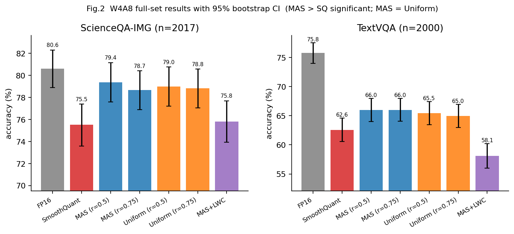
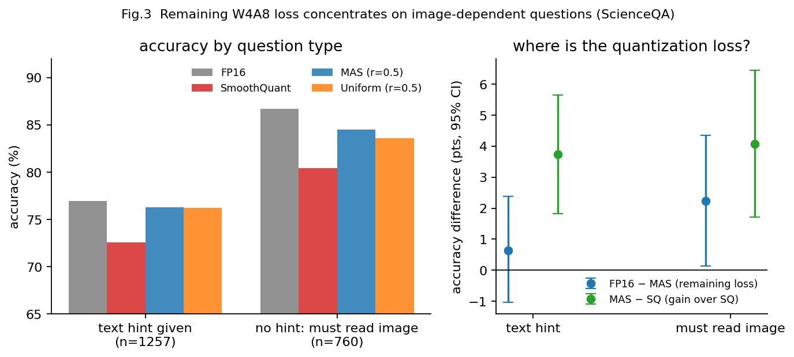
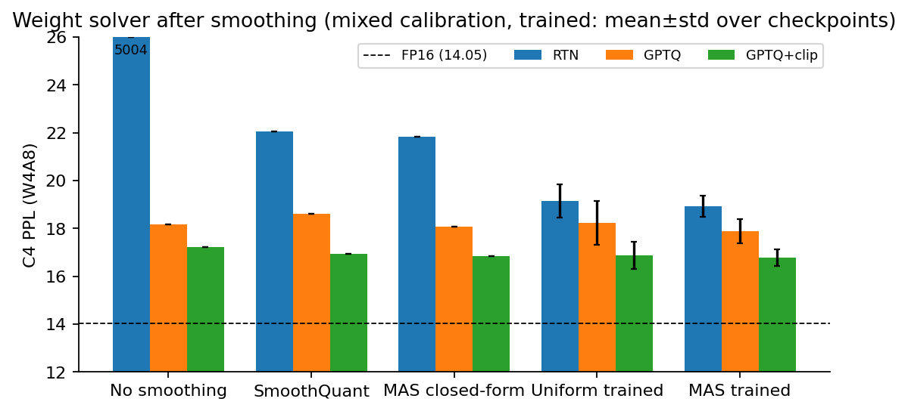

# MASQuant 复现与改进 · 书面报告

> 课程大作业书面报告。按评分要求组织：所选论文简介 → 改进原因 → 改进方案 → 实验结果 → 小组成员分工。
> 详细实验记录见 [`复现与改进_实验报告.md`](复现与改进_实验报告.md)，论文推导与代码对照见
> [`MASQuant_论文精读.md`](MASQuant_论文精读.md)，运行方法见 [`复现与改进_使用说明.md`](复现与改进_使用说明.md)，
> 每个数字对应的原始结果文件见 [`RESULTS_MAP.md`](RESULTS_MAP.md) 与仓库 [`results/`](../results/)。

---

## 摘要

我们在 Qwen2.5-VL-3B-Instruct 上复现了 MASQuant（模态感知平滑量化）。**复现结论**：W4A8 下 MAS 显著优于
SmoothQuant（PPL 18.46 vs 22.63；全量 ScienceQA / TextVQA 上 +3.2 / +3.4 点，配对 bootstrap 显著），与论文方向一致。
在复现中我们发现了论文没有讨论的几个问题，并据此做了改进：

1. **校准集模态失衡（主要改进）**：原校准集文本 token 只占 8.1%，MAS 的文本平滑因子几乎无监督。
   我们提出**混合校准**（补充纯文本样本），PPL 从 18.46±1.43 降到 16.2±0.4（方差降到约 1/4），
   且在**不同领域的 C4** 上收益仍保留约 80%（p=0.0001），不是同域作弊。
2. **NVFP4 量化格式拓展（W4A4）**：实现 E2M1 + FP8 块缩放的 NVFP4 伪量化。INT4 在 W4A4 下崩溃（PPL 96377），
   NVFP4 的 PPL 是 11.75（FP16 11.11）；**补做下游后更强**：ScienceQA 80.45 与 FP16（80.80）统计上无差异、
   TextVQA 73.64 仅差 2.2 点，而同为 4-bit 权重的 INT W4A8 只到 63.47。
3. **视频模态拓展**：论文只做了图/文/音，我们把 MAS 扩展到视频 token（4 模态）。
4. **CMC 的下游评测与自适应秩（含一项撤回）**：自适应秩在 PPL 上"省 7.8% 参数、PPL 不变"，但 PPL 不经过视觉旁路；
   补做 4000 题下游后发现：论文默认的 CMC（rank 0.05）在混合校准的 checkpoint 上让 TextVQA **显著下降 6.9 点**，
   自适应秩更差（−12.3）。而**不加低秩旁路、只用文本尺度**与理想上界打平——这是更简单、更好的部署方案。
5. **工程与正确性**：共修复 7 个实现 bug（LWC 参数从未被优化、纯文本样本 backward 两次、视频 mask 丢失、
   `reuse_scale` 漏拷视频尺度，以及 SQNR 探针与保真度评测工具中的 3 处，见实验报告 §6.3/§6.4），按模态 gather 的单遍前向让单层 prefill 提速 3.84×、decode 9.24×（数值逐位一致）。
6. **平滑之后换掉 RTN：多模态感知的 GPTQ 权重求解（下游收益最大的改进）**：MAS 只改变了"量化什么"，权重仍用 RTN。
   我们在平滑空间里按模态统计 Hessian 做 GPTQ，再按 Hessian 误差逐行选裁剪系数（clip），格式不变、推理零开销。
   W4A8 TextVQA **63.47 → 70.98 ~ 73.53**（与 FP16 的差距从 12.4 点缩到 2.3 ~ 4.9 点，配对 bootstrap 显著），
   C4 PPL 在 8 个 MAS checkpoint 上**每个都降约 2.1**。并发现一个多模态特有的前提：**在原校准集（文本 8%）上，
   分模态 GPTQ 反而在 9/9 个 checkpoint 上变差**，换成混合校准集的 Hessian 后才生效——改进 A 对更强的求解器是必要条件。
   详见 [`改进F_平滑后GPTQ.md`](改进F_平滑后GPTQ.md)。

我们也报告了一个**负面结论**：在控制校准数据和初始化统计之后，"分模态平滑"与"统一平滑 + 同样训练"在
PPL（p=0.97）、两个全量 benchmark 和 KL 保真度上都**打平**——论文的增益主要来自"可学习平滑"，而不是"分模态"。
换上 GPTQ 求解器后这一结论更明显：**不平滑 / 闭式解 / 统一 / 分模态 + GPTQ+clip 在下游两两大多不显著**，
W4A8 剩余误差的主体在权重量化，而不在激活的模态差异。

---

## 1. 所选论文简介

**论文**：*MASQuant: Modality-Aware Smoothing Quantization for Multimodal Large Language Models*
（阿里云，arXiv 2603.04800；官方代码 [alibaba/EfficientAI](https://github.com/alibaba/EfficientAI)）。

### 1.1 背景与问题

训练后量化（PTQ）的主要难点是激活里的离群通道。SmoothQuant 用逐通道缩放 $S$ 做等价变换
$Y = (XS^{-1})(SW)$，把激活的离群值"搬"到权重上。但在多模态大模型（MLLM）里，不同模态 token 的
激活量级相差 10–100 倍，统一的 $S$ 只能迁就幅值最大的模态（通常是视觉），弱势模态（文本、音频）
被一个"为别人量身定做"的尺度压缩，量化误差急剧增大——论文称之为 **Smoothing Misalignment（平滑错位）**。
论文在 Qwen2.5-Omni 上展示：SmoothQuant W4A8 让 Librispeech WER 从 3.9 恶化到 77.4。

**Theorem 1** 量化了错位的损失：令 $\alpha_i = R_i^{m}/R_i^{m'}$ 为强/弱模态在通道 $i$ 上的范围比，
则统一平滑相对最优平滑的 SQNR 损失为

$$\Delta = 10\log_{10}\Big[\frac{(\min_i\alpha_i)^2}{d}\sum_{i=1}^{d}\frac{1}{\alpha_i^2}\Big] \le 0,$$

当且仅当所有 $\alpha_i$ 相等时为 0。（我们在精读中发现**论文 Eq.(17) 的分子分母写反了**：按原式，
$\alpha_i$ 全相等时损失不为 0。）

### 1.2 方法

1. **MAS（Modality-Aware Smoothing）**：每个模态一个独立的平滑因子 $S_m$，用该模态自己的激活统计做闭式解
   初始化，再以 $\sum_m \lambda_m\|Q(X^mS_m^{-1})Q(S_mW) - X^mW\|_1$ 为目标逐层训练。
2. **CMC（Cross-Modal Compensation）**：分模态平滑会导致每个模态需要一份量化权重 $Q(S_mW)$。CMC 只存文本的
   $Q(S_tW)$，其它模态用低秩旁路 $X_mS_m^{-1}L_1^mL_2^m$ 补偿残差。**Theorem 2** 证明：先对输入做白化，
   再对 $T\Delta W$ 做截断 SVD，即是输出误差意义下的最优低秩近似。由于 decode 阶段只有文本 token，
   低秩旁路只在 prefill 触发。

### 1.3 论文主要结论

Qwen2.5-VL W4A8 上 MASQuant 平均分 64.7（SmoothQuant 57.4、RTN 5.1）；Omni 模型上救回了 ASR；
消融（Table 3）声称"可学习优化会放大分模态相对统一平滑的优势"。

---

## 2. 改进原因：复现中发现的问题

我们先完整复现了论文的 W4A8 流程（PPL + 多模态 benchmark），发现以下问题，它们构成了改进的出发点：

| # | 观察 | 证据 | 带来的改进 |
|---|---|---|---|
| 1 | **MAS 训练结果方差很大**：同一配置 3 次 PPL 为 17.03 / 18.46 / 19.89（std 1.43），而统一平滑只有 std 0.15 | 实验报告 §1.2 | 追查方差来源 → #2 |
| 2 | **校准集模态严重失衡**：ShareGPT4V-COCO 128 样本里图像 token 43658、文本 token 3873（**仅 8.1%**），且文本基本是重复的对话模板。MAS 的文本平滑因子几乎没有监督信号 | 统计 `custom_dataset.py` 生成的 mask | **改进 A：混合校准** |
| 3 | 论文只评估 INT 量化。W4A4 下 INT4 直接崩溃（RTN PPL 96377），而新一代 GPU（Blackwell）原生支持 NVFP4 | 实测 | **改进 B：NVFP4** |
| 4 | Qwen2.5-VL 有独立的 `video_token_id`，但论文与代码都没有处理视频；原代码甚至在 `modeling_qwen2_5_vl.py` 里丢弃了 `video_mask` | 读代码 | **改进 C：视频模态** |
| 5 | CMC 对所有层使用同一个秩比例（`--rank 0.05`，下限硬编码 32），而各层 $\Delta W$ 的有效秩差异很大 | 有效秩统计 | **改进 D：自适应秩分配** |
| 6 | 原实现对每个模态各跑一遍完整 GEMM 再按 mask 相加（3–4× 计算量）；且 `--lwc` 一开就崩、纯文本校准样本会触发 "backward twice" | 读代码 + 实测 | **改进 E：bug 修复与快路径** |
| 7 | 论文只报单次结果、无置信区间；纯文本 PPL 与多模态下游任务可能背离 | 实测（见 §4.5） | 评测上全部改为多次重复 + 配对 bootstrap |
| 8 | **平滑之后的权重仍用 RTN**（逐元素独立舍入，不看激活统计）；无平滑 RTN 崩到 PPL 6103，而单层 SQNR 只比 MAS 低 0.3 dB；W4A8 与 FP16 在 TextVQA 上仍差约 12 点 —— 剩余误差像是在权重侧 | 读代码 + 实测 | **改进 F：多模态感知 GPTQ** |

---

## 3. 改进方案

### 3.1 改进 A：模态平衡的混合校准（`text-vision-mix`）

- 新增校准集类型 `text-vision-mix`：一部分样本是原来的"图像 + 描述"，另一部分替换为 wikitext 训练集的
  连续文本片段。纯文本样本占比由环境变量 `MAS_CALI_TEXT_RATIO` 控制（默认 0.5）。
- 激活统计（`act_scales`）与 dataloader 缓存文件名都带上比例标签，**保证初始化统计与训练数据匹配**
  （我们踩过的坑：不匹配会产生虚假的"分模态显著更好"，见 §4.2）。
- 代码：`custom_dataset.py`、`generate_act_scale_shift.py`、`main.py`。

### 3.2 改进 B：NVFP4 量化格式

- 新增 `quantize/nvfp4.py`：元素为 E2M1（可表示 $\{0,\pm0.5,\pm1,\pm1.5,\pm2,\pm3,\pm4,\pm6\}$），每 16 个元素
  共享一个 FP8(E4M3) 块缩放，外加每张量 FP32 全局缩放；接口与 `UniformAffineQuantizer` 兼容。
- `quantize/int_linear.py` 抽象出 `build_quantizer`，命令行 `--wfmt nvfp4 --afmt nvfp4` 即可切换。

### 3.3 改进 C：视频模态（4 模态 MAS）

- `models/modeling_qwen2_5_vl.py`：把 `video_mask` 透传给语言模型；
- `generate_act_scale_shift.py`：统计视频 token 的激活范围；
- `quantize/int_linear.py` / `masquant.py`：新增 `video_smooth_scale`，loss 与前向支持 4 元组 mask；
  `MAS_VIDEO_SHARE_VISION` 控制视频是否复用图像尺度；
- `tools/make_videos.py`：用 COCO 图像合成 32 段 4 秒短视频作为视频校准源。

### 3.4 改进 D：CMC 的按层自适应秩分配（下游评测后撤回）

> ⚠️ 这一改进只在 PPL 上验证过，而 PPL 不经过 CMC 的视觉旁路。补做下游后它显著更差，见 §4.5 与
> [`补充实验.md`](补充实验.md) §4。保留实现以便复现这一阴性结果。

`quantize/rank_alloc.py`：在总秩预算 $\sum_l r_l \le B$ 下，每步把一个秩分给边际能量增益
$\sigma_r^2/\sum\sigma^2$ 最大的层（Eckart–Young 下即重构误差的下降量）；另提供按累计能量阈值定秩的策略。
`infer_mas.py --adaptive_rank greedy|energy` 启用。

### 3.5 改进 E：正确性修复与推理快路径

| 问题 | 位置 | 修复 |
|---|---|---|
| LWC 裁剪参数从未加入优化器；且 fp32 裁剪因子与 bf16 输入 matmul 崩溃 | `quantize/masquant.py` | 注册参数 + dtype 对齐 |
| 纯文本样本复用上一个样本已 backward 的 `vision_diff` → "backward twice" | `quantize/masquant.py` | 按样本重置 |
| `video_mask` 被丢弃 | `models/modeling_qwen2_5_vl.py` | 透传 |
| `reuse_scale` 漏拷 `video_smooth_scale`（k/v/gate 视频尺度一直全 1） | `quantize/utils.py` | 补拷 |
| 每个模态一遍完整 GEMM | `quantize/int_linear.py` | 按模态 gather 只算本模态行 + 量化权重缓存（`MAS_FAST=1`） |
| 硬编码作者机器路径 `/nas/yuehu/...`、在线依赖 | `custom_dataset.py`、`datautils.py` | 环境变量 + 本地 parquet 离线加载 |

此外新增分析工具：配对 bootstrap（`tools/paired_bootstrap.py`）、按模态 SQNR 探针（`tools/snr_probe.py`）、
无标签 KL 保真度（`tools/fidelity_eval.py`）、ScienceQA 题型拆分（`tools/sqa_breakdown.py`）。

### 3.6 改进 F：平滑之后的多模态感知 GPTQ（`quantize/gptq.py`）

在平滑尺度确定之后（训练好的 checkpoint 或闭式解），对每一份平滑后的权重 $W s_m$ 求解
$\min_Q \mathrm{tr}[(Ws_m-Q)H_m(Ws_m-Q)^\top]$，$Q$ 与原 RTN 落在**同一格点**（部署格式不变）。多模态相关的设计：

- **在平滑空间、按模态统计 Hessian**：$H_m=\sum_{t\in\mathcal{T}_m}(x_t/s_m)(x_t/s_m)^\top$，文本权重只看文本 token，视觉权重只看视觉 token；
  可选 `--gptq_hsrc all`（所有 token 都参与，用于某模态 token 太少）与 `--gptq_hmode balanced`（一份权重服务多模态时按模态均衡）；
- **clip**：每行在 $\gamma\in\{1,0.95,0.9,0.85\}$ 下缩小步长各解一次，按 H 加权误差逐行选优，并把 RTN 作为候选，保证逐行不劣于 RTN；
- **cd**（可选）：GPTQ 后逐元素坐标下降，收敛到 1-opt 局部极小；
- 接线：`masquant()` 在每层平滑尺度定下来之后、更新下一层输入之前调用；结果以 buffer 形式挂在 `QuantLinear` 上，前向优先使用。
  `scripts/gptq_ppl.sh` 一键评测；开关见 [`改进F_平滑后GPTQ.md`](改进F_平滑后GPTQ.md) §2.3。

---

## 4. 实验结果

**设置**：Qwen2.5-VL-3B-Instruct；W4A8（权重 per-channel 对称、激活 per-token）；校准 128 样本、训练 2 epoch；
PPL 在 wikitext2（及 C4 validation）上测；benchmark 为 **ScienceQA-IMG test 全量 2017 题 + TextVQA val 前 2000 题**，
batch=1，`max_pixels=401408`。训练路径存在 kernel 级非确定性，**所有训练配置至少重复 3 次报 mean ± std**；
benchmark 差异一律用同题配对 bootstrap（10000 次）给 95% CI。

### 4.1 复现：PPL（wikitext2）

| 配置 | PPL ↓（重复次数） |
|---|---|
| FP16 | 11.11 |
| RTN（不平滑） | 6076 |
| SmoothQuant（统一，闭式解） | 22.63（3，完全确定） |
| MAS 仅初始化（分模态闭式解） | 19.43（3，完全确定） |
| **MAS 训练（论文配置）** | **18.46 ± 1.43（3）**（论文 Table 5：18.6） |

复现的均值与论文几乎一致；MAS 即使不训练也优于 SmoothQuant。

### 4.2 改进 A：混合校准

| 纯文本样本占比 | 文本 token 占比 | MAS PPL（wikitext2） | 次数 |
|---|---|---|---|
| 0（原校准） | 8.1% | 18.46 ± 1.43 | 3 |
| 0.125 | 18.3% | 20.26 ± 1.33 | 3 |
| 0.25 | 28.9% | 18.67 ± 3.21 | 3 |
| 0.375 | 40.2% | 16.74 ± 0.52 | 3 |
| **0.5（默认，推荐）** | 51.4% | **16.35 ± 0.54** | 6 |
| 0.75 | 74.9% | 16.19 ± 0.34 | 3 |
| 0.875 | 87.1% | 16.29 ± 0.45 | 3 |

**跨领域验证**（排除"补充的 wikitext 文本与 wikitext 测试集同域"的质疑）：

| 配置 | wikitext2 | C4 |
|---|---|---|
| FP16 | 11.11 | 14.05 |
| MAS 原校准 | 18.46 ± 1.43 | 20.21 ± 0.23（4） |
| MAS 混合校准 0.5 | 16.35 ± 0.54 | **18.53 ± 0.11（3），p=0.0001** |
| MAS 混合校准 0.75 | 16.19 ± 0.34 | 18.77 ± 0.50（3） |

结论：
- 文本占比 ≥40% 后 PPL 进入 16.2~16.7 的**宽平台**，比例不需要精调；
- 换到 C4 后收益（−1.69）保留约 **80%**，高度显著——**改进是真实的，不是同域匹配**；
- 下游 benchmark 对比例不敏感（0.5/0.75/0.875 两两差异均不显著），不会掉点。
- 方法论教训：初始化用的 `act_scales` 必须与训练数据比例匹配。早期用 0.5 的统计初始化 0.75 的训练，
  得到"分模态显著优于统一（p=0.004）"，换成匹配统计后差异塌缩到 −0.01（p=0.97），该结论已撤回。

### 4.3 多模态 benchmark（全量，配对 bootstrap）

| 配置 | ScienceQA（n=2017） | TextVQA（n=2000） |
|---|---|---|
| FP16 | **80.61** | **75.78** |
| SmoothQuant | 75.51 | 62.58 |
| MAS + 混合校准 0.5 | 79.38 | 65.98 |
| MAS + 混合校准 0.75 | 78.68 | 65.99 |
| 统一 scale + 训练 + 混合校准 0.5 | 78.98 | 65.45 |
| 统一 scale + 训练 + 混合校准 0.75 | 78.83 | 64.97 |
| MAS + LWC | 75.81 | 58.09 |

| 配对差异（95% CI） | ScienceQA | TextVQA |
|---|---|---|
| MAS − SmoothQuant | **+3.17 [+1.54, +4.81]** | **+3.41 [+1.74, +5.10]** |
| MAS − FP16 | **−1.93 [−3.32, −0.55]** | **−9.79 [−11.42, −8.18]** |
| MAS − 统一 scale（0.75） | −0.15 [−1.64, +1.34] | +1.02 [−0.55, +2.56] |
| MAS − MAS+LWC | **+2.88 [+1.39, +4.36]** | **+7.91 [+6.16, +9.74]** |

（MAS 均取 ratio=0.75 为参照。）

- **MAS 显著优于 SmoothQuant**，复现成功；
- **W4A8 尚未追平 FP16**（ScienceQA 差 1.93 点且显著，TextVQA 差约 10 点）；
- **分模态 vs 统一 scale 打平**：论文 Table 3"可学习优化会放大分模态优势"在本设置下未复现；
- **MAS + LWC 是 PPL 与下游背离的反例**：PPL 最低（15.45）但两个下游都显著变差——只报 PPL 会误判。

**量化损失在哪类题上？** 按 ScienceQA 是否有文字提示拆分：

| | 有文字提示（1257） | 必须读图（760） |
|---|---|---|
| FP16 − MAS | +0.64（不显著） | **+2.24 [+0.13, +4.34]（显著）** |
| MAS − SmoothQuant | **+3.74** | **+4.08** |

文字题上 MAS 已与 FP16 无显著差异，剩余损失集中在依赖地图/视觉定位的题上。

### 4.4 改进 B：NVFP4（W4A4）

| 配置 | PPL ↓ |
|---|---|
| FP16 | 11.11 |
| INT4A4 RTN | 96377（崩溃） |
| NVFP4 RTN | 12.25 |
| NVFP4 + SmoothQuant | 12.06 |
| **NVFP4 + MAS 闭式解（不训练）** | **11.75** |
| NVFP4 + MAS 训练 | 12.14 ± 0.03（3） |

单层合成数据上 NVFP4 的 SQNR（22.43 dB）与 INT8（22.08 dB）相当，远高于 INT4（5.53 dB）。
W4A4 下 NVFP4 + MAS 闭式解距 FP16 仅 +0.64。训练反而略差：端到端缩放尺度的实验排除了
"训练把尺度推大"这一假设，原因尚未查清；**实用建议是 FP4 下直接用闭式解**。

**补做的下游评测（同题配对 bootstrap）说明这条改进比 PPL 看上去更有价值**：

| 配置 | 位宽 | ScienceQA | TextVQA |
|---|---|---|---|
| FP16 | 16/16 | 80.80 | 75.85 |
| NVFP4 RTN | **4/4** | 80.25 | 73.72 |
| NVFP4 + MAS 闭式解 | **4/4** | **80.45** | **73.64** |
| MAS（INT） | 4/8 | 78.65 | 63.47 |
| SmoothQuant（INT） | 4/8 | 75.25 | 61.05 |

- NVFP4 与 FP16 在 ScienceQA 上**统计上无差异**（+0.35 [−0.65, +1.40]），TextVQA 差 2.21（显著但很小）；
- **同为 4-bit 权重，FP4 激活 4 bit 比 INT 激活 8 bit 在 TextVQA 上高约 10 个百分点**——
  这说明多模态量化的瓶颈不只是"位宽"，而是格式能否适应视觉 token 的离群分布。

### 4.5 改进 C/D/E 与其他诊断

| 项目 | 结果 |
|---|---|
| 视频模态 | 视频独立尺度 vs 复用图像尺度（各 3 次）：KL 1.46 vs **1.30**、top-1 一致率 45.5% vs **48.9%**、PPL 19.93 vs **19.03**，均不显著 → 默认复用图像尺度（参数更少、方差更小） |
| 按模态 SQNR（288 配对） | MAS − 统一 scale：text +0.97、image +1.12、video +0.26 dB（CI 均不含 0）。方向与论文一致，但幅度约 1 dB，传到端到端后被吸收（KL 1.53 vs 1.55） |
| **CMC 下游（补做，4000 题）** | 同一混合校准 checkpoint：不补偿 79.55 / 63.35；理想上界（视觉单独一份权重）78.65 / 63.47；**CMC r0.05 78.45 / 56.48（TextVQA −6.86，显著）**；CMC r0.2 79.30 / 62.24；自适应秩 75.40 / 51.04（−12.3，显著）。单层诊断：CMC 平均 SQNR 最高，但 23/72 个模块被补偿坏（`layers.3.k_proj` 12.1→3.5 dB）。旧 checkpoint 上 CMC 只是小幅有害（−0.7，不显著），两台机器一致 |
| 快路径 | 单层 prefill 3.84×、decode 9.24×，文本行输出逐位一致，全模型 PPL 完全相同 |
| LWC 修复 | 修复后 PPL 18.46 → 15.45，但下游显著变差（见 §4.3） |
| λ_v 消融 | 论文称 λ_v=1.0；实测 20.73 ± 2.46，比代码默认 0.5（18.46 ± 1.43）更差 |
| W4A6 下游（补做） | MAS 75.85 / 53.12 vs SQ 71.60 / 53.32：ScienceQA 上 MAS 显著更好（+4.25），TextVQA 两者都崩到 53（PPL 25.7 看不出这个崩溃） |
| auto α 搜索 | 108 个模块中 49 个停在下界 0.5；PPL 15.91 ± 0.64 vs 16.19 ± 0.34（p=0.56），慢 5–10 倍，不推荐 |
| 平滑因子正值约束 | 训练出的尺度有 0.2–0.4% 通道为负；加约束后负通道清零但 PPL 无改善（不显著） |

---

### 4.6 改进 F：平滑后的 GPTQ（B200，冻结平滑尺度上的配对比较）

**PPL（W4A8，混合校准；wikitext2 / C4；FP16 = 11.11 / 14.05）**

| 平滑方式 | RTN | GPTQ | GPTQ + clip |
|---|---|---|---|
| 不平滑 | 6103 / 5004 | 14.05 / 18.18 | 13.70 / 17.24 |
| SmoothQuant | 23.11 / 22.04 | 15.45 / 18.61 | 15.10 / 16.94 |
| MAS 闭式解 | 22.91 / 21.82 | 13.96 / 18.07 | **12.93 / 16.85** |
| 统一 scale 训练（12 个 ckpt） | 18.56 / 19.16 | 14.59 / 18.23 | 13.52 / 16.87 |
| MAS 训练（8 个 ckpt） | 18.08 / 18.92 | 15.23 / 17.88 | 14.24 / **16.79** |

同一 checkpoint 上 GPTQ+clip 相对 RTN 的 C4 变化：MAS **8/8** 变好（−1.95 ~ −2.24），统一 scale **12/12** 变好（−1.96 ~ −2.70）。
消融：只做 H 感知 clip 不做 GPTQ 也有 −1.35（4/4），再加 GPTQ 又 −0.68（4/4），两者互补；cd 抛光无一致收益，默认不开。
γ 网格：逐行按 H 误差选 γ 会一路推到网格下界（原网格 94–97% 的行选 0.85，加宽后 80% 选 0.70），而且**逐层代理误差最优的 γ 与端到端最优不一致**；
加宽网格（下探到 0.7）C4 再降 0.1~0.8（同一 MAS ckpt 16.48→16.36；不平滑 17.24→16.43），表中数字用的是保守的原网格。

**下游（TextVQA 2000 + ScienceQA 2000，同题配对）**

| 配置 | ScienceQA | TextVQA |
|---|---|---|
| FP16 | 80.80 | 75.85 |
| MAS 训练 + RTN | 78.65 | 63.47 |
| MAS 训练 + GPTQ + clip | 79.15 | 70.98 |
| MAS 训练 + GPTQ + clip，只用文本尺度（单权重） | **79.70** | 71.88 |
| 不平滑 + GPTQ + clip | 78.70 | 72.95 |
| 统一 scale 训练 + GPTQ + clip | 79.30 | **73.53** |

- **MAS+GPTQ+clip − MAS+RTN：TextVQA +7.51 [+5.77, +9.21]**（全量 5000 题上 GPTQ 单独就是 +7.24 [+6.22, +8.30]）；
- 不平滑 + GPTQ+clip − SmoothQuant + RTN：ScienceQA +3.45、TextVQA **+11.90**，均显著；
- 与 FP16 的 TextVQA 差距从 12.4 缩小到 2.3 ~ 4.9；**单权重部署 + GPTQ+clip 在 ScienceQA 上与 FP16 无显著差异**（−1.10 [−2.35, +0.15]）；
- 好的求解器下"用什么平滑"基本不重要：无平滑 / MAS 闭式解 / 统一训练 + GPTQ+clip 两两不显著。

**多模态特有的前提：Hessian 的校准集也要模态平衡**

| 原校准训练出的 MAS checkpoint | C4 PPL |
|---|---|
| RTN（9 个） | 20.40 ± 0.46 |
| 分模态 GPTQ，Hessian 来自原校准集（9 个） | **22.36 ± 0.77（0/9 变好）** |
| GPTQ + clip，Hessian 来自原校准集（4 个） | 19.29 ± 0.46 |
| GPTQ + clip，**同样的平滑尺度，Hessian 换成混合校准集**（4 个） | **17.39 ± 0.16** |

原校准集里文本 token 只有 3873 个且多为重复模板，文本权重的 GPTQ 在校准集上恢复了 95% 的误差（混合校准下约 48%）——
这是过拟合，换到真实文本上反而更差。**校准集的模态平衡对求解器比对平滑尺度更重要**，这是改进 A 与改进 F 的连接点。

**NVFP4（W4A4）**：RTN 已接近 FP16，GPTQ 最多改善 C4 0.15（混合校准），clip 与 cd 一律变差——NVFP4 的 16 元素块缩放
已经吸收了大部分权重误差，改进 F 针对的是 INT 的 per-channel 粗粒度格点。

---

## 5. 结论与局限

**结论**
1. MASQuant 的复现成功：W4A8 下显著优于 SmoothQuant（PPL 与两个全量 benchmark）。
2. **最有效的改进是校准数据的模态平衡**：PPL −2.1（wikitext2）/ −1.7（C4，p=0.0001），方差降到约 1/4，
   成本为零（只改校准数据）。
3. NVFP4 让 W4A4 可用（INT4 崩溃，NVFP4 + MAS 11.75 vs FP16 11.11）。
4. 在控制变量后，"分模态"本身相对"统一平滑 + 训练"没有可测量的端到端增益；论文的提升主要来自可学习平滑。
5. 方法论：只报 PPL 或单层 SQNR 都可能误判（LWC、RTN 是反例），必须报重复次数并做配对显著性检验。
6. **下游收益最大的改进是把平滑之后的 RTN 换成多模态感知的 GPTQ + clip**：TextVQA +7.5 ~ +9.5 点、C4 PPL 每个 checkpoint 约 −2.1，
   零推理开销；它要求 Hessian 来自模态平衡的校准集（原校准集上反而有害）。在这个求解器下，平滑方式的选择基本不再重要。

**局限**
- 只在 Qwen2.5-VL-3B 上实验，未覆盖 Omni（音频）与更大模型；
- MMMU（需 OpenAI judge）与 OCRBench（聚合需 `output_path`）未纳入评测；
- 视频校准数据是由 COCO 图像合成的短片，数量少（32 段），视频相关结论置信度有限；
- 训练路径存在非确定性（同一张卡跑两次 PPL 可差 1.6），故所有训练配置都报重复次数，跨机器只比方向；
- 主表数字在**原实验机（8×RTX PRO 6000）**上测得；换到 B200 后重跑，结论方向全部成立、绝对值有 1~2 点的差异（见
  [`复现性诊断.md`](复现性诊断.md) 与 [`补充实验.md`](补充实验.md)）；
- NVFP4 是伪量化，未实现真实 kernel，没有测速。
- 改进 F 的下游每种配置只评了一个 checkpoint（每次约 70 分钟）；PPL 层面的结论有 8~12 个 checkpoint 的配对支持。

---

## 6. 小组成员分工

> 本组共 2 人。（姓名/学号与具体分工待补充）

| 成员 | 学号 | 分工 |
|---|---|---|
| （待补充） | | |
| （待补充） | | |

---

## 7. 代码与复现

- 仓库总览见 [`README_COURSE.md`](../README_COURSE.md)；环境依赖、数据集下载链接、运行命令与所有新增开关见
  [`复现与改进_使用说明.md`](复现与改进_使用说明.md)；全部实验的启动脚本在 [`experiments/`](../experiments/)；
- 报告用到的全部原始结果（逐题预测、PPL 记录、SQNR/KL 等）在 [`results/`](../results/)，
  可不重新训练直接复算统计量，对应关系见 [`RESULTS_MAP.md`](RESULTS_MAP.md)；
- 线下汇报的讲稿见 [`汇报提纲.md`](汇报提纲.md)；
- 相对官方代码的改动可以通过 git 历史查看（第一个提交是官方代码原样快照）。
