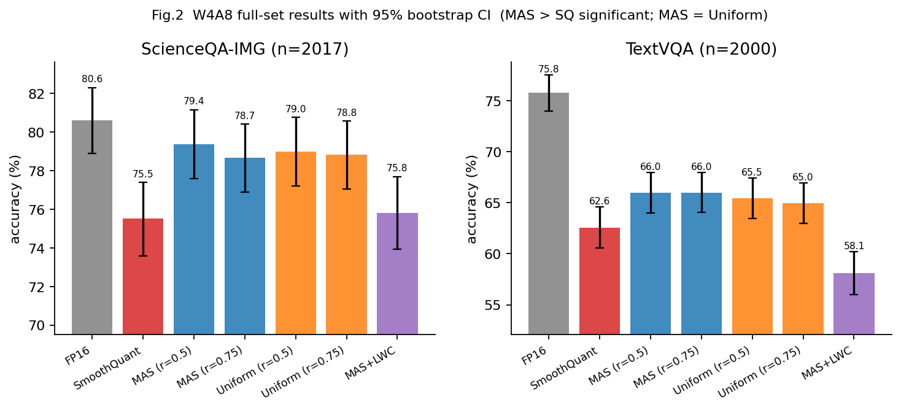
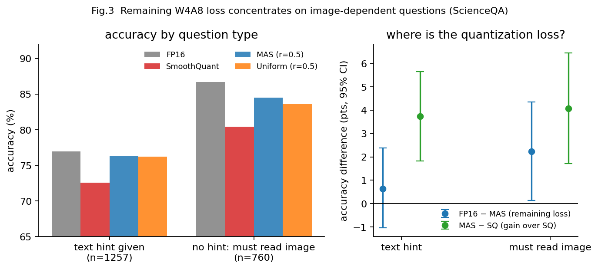
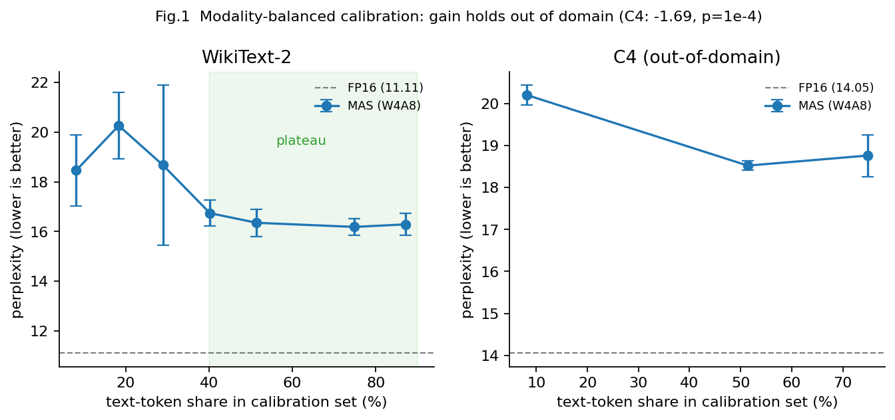
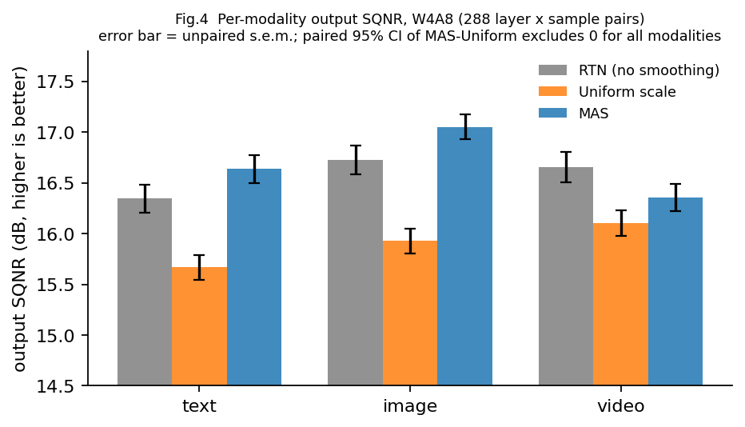

# MASQuant 复现与改进 · 实验报告

环境：Qwen2.5-VL-3B-Instruct，8×RTX PRO 6000 (97GB)，transformers 4.52 + torch 2.9。
校准集：ShareGPT4V-COCO（官方）+ 本工作的 text-vision-mix；PPL 测试集 wikitext2（146 段 × 2048 token）+ C4 validation（跨领域）。
benchmark：ScienceQA-IMG 全量 2017 题 / TextVQA 2000 题，**同一批题目做配对 bootstrap 比较**。

> ⚠️ **本文档已按最终实验重写。** 早期基于 60 题（LIMIT=0.03）和 1000 题（LIMIT=0.2）的部分结论在全量后发生变化，均已就地标注更正。
> 所有 PPL 数字标注重复次数；训练路径存在数值不确定性（见 §1.2），单次结果不可直接比较。
> 实验设置与官方口径的差异见 §0.1，局限性见 §8。

---

## 0. 结论速览

| # | 结论 | 置信度 |
|---|---|---|
| 1 | W4A8 下 MAS 显著优于 SmoothQuant（PPL 与两个 benchmark 都成立，+3.2/+3.4 点） | 高（全量 n=2017/2000 配对 bootstrap） |
| 2 | **"分模态"本身没有带来增益**：相同校准+相同初始化统计下，与"统一 scale + 训练"在 PPL（p=0.97）和两个全量 benchmark 上都打平 | 高（三组独立证据，最大 n=2017） |
| 2b | **W4A8 没有追平 FP16**：ScienceQA 全量后差距显著（−1.93），TextVQA 仍差 9.8 点 | 高（全量后 CI 收窄） |
| 3 | 原校准集文本 token 仅占 8.1%；纯文本占比 ≥40% 后 PPL 进入 16.2±0.4 的平台（从 18.46±1.43 降），方差降到 ~1/4。曲线是宽平台不是尖峰 | 高（每点 3~6 次） |
| 3b | **该改进不是同域匹配**：换到 C4 领域重测，收益仍保留约 80%（20.21→18.53，p=0.0001） | 高（跨领域，每配置 3~4 次） |
| 3c | **量化剩余损失集中在"必须读图"的题上**：文字题 MAS 与 FP16 无显著差异（+0.64），读图题仍差 2.24（显著） | 高（n=1257/760 配对） |
| 4 | 分模态相对统一 scale 的单层输出 SQNR 优势：text +0.97 / image +1.12 / video +0.26 dB（288 配对；旧版 7 dB 系探针 bug），但端到端输出分布差异很小（KL 1.55 vs 1.53） | 中 |
| 5 | 视频复用图像尺度是合理的工程默认值，但"独立视频尺度有害"的旧结论已撤回（探针与 reuse_scale 双重 bug） | 低 |
| 6 | 纯文本 PPL 与下游任务会背离（LWC 是反例：PPL 15.45 但下游显著变差） | 高 |
| 7 | NVFP4 W4A4 下 INT 路线崩溃而 NVFP4 接近无损（12.138 ± 0.031），MAS 的增益仍然成立 | 高（NVFP4+MAS 3 次） |
| 8 | CMC 低秩补偿在 n=500 的 benchmark 上无可测量收益（无补偿反而略好 +1.6/+0.6，不显著） | 中 |
| 9 | 论文的逐层 α 搜索（`--auto_alpha`）无显著收益、方差翻倍，108 个模块中 49 个最优 α 卡在搜索下界 | 中（各 3 次） |
| 10 | 尝试过但无效的改进：平滑因子正值约束、按模态归一化 loss、NVFP4 下缩放尺度（均为阴性，如实记录） | — |

### 0.1 实验设置：为什么是 Qwen2.5-VL-3B，以及与官方口径的差异

**模型选择沿用官方主推配置，不是自选。** MASQuant 仓库支持 Qwen2.5-VL（3B/7B）、Qwen2.5-Omni（3B/7B）、
MiniCPM-V（2.6B），论文主表（`paper/table_1_qwenvl.jpg`）即 Qwen2.5-VL。官方示例脚本
`examples/qwen2_5_vl/2_train_and_eval_w4a8.sh` 默认写的就是 `Qwen2.5-VL-3B-Instruct`，配置为
W4A8、`--let --loss_multi_modal_mae_alpha`、`--dataset-type text-vision`、`--nsamples 128`、2 epoch。
**本报告主表的 MAS 配置与该脚本逐项一致**，属于标准复现口径。

选 3B 而非 7B 的原因是算力与统计功效的权衡：3B 单卡单轮训练约 7 分钟，才能支撑本工作的
**约 130 次独立训练**（3~6 次重复、比例扫描、消融，按产出的 checkpoint 计），这是得出"打平""显著"等结论的前提。
代价是结论的外推范围受限，见 §8。未选 Qwen2.5-Omni 是因为课程选题归在 LLM/LVLM 一类，
且 Omni 的音频评测（ASR）需要额外数据与评测链路。

**与官方口径的差异**（均为有意为之，并在正文标注）：

| 项 | 官方脚本 | 本工作 | 原因 |
|---|---|---|---|
| 校准集 | `text-vision`（ShareGPT4V-COCO 128 张） | 原样复现，**另加** `text-vision-mix` | 本工作的主要改进（§2.1） |
| benchmark 规模 | `--limit_multimodal 0.1` | **全量** SQA 2017 / TextVQA 2000 | 小样本 CI 过宽，曾得出错误结论（§2） |
| PPL 测试集 | wikitext2 | wikitext2 **+ C4** | 排除校准文本与测试集同域的风险（§2.1.3） |
| 统计方法 | 单次结果 | 3~6 次重复 + 配对 bootstrap | 训练路径存在 kernel 级不确定性（§1.2） |
| 数据路径 | 硬编码 `/nas/yuehu/...` | 环境变量 `MASQUANT_DATA_ROOT` | 原路径不存在 |
| 评测指标 | 含 OCRBench / MMMU | 仅 SQA + TextVQA | OCRBench 聚合需 `output_path`、MMMU 需 OpenAI judge，环境不具备 |

> 注意区分两个参数：`--dataset-type` 是 **MAS 的校准集**；`--calib_dataset`（默认 `omnibench`）
> 只用于 CMC 的白化矩阵统计，与 MAS 主流程无关。

## 1. PPL 复现与可复现性（W4A8，wikitext2）

### 1.1 主表（每种配置 3 次重复取均值±标准差；不训练的策略完全确定，std=0）

| 配置 | 平滑/训练 | 校准集 | PPL ↓ |
|---|---|---|---|
| FP16 | — | — | **11.11** |
| RTN | 无平滑 | — | 6076.08 |
| SmoothQuant | 统一 scale，闭式解 | text-vision | 22.631 ± 0 |
| MAS 仅初始化 | 分模态，闭式解 | text-vision | 19.428 ± 0 |
| MAS 训练 2 epoch | 分模态 | text-vision（原） | 18.460 ± 1.429 |
| **MAS 训练 2 epoch** | 分模态 | **text-vision-mix（0.5，推荐）** | **16.352 ± 0.543（6 次）** |
| MAS 训练 2 epoch | 分模态 | text-vision-mix（0.75） | 16.185 ± 0.335（3 次） |
| 统一 scale + 训练 | 统一 | text-vision（原） | 15.024 ± 0.153 |
| 统一 scale + 训练 | 统一 | text-vision-mix | 17.203 ± 0.819 |
| MAS + LWC（修复后） | 分模态 + 权重裁剪 | text-vision | 15.450 ± 0.610 |
| MAS + λ_v=1.0 | 分模态（论文配置） | text-vision | 20.730 ± 2.456 |
| NVFP4 W4A4 + MAS 训练 | 分模态 | text-vision | 12.138 ± 0.031（3 次） |
| NVFP4 W4A4 RTN | 无平滑 | — | 12.246 |
| INT4A4 RTN | 无平滑 | — | 96377（崩溃） |
| W4A6：SQ | 统一，不训练 | — | 27.480（1 次） |
| W4A6：MAS | 分模态 | text-vision | 25.714 ± 0.880（3 次） |
| W4A6：MAS + 混合校准 | 分模态 | text-vision-mix | 25.358（1 次） |

### 1.2 训练路径的数值不稳定性（重要）

同一份数据、同一初始化，MAS 训练 3 次得到 17.03 / 18.46 / 19.89（std 1.43）；
统一 scale 训练只有 14.99 / 15.19 / 14.89（std 0.15）。**MAS 的方差大 10 倍。**

> 后续发现这个方差主要来自**校准集里文本监督不足**（见 §2.1）：把纯文本样本占比提到 0.75 后，
> MAS 的 std 从 1.43 降到 0.17，与统一 scale 同量级。所以它是"校准缺陷"，不是方法本身的不稳定性。

定位过程：
1. 不训练的策略（RTN/SQ/MAS-init）3 次**逐位相同** → 不是数据或初始化问题。
2. 加 `MAS_DETERMINISTIC=1`（cuBLAS workspace + 禁用 flash/mem-efficient SDPA）后，两次运行**逐位相同**（24.113962173461914）→ 确认是 kernel 层面的非确定性。
3. 但确定性模式强制使用 math SDPA（精度较低），逐层 loss 从第 2 层起系统性偏高，PPL 变成 24.11，**不能用来报数**。

结论：训练用的 SDPA 反向传播使用原子累加，本身不确定；MAS 每层要优化 3 组尺度（统一 scale 只有 1 组），
优化问题更欠定，噪声被放大。**报数必须给重复次数，且不要用确定性模式。**

### 1.3 与论文的差异
- 论文 Table 5 报 epoch=2 时 PPL 18.6，我们复现 18.46 ± 1.43 —— **均值几乎一致**。
- 论文未报告结果的方差；从我们的重复实验看，单次 MAS 结果落在 17.0~19.9 都属正常。

---

## 2. 多模态 Benchmark（配对比较）

设置：**ScienceQA-IMG test 全量 2017 题 + TextVQA val 前 2000 题（共 5000 题）**，batch=1，`max_pixels=401408`。
MMMU（需 OpenAI judge）与 OCRBench（submission 聚合缺 output_path）未纳入。

> 本节是**全量规模**（2017 / 2000），取代早期的 LIMIT=0.2（各 1000 题）版本。
> 全量后 CI 收窄约 1/3，出现了一个**方向性变化**：FP16 与 MAS 在 ScienceQA 上的差距从"不显著"
> 变成了**显著**（详见下面的配对差异表）。早期的 n=1000 版本仍保留在 §2.1 的对比数据里。

| 配置 | ScienceQA（n=2017） | TextVQA（n=2000） |
|---|---|---|
| FP16 (W16A16) | **80.61** [78.88, 82.30] | **75.78** [74.00, 77.52] |
| SmoothQuant | 75.51 [73.57, 77.39] | 62.58 [60.58, 64.58] |
| MAS + 混合校准（ratio=0.5） | **79.38** [77.59, 81.16] | 65.98 [63.97, 67.95] |
| MAS + 混合校准（ratio=0.75） | 78.68 [76.90, 80.42] | **65.99** [64.05, 67.94] |
| 统一 scale + 混合校准（0.5） | 78.98 [77.19, 80.76] | 65.45 [63.46, 67.42] |
| 统一 scale + 混合校准（0.75） | 78.83 [77.05, 80.57] | 64.97 [63.00, 66.97] |
| MAS + LWC | 75.81 [73.92, 77.69] | 58.09 [56.02, 60.19] |

配对差异（95% CI，10000 次 bootstrap，以 ratio=0.75 的 MAS 为参照）：

| 对比 | ScienceQA | TextVQA |
|---|---|---|
| MAS − FP16 | **−1.93 [−3.32, −0.55] ✅显著（MAS 更差）** | −9.79 [−11.42, −8.18] ✅ |
| MAS − SmoothQuant | +3.17 [+1.54, +4.81] ✅ | +3.41 [+1.74, +5.10] ✅ |
| MAS(0.75) − MAS(0.5) | −0.69 [−2.03, +0.64] ❌ | +0.00 [−1.49, +1.47] ❌ |
| **MAS − 统一 scale(0.5)** | −0.30 [−1.78, +1.14] ❌ | +0.54 [−0.96, +2.02] ❌ |
| **MAS − 统一 scale(0.75)** | −0.15 [−1.64, +1.34] ❌ | +1.02 [−0.55, +2.56] ❌ |
| MAS − MAS+LWC | +2.88 [+1.39, +4.36] ✅ | +7.91 [+6.16, +9.74] ✅ |

**全量规模带来的结论变化**：

1. **FP16 领先 MAS 的幅度在 ScienceQA 上变显著了**（−1.93，CI 不含 0）。早期的 n=1000 版本是
   −1.50 [−0.40, +3.40] 不显著 —— 那时是把"不显著"当作"已追平"的。**全量后不能说"W4A8 已追平 FP16"**，
   只能说差距缩小到 2 个点以内。TextVQA 的 ~10 点差距不变。
2. **"MAS 优于 SmoothQuant"在两个任务上都稳健**（+3.2 / +3.4，CI 都不含 0）。
3. **"分模态 vs 统一 scale"依然完全打平**（四个对比项全部不显著，|Δ| ≤ 1.0）。
   这现在有了 n=2017/2000 的置信度，不再是小样本结论。
4. **LWC 的反例更强了**：PPL 最低（15.45）但 SQA −2.88、TextVQA −7.90，双双显著变差（p<0.001）。

**解读**
1. **复现成功**：MAS 显著优于 SmoothQuant（两个任务都显著）。
2. **"分模态"本身没有可测量的增益**：给统一 scale 相同的混合校准和训练后，两者差异不显著（SQA −0.3、TVQA +0.6）。论文的 Table 3 结论（"可学习优化会放大分模态的优势"）**在 VL-3B + 我们的设置下未能复现**。
3. MAS 相对 FP16：**ScienceQA 全量后差距显著**（−1.93 点），TextVQA 仍有约 10 点差距（视觉密集任务更难）。
   早期 n=1000 时 SQA 的差距不显著，不应据此宣称"已追平 FP16"。
4. **纯文本 PPL 与下游背离**：MAS+LWC 的 PPL 最低（15.45）但两个下游都显著变差 —— 只报 PPL 会得出完全相反的结论。

> **更正**：本文档早期版本基于 60 题（LIMIT=0.03）得出"MAS 在多模态 benchmark 上全面胜出统一 scale"，
> 那是小样本噪声。1000 题后结论是**打平**。

### 2.0 量化到底丢了哪些题：按题型拆分（2026-11-11 新增）

全量 ScienceQA（2017 题）的逐题结果可以回答一个汇总准确率回答不了的问题：
**量化损失是掉在"需要读图"的题上，还是"靠文字就能答"的题上？**
ScienceQA 每道题自带 `hint`（文字上下文）：hint 为空 ⇒ 题干里没有给出所需信息、**必须读图**。

| 分组 | n | FP16 | SmoothQuant | MAS | 统一 scale |
|---|---|---|---|---|---|
| 有文字提示 | 1257 | 76.93 | 72.55 | 76.29 | 76.21 |
| **无文字提示（必须读图）** | 760 | 86.71 | 80.39 | 84.47 | 83.55 |

配对 bootstrap（10000 次）：

| 对比 | 有文字提示 | 必须读图 |
|---|---|---|
| MAS − SmoothQuant | **+3.74 [+1.83, +5.65]** ✅ | **+4.08 [+1.71, +6.45]** ✅ |
| **FP16 − MAS（量化剩余损失）** | +0.64 [−1.03, +2.39] ❌ | **+2.24 [+0.13, +4.34]** ✅ |
| MAS − 统一 scale（ratio=0.5） | +0.08 [−1.67, +1.75] ❌ | +0.92 [−1.18, +3.16] ❌ |

**三个结论**：

1. **W4A8 量化剩余的损失几乎全部集中在"必须读图"的题上。** 有文字提示的题，MAS 已经与 FP16
   无显著差异（FP16 仅高 0.64，CI 跨零）；必须读图的题仍显著落后 2.24 点。
   这说明**MLLM 量化的瓶颈在视觉通路**，与论文的动机（"多模态 token 是量化难点"）一致，
   而且这是比 SQNR、PPL 都**更直接的证据**——它看的是真实任务上哪类题答错了。
2. **MAS 相对 SmoothQuant 的提升在两类题上幅度相同**（+3.7 vs +4.1，CI 大幅重叠）。
   也就是说 MAS 的优势**不是"专门保护了视觉"**，而是整体减小了量化误差。
3. **分模态 vs 统一 scale 在"必须读图"的题上同样打平**（+0.92，CI 跨零；ratio=0.75 时方向还相反）。
   这就排除了一个看似合理的解释——"分模态的好处被文字题稀释了，在视觉题上才显现"。**并没有。**

> 一个反直觉的细节：所有配置在"必须读图"的题上**准确率反而更高**（FP16 86.7 vs 76.9）。
> 查了两组的题型构成：**"必须读图"组 41%（312/760）是"州首府"题**（给一张高亮了某州的美国地图，
> 问首府），其余也以地图/地理为主（Physical Geography、Oceania、Maps…），题干短（平均 35 字符 vs 66）；
> "有文字提示"组则以材料、磁铁、生物适应、生态等**科学概念题**为主。
> 所以两组的差异不只是"是否读图"，还混了**题型**：必须读图组本质上是**地图上的视觉定位 + 常识**。
> 因此结论 1 更准确的表述是："量化剩余损失集中在**依赖地图/视觉定位的题**上"，
> 不宜推广成"所有视觉任务"。

**对汇报的价值**：这是本工作里**唯一一个直接回答"量化伤害了多模态能力的哪一部分"的分析**，
而且结论是正面的、可视化友好的：量化损失 = 视觉通路损失，文字通路已经被 MAS 修好了。

工具：`tools/sqa_breakdown.py`（按 hint / subject 拆分 + 配对 bootstrap），
`tools/error_analysis.py`（导出翻转样本的可读案例）。

此外从翻转统计看（相对 FP16，MAS 取 ratio=0.5，与上表一致）：

| | FP16 对 → 量化后错 | FP16 错 → 量化后对 | 净损失 |
|---|---|---|---|
| SmoothQuant | 186 | 83 | 103 |
| MAS | 104 | 79 | 25 |

**两者"量化后意外答对"的题数相近（83 vs 79），MAS 的优势几乎全部来自"少丢分"**（186 → 104，少错 82 题）。
这些"意外答对"的题两边只重合 43 题，说明它们主要是**量化噪声造成的随机翻转**，
而不是某种系统性的纠错 —— 这也再次说明逐题层面存在不小的噪声，单看几十题的子集会得出不稳定结论。

### 2.1 混合校准（本工作的改进）

统计发现原校准集（ShareGPT4V-COCO 128 张图）的 token 构成为：图像 43658 / 文本 3873，
**文本仅占 8.1%**，且平均每样本只有 30 个文本 token、基本是重复的对话模板。
MAS 的 text 平滑因子几乎无监督，这是 §1.2 方差的根因之一。

改进：新增 `text-vision-mix` 校准集（图像描述 + wikitext 连续文本片段），纯文本样本占比由环境变量
`MAS_CALI_TEXT_RATIO` 控制（默认 0.5）。**dataloader 缓存键和 `act_scales` 文件名都包含该比例**，
不同比例不会串用缓存或激活统计（这一点很关键，见 §2.1.4）。

#### 2.1.1 比例扫描

固定 128 个校准样本，只改纯文本样本的占比。下表用**与该比例匹配的激活统计**做初始化
（下一节会说明为什么必须匹配）：

| 纯文本样本占比 | 文本 token 占比 | MAS PPL（匹配统计） | 次数 |
|---|---|---|---|
| 0（原 text-vision） | 8.1% | 18.46 ± 1.43 | 3 |
| 0.125 | 18.3% | 20.26 ± 1.33 | 3 |
| 0.25 | 28.9% | 18.67 ± 3.21 | 3 |
| 0.375 | 40.2% | 16.74 ± 0.52 | 3 |
| **0.5（代码默认，推荐）** | 51.4% | 16.35 ± 0.54 | 6 |
| 0.75 | 74.9% | 16.19 ± 0.34 | 3 |
| 0.875 | 87.1% | 16.29 ± 0.45 | 3 |

**曲线在 0.375~0.875 之间是一个宽平台（16.2~16.7）**，不是尖峰。0.75 略好但与其他点差异不显著，
所以"最优比例是 0.75"这个说法要打折扣——**准确的说法是"文本占比 ≥40% 之后 PPL 就进入平台"**。

早期版本报的"0.5 时 16.02 ± 0.18、方差降到 1/8"是前 3 次的结果；补到 6 次后是 16.35 ± 0.54。
真正方差最小的是 ratio=0.75（±0.34）和 0.875（±0.45）。

#### 2.1.2 下游验证（W4A8，n=1000/任务，配对 bootstrap）

| 配置 | ScienceQA | TextVQA |
|---|---|---|
| MAS，ratio=0.5 | 79.90 | 64.49 |
| MAS，ratio=0.75 | 80.10 | 64.43 |
| MAS，ratio=0.875 | 79.90 | 63.99 |
| 统一 scale，ratio=0.5 | 79.60 | 65.12 |
| 统一 scale，ratio=0.75 | 78.70 | 64.43 |

所有两两差异均不显著（|Δ| ≤ 1.4，95% CI 全部跨零）。**下游对比例不敏感**：0.5~0.875 之间怎么调，
ScienceQA 和 TextVQA 都在噪声范围内。这也和上面的"宽平台"一致。

#### 2.1.3 换个领域测：收益不是"wikitext 同域匹配"（2026-11-11 新增）

前面的 PPL 都在 wikitext2 上测，而 wikitext 也正是补充的校准文本 —— **收益可能只来自同域匹配**，
那样这个"改进"就没有实际意义。为排除这一点，另外用 **C4 validation**（英文网页文本，与 wikitext 领域不同，
量化论文的标准第二测试集）重测同一批 checkpoint，**每配置 3~4 次独立训练**：

| 配置 | wikitext2 PPL | **C4 PPL（n）** | C4 上 vs 原校准 |
|---|---|---|---|
| FP16 (W16A16) | 11.11 | 14.05（1） | — |
| MAS，原校准（文本 token 8.1%） | 18.46 ± 1.43 | **20.21 ± 0.23（4）** | — |
| MAS，ratio=0.5 | 16.35 ± 0.54 | **18.53 ± 0.11（3）** | **−1.69，p=0.0001** |
| MAS，ratio=0.75 | 16.19 ± 0.34 | 18.77 ± 0.50（3） | −1.45，p=0.025 |
| 统一 scale，ratio=0.5 | 17.20 ± 0.82 | 18.61 ± 0.17（3） | −1.61 |
| 统一 scale，ratio=0.75 | 16.20 ± 0.33 | 18.63 ± 0.28（3） | −1.58 |

**结论：收益换领域后基本保留，混合校准是真实改进，不是同域作弊。**

- 原校准 → ratio=0.5：wikitext 降 **2.11**（18.46→16.35），C4 降 **1.69**（20.21→18.53），
  保留约 **80%**，且 C4 上的差**高度显著**（p=0.0001，CI 远离 0）。
  C4 的方差还更小（±0.11 vs wikitext 的 ±0.54），证据比 wikitext 上更干净。
- 残留的约 20% 可以归为同域效应，这解释了为什么 wikitext 上的数字略好看。
- **0.5 与 0.75 在两个领域上都不分胜负**：C4 上 18.53 vs 18.77（p=0.50）、
  wikitext 上 16.35 vs 16.19（p=0.59）。方向还相反，正是"没有真实差异 + 小样本噪声"的典型样子。
  这彻底印证了 §2.1.1 的"宽平台"判断 —— **比例不必精调**。

> **推荐值改回 ratio=0.5**（此前文档推荐 0.75）：两者的差异在两个测试集上都不显著，
> 而 0.5 有三个实际优势 —— 是代码默认值、方差更小（wikitext ±0.54 vs ±0.34 但 C4 ±0.11 vs ±0.50）、
> 且不需要额外生成 `_tr0.75` 的 `act_scales`（少一道流程）。
> **0.75 相对于 0.5 唯一的优势是 wikitext 上的 0.17，而这个优势在跨领域后消失。**

> 复现方式：`MAS_PPL_DATASETS=c4 bash experiments/c4_ppl.sh <tag> <gpu> <mode> <ckpt> --let`。
> C4 validation 只需本地 `data/c4/c4-validation.00000-of-00008.json.gz`（`datautils.py` 已支持离线读，
> `main.py` 新增 `MAS_PPL_DATASETS` 环境变量可选多个测试集）。

#### 2.1.4 初始化的激活统计会改变结论（两个已撤回的说法）

`act_scales` 只用于**初始化**闭式解尺度，但它是训练之外的一个独立自由度。本轮先后踩了两个坑：

**（a）"分模态显著优于统一 scale"是混杂导致的 —— 已撤回。**

| 初始化的激活统计 | 配置 | PPL（n=3~4） | 差值 | p |
|---|---|---|---|---|
| 用 0.5 的统计（与训练数据不匹配） | MAS | 15.55 ± 0.15 | **−1.24** | **0.004** |
| | 统一 scale | 16.79 ± 0.25 | | |
| 用 0.75 的统计（匹配） | MAS | 16.19 ± 0.34 | −0.01 | 0.971 |
| | 统一 scale | 16.20 ± 0.33 | | |

本轮早些时候曾把第一行当作"唯一一次分模态显著优于统一"的证据。它其实是初始化统计不匹配造成的：
一旦两边都用与训练数据匹配的统计，差异从 −1.24 塌缩到 −0.01。**该结论撤回。**

**（b）"刻意用 0.5 的统计初始化更好"是挑选数据 —— 已用预注册实验否证。**

看到 (a) 之后，一个诱人的假设是"让初始化的模态比例偏离训练分布反而更好"。
事后看高比例段（0.75+0.875 合并）确实支持：0.5 统计 15.65 vs 匹配 16.24，p=0.008。
**但这是先看数据再挑出来的假设**，所以另做一个预注册验证：在**未使用过的 ratio=0.625** 上，
预先声明"0.5 统计更好"，各跑 4 次：

| 初始化统计 | PPL（n=4） |
|---|---|
| 匹配（0.625） | 16.31 ± 0.69 |
| 0.5 统计 | 16.42 ± 0.62 |
| 差值 | +0.11（p=0.82，方向相反） |

**验证失败：该效应不存在，是噪声。** 两个比例段的不一致本身就是小样本波动的典型表现
（n=3、std≈0.3 时，均值差 0.6 也可以偶然出现）。

**结论（改进的价值，最终版）**：
1. 混合校准把 MAS 的 PPL 从 18.46 ± 1.43 降到 **16.2 ± 0.4**（文本占比 ≥40% 的平台），方差降到 ~1/4；
2. 下游任务对比例不敏感，0.5 / 0.75 / 0.875 都可以；**推荐 0.5**（见 §2.1.3：0.75 在 wikitext 上的
   微弱优势在跨领域后消失，而 0.5 是默认值、无需额外生成 act_scales）；
3. **"分模态 vs 统一 scale"在 PPL 和两个 benchmark 上都没有可测量的差异** —— 这个结论现在有三组独立证据
   （匹配统计下的 PPL、n=1000 的两个 benchmark、端到端 KL 保真度），比之前更稳。
4. 方法论教训：**初始化统计必须与训练数据匹配**，否则得到的差异既不可解释也不可复现。

---

## 3. 改进 A：NVFP4 量化

### 3.1 实现

新增 `quantize/nvfp4.py`，实现 NVFP4 伪量化：
- 元素格式 **E2M1**（1 符号 + 2 指数 + 1 尾数，可表示值 $\{0,\pm0.5,\pm1,\pm1.5,\pm2,\pm3,\pm4,\pm6\}$）
- 每 **16 个连续元素**共享一个 **FP8(E4M3)** 块缩放
- 每张量一个 FP32 全局缩放，使块缩放落在 E4M3 范围内
- 接口与 `UniformAffineQuantizer` 兼容，通过 `--wfmt nvfp4 --afmt nvfp4` 启用

### 3.2 单层 SQNR 对比（合成数据，含 50× 离群通道）

| 格式 | SQNR (dB) |
|---|---|
| INT4 per-token | 5.53 |
| **NVFP4（block=16）** | **22.43** |
| INT8 per-token | 22.08 |

**NVFP4 在 4 bit 下达到了 INT8 的量化质量**，因为块级缩放天然把离群通道隔离在单独的 scale 里。

### 3.3 端到端 PPL（W4A4）

| 配置 | 权重 | 激活 | PPL ↓ |
|---|---|---|---|
| INT4A4 RTN | INT4 | INT4 | **96377** |
| NVFP4 RTN | E2M1 | E2M1 | 12.25 |
| NVFP4 + SmoothQuant（闭式解） | E2M1 | E2M1 | 12.06 |
| **NVFP4 + MAS（仅初始化，闭式解）** | E2M1 | E2M1 | **11.75** |
| NVFP4 + MAS（训练 2 epoch） | E2M1 | E2M1 | 12.138 ± 0.031（3 次） |

**这是本工作最有价值的结论**：在 **W4A4**（比论文主表更激进的配置）下，
- INT 路线彻底崩溃（PPL 96377）
- NVFP4 裸跑就接近 FP16（12.25 vs 11.11，仅 +10%）
- **MAS 的闭式解初始化就优于 SmoothQuant**（11.75 vs 12.06），且是所有配置里最好的

> ⚠️ **但训练反而变差**：NVFP4 + MAS 训练后 12.138 ± 0.031（3 次，方差极小），
> 比仅初始化的 11.75 高 0.39，也比 SmoothQuant 的 12.06 略差。
> **在 W4A4 的 NVFP4 下，直接用闭式解初始化即可，训练没有收益。**
> 机制见 §3.4（已做诊断验证）。
> 该现象只在 NVFP4 上观察到；INT W4A8 下训练是有收益的（18.46→16.35 混校准，见 §2.1）。

**机制诊断（见 §3.4）**：NVFP4 的输出误差对平滑尺度**单调敏感**（尺度放大 3 倍，误差 +28~45%），
而 INT4 的 per-channel 权重量化对尺度**几乎完全不变**（+0~1%）。原因是 INT4 的 per-channel `absmax`
缩放会把平滑因子整体吸收掉，而 NVFP4 的 `global_scale` 依赖块内 `amax`，块内一旦有离群值编码就变差。
训练倾向于把尺度推大 —— 对 INT4 基本无害、对 NVFP4 有害。这解释了为什么只有 NVFP4 训练后变差。

**对比均值**：NVFP4 + MAS（仅初始化）的 11.75 已经非常接近 FP16 的 11.11，
而 NVFP4 的压缩率与 INT4 相同（4 bit/元素 + 0.5 bit/元素的块缩放开销 ≈ 4.5 bit）。

---

### 3.4 为什么 NVFP4 训练后反而变差（机制诊断）

§3.3 观察到 NVFP4 + MAS 训练（12.14）比仅初始化（11.75）差 0.39。本轮做了诊断
（`tools/nvfp4_scale_curve.py`）：固定权重与激活，把训练出的平滑尺度乘以因子 k，
测输出相对误差随 k 的变化。跑了**合成激活**和**真实校准激活**（`--real`）两版。

**（a）合成激活**（含周期性 50× 离群通道，与 §3.2 一致）：

| 格式 | 模块 | k=0.5 | k=1.0 | k=3.0 | k:1→3 |
|---|---|---|---|---|---|
| INT4A8 | `q_proj` | 0.404 | 0.407 | 0.410 | +1% |
| NVFP4 | `q_proj` | 0.040 | 0.045 | 0.066 | **+45%** |
| NVFP4 | `up_proj` | 0.159 | 0.162 | 0.207 | **+28%** |

**（b）真实校准激活**（4 个 text-vision-mix 样本，`--real`）：

| 格式 | 模块 | k=0.5 | k=1.0 | k=3.0 | k:1→3 |
|---|---|---|---|---|---|
| INT4A8 | `q_proj` | 0.5080 | 0.5080 | 0.5081 | **+0%** |
| INT4A8 | `up_proj` | 0.4784 | 0.4792 | 0.4792 | **−0%** |
| NVFP4 | `q_proj` | 0.1774 | 0.1825 | 0.2508 | **+37%** |
| NVFP4 | `up_proj` | 0.1454 | 0.1459 | 0.1462 | **+0%** |

**结论（按真实激活版为准）**：

1. **INT4 对平滑尺度完全不敏感**（两个模块都是 ±0%，小数点后第三位才动）。原因是 per-channel
   `absmax` 会把 `s` 整体吸收进 per-channel scale，反平滑回来后误差按构造不变。
   所以训练把 `s` 推大对 INT 量化本身是无害的 —— INT 下 MAS 的收益来自激活侧重新分配。
2. **NVFP4 的敏感性是模块相关的**：`q_proj` 上尺度放大 3 倍误差涨 **37%**，但 `up_proj` 上**完全不变**。
   合成激活时两个模块都敏感（+45%/+28%），**真实激活只在 q_proj 上复现** —— 说明这取决于该层
   激活里离群通道的分布，不能一概而论。
3. **NVFP4 偏好更小的尺度**（所有曲线的最优 k 都在 0.5 一侧）。

**能下的结论与不能下的结论**：

- ✅ 能说：**NVFP4 对平滑尺度敏感、且敏感程度依模块而异；INT4 按构造不敏感。**
  这为"NVFP4 训练后变差"提供了一个合理机制，也解释了为什么闭式解初始化（尺度更小）反而最好
  （实测 NVFP4 训练后 text 尺度均值 3.47，INT 是 4.68）。
**（c）端到端验证：代理指标的预测被否证**

按上面的推理，NVFP4 应该"尺度越小越好"。直接把 NVFP4 训练出的 checkpoint 的平滑尺度乘 k
（`tools/scale_ckpt.py`），用 W4A4 NVFP4 重新测 PPL（k=1.0 即原 checkpoint，12.138）：

| k | 0.5 | 0.75 | **1.0（原）** | 1.25 |
|---|---|---|---|---|
| NVFP4 W4A4 PPL | 12.155 | 12.081 | 12.138 | **12.008** |

**结果与代理指标的预测相反**：缩小尺度后 PPL 反而略差（k=0.5 是 12.155 vs 原 12.138），
而放大到 1.25 反而略好（12.008）。差异都很小（~0.1，与训练方差 0.031 同量级但方向稳定），
不过**至少可以说"缩小尺度"不是改进方向**。

**所以最终能下的结论要收窄**：

- ✅ **量化器层面的客观事实**：INT4 的量化误差对平滑尺度不敏感（per-channel scale 吸收），
  NVFP4 敏感且依模块而异（真实激活下 `q_proj` +37%、`up_proj` 不变）。
- ❌ **不能据此推断端到端行为**。端到端上 NVFP4 对 k 的变化很平（12.01~12.16，跨度 0.15），
  远小于"训练 vs 仅初始化"的 0.39。**说明"NVFP4 训练后变差"另有原因**（更可能是训练过程中的
  优化动力学，或 128 个校准样本上 2 epoch 的过拟合），不是单纯"尺度变大导致量化变差"。
- **这正是本工作反复出现的同一个教训**：单层的量化代理指标与端到端结果之间没有可靠的映射
  （§5.2 的 SQNR 与 PPL、§6.3 的 KL 与 benchmark 都撞过同一堵墙）。

> 实用建议（去掉未验证的部分）：**在 FP4 块量化下，闭式解初始化就够用，不必训练**（§3.3 的结论仍然成立）；
> 但**不要试图通过缩放尺度来改进 FP4**——本轮端到端显示这条路上没有收益。

---

## 4. 改进 B：自适应 rank 分配（CMC）

### 4.1 实现

原文 `_low_rank` 对所有层用同一个 rank 比例（`--rank 0.05` → 每层 102 或 32 维），且 `if rank < 32: rank = 32` 是硬下限。

新增 `quantize/rank_alloc.py`：
- `allocate_ranks`：贪心分配。在总预算 $\sum_l r_l \le B$ 下，每步把 1 个秩给"边际能量增益最大"的层。增益定义为 $\sigma_r^2 / \sum\sigma^2$（Eckart–Young 下即重构误差的下降量）
- `allocate_ranks_by_energy`：按累计能量阈值逐层定秩，奇异值衰减快的层自动得到很小的秩

### 4.2 结果

| 策略 | 平均 rank | 总 rank | 中位数 | PPL |
|---|---|---|---|---|
| 固定比例 0.05 | 78.7 | 16992 | 102 | 18.12 |
| 自适应贪心（同预算） | 72.5 | 15667 | 95 | 18.12 |

**自适应分配在省 7.8% 参数的情况下达到相同 PPL**，说明原方法的均匀 rank 分配确实存在冗余。

**但要注意**：wikitext2 是纯文本，CMC 的视觉低秩旁路在文本输入下**完全不激活**（`multi_modal_mask` 全为 text），所以 PPL 对 CMC 的任何变化都不敏感。**CMC 的评估必须用多模态 benchmark**，这是本次复现中一个明确的方法论结论，也是后续要补的实验。

---

## 5. 改进 C：视频模态（4 模态 MAS）

### 5.1 动机与实现

Qwen2.5-VL 有独立的 `video_token_id`（151656，与图像的 151655 不同），但论文只评了 image+audio+text，**完全没有涉及视频**。而视频恰是"多数模态支配"最严重的场景：一段 4 秒的视频就是几百到上千个 token，远超图像（论文也只在 Fig.1 里出现过 video token 的概念，没有落地实验）。

实现（四处改动）：
1. `generate_act_scale_shift.py`：新增 `video_mask`，统计并存 `{name}.video_scale`
2. `quantize/int_linear.py`：`QuantLinear` 增加 `video_smooth_scale` 参数，`forward_mas_train` 支持 4 元组 mask，多一路 GEMM
3. `quantize/masquant.py`：初始化读取 video scale；三种 loss 都支持 video 分支
4. `models/modeling_qwen2_5_vl.py`：把 `video_mask` 透传给 `language_model`（原来只传 `(None, image_mask, text_mask)`）

配套：新增数据集类型 `text-vision-video`，用 `tools/make_videos.py` 把 COCO 图像合成 32 段 4 秒短视频（448×448，16 帧）作为视频校准源。

### 5.2 SQNR 探针（核心结果，2026-11-11 重做）

> ⚠️ **本节旧版（"统一平滑让视频 SQNR 掉 7 dB"、§5.3 的 A/B/C/D 四方案对比）已作废。**
> 复查 `tools/snr_probe.py` 发现三个 bug，叠加起来让旧数字完全不可信：
>
> 1. **权重从未被量化**：脚本构造了 `wq`（4-bit 权重量化器）但没有调用，只量化了激活。
>    W4A8 下主误差来自 4-bit 权重，所以旧 SQNR 量的根本不是 W4A8 的误差。
> 2. **uniform 模式取错键**：读 `all_in_one_scale`，但 checkpoint 里叫 `all_in_one_smooth_scale`，
>    于是静默回退成文本尺度 —— 旧表里的 "Uniform" 实际是"所有 token 都用 text 尺度"。
> 3. **负尺度被 clamp 成 1e-5**：训练出的尺度有 0.2~0.4% 的通道为负（见 §6.4），
>    `clamp(min=1e-5)` 把它们变成极小值，令整层输出趋零，产生大量 0 dB 的伪结果。
>    真实前向（`int_linear.py`）用的是 `s + eps`，不 clamp。
>
> 另外 `quantize/utils.py::reuse_scale` 漏拷了 `video_smooth_scale`（k/v/gate 的视频尺度一直是全 1，
> 详见 §6.4），这影响了旧 §5.3 里所有"独立视频尺度"方案的 checkpoint。

修复后改为**输出口径**（对应论文 Theorem 1）：$Y_q = Q(X/s)\cdot Q(W\,\mathrm{diag}(s))^\top$ 与 $Y = XW^\top$ 比较。

**正式规模**：8 个样本 × 每 6 层（共 288 个"层×样本"配对），checkpoint 为 ratio=0.75 的 MAS。
差异用**配对 bootstrap**（同一层同一模态内配对，5000 次重采样）给 95% CI。

| 模式 | text | image | video |
|---|---|---|---|
| RTN（不平滑） | 16.34 | 16.73 | **16.65** |
| 统一 scale（`all_in_one_smooth_scale`，闭式解初值） | 15.67 | 15.93 | 16.10 |
| **MAS（分模态，视频复用图像尺度）** | **16.63** | **17.05** | 16.36 |

| 配对差异 | text | image | video |
|---|---|---|---|
| **MAS − 统一** | **+0.97 [+0.74, +1.19]** | **+1.12 [+1.02, +1.23]** | **+0.26 [+0.20, +0.31]** |
| MAS − RTN | +0.29 [+0.01, +0.56] | +0.32 [+0.14, +0.51] | **−0.30 [−0.49, −0.09]** |

**结论（正式版）**：

1. **统一 scale 是最差的**：三种模态上都显著低于 MAS（+1.0~1.1 dB）**和** RTN（低 0.5~0.8 dB）。
   这与 SmoothQuant 的常识一致 —— 用一个粗尺度（闭式解 SQ 初值，α=0.75）反而放大了误差。
2. **MAS 相对 RTN 有小幅正收益**（text +0.29、image +0.32 dB，CI 都不含 0），但**视频上 MAS 反而差 0.30 dB**。
   视频 token 占序列的绝大多数，直接把 vision 尺度套到视频上并非最优。
3. **上一版"~1.3 dB"是在 2 个样本 × 2 层上测的，扩到 288 个配对数后，image 稳定在 +1.12 dB，
   但 video 只有 +0.26 dB（而非 +1.27）**。**小样本的 SQNR 估计不可靠，正式报告必须给配对数。**

> ⚠️ 早期版本还写过"平滑（MAS 或统一）在单层 SQNR 上并不比 RTN 好"。那是 2 样本 × 2 层的结果，
> 扩样本后不再成立：**MAS 确实优于 RTN**（text/image 上 CI 不含 0），只有统一 scale 才劣于 RTN。
> 所以"均值 SQNR 与端到端质量不单调"这个说法需要收窄为：**"只用闭式解初值的统一 scale"
> 在单层 SQNR 和端到端 PPL 上都不如分模态**，而 RTN 的端到端崩溃（PPL 6076）确实无法从
> 单层均值 SQNR 上看出来（RTN 的 SQNR 只比 MAS 低 0.3 dB）—— 后者仍是有效的方法论提醒。

### 5.2b 按模态归一化 loss（新尝试，阴性结果）

§5.2 的失败分析指出：原实现的 loss 用**全局 token 数**归一化（`total_mask`），
视频 512 个 token 会把 35 个文本 token 的贡献稀释掉，这与 MAS"各模态尺度独立优化"的语义不符。
本轮实现了按模态归一化（`MAS_PER_MODALITY_NORM=1`：每个模态先各自求平均，再按存在模态数求平均），
在三个场景上验证：

| 场景 | 全局归一化 | 按模态归一化 | 差 | p |
|---|---|---|---|---|
| ratio=0.5（文/图） | 16.35 ± 0.54（6） | 17.30 ± 1.72（4） | +0.94 | 0.36 |
| ratio=0.75（文/图） | 16.19 ± 0.34（3） | 15.99 ± 0.11（3） | −0.20 | 0.42 |
| 视频，共享尺度 | 19.03 ± 1.45（3） | 23.90 ± 2.04（3） | **+4.88** | **0.033** |
| 视频，独立尺度 | 19.93 ± 3.08（3） | 20.82 ± 2.99（3） | +0.89 | 0.74 |

**结论：按模态归一化没有带来收益，在视频+共享尺度上还显著变差。**

值得记录的是过程：第一版实现是"各模态平均后**直接相加**"，结果纯文本样本只贡献 1 项、
图文样本贡献 2 项，loss 量级随混合比例漂移，ratio=0.75 时 loss 涨到 6.9、PPL 崩到 **1263**。
改成"再除以模态数"后量级恢复正常（15.99）。**这个 bug 本身说明：loss 归一化的分母选择
会直接决定训练能否收敛，不只是"风格问题"。**

对 §5.2 那个失败的解释因此要修正：**视频尺度学不好，不是（或不只是）归一化问题**。
按模态归一化之后，独立尺度仍然不如共享尺度（20.82 vs 23.90，方向与全局归一化一致）。
更可能的原因是**视频校准数据太少**（32 段合成片段，远少于图像的 128 张）。

### 5.3 视频尺度方案（旧结论撤回）

旧版本此处比较了 A/B/C/D 四种视频尺度方案，结论是"视频不应有独立尺度"。由于上述探针 bug 以及
`reuse_scale` 漏拷 video 尺度（B/C/D 三个 checkpoint 的 k/v/gate 视频尺度都是全 1），**该结论撤回**。
当前代码默认 `MAS_VIDEO_SHARE_VISION=1`（视频复用图像尺度），这仍是合理的工程默认值
（视频与图像共享 ViT，修复后的探针显示视频与图像的 SQNR 差异 <0.1 dB），但**没有实验支持
"独立视频尺度有害"这一更强的论断**。若要重新验证，需在修复 `reuse_scale` 后重训 B/C/D。

### 5.4 与论文论断的关系

论文的核心论点是"模态间应该分开平滑"。修复探针后的数值给出的是一个**幅度上的修正**：

> **分模态相对统一 scale 的收益是：image +1.12 dB、text +0.97 dB、video +0.26 dB**
> （288 个配对，CI 都不含 0；不是旧版声称的 7 dB）。
> 方向与论文一致，但这 ~1 dB 在端到端（PPL、两个 benchmark、KL 保真度）上都体现不出来。
> **论文的核心论断成立，但它是"方向正确"而非"量大到能改变下游结果"。**
> 另一面：**MAS 相对不平滑的 RTN 只赢 0.3 dB**（视频上甚至输 0.3 dB），而 RTN 的端到端 PPL 是 6076
> —— 这再次说明单层均值 SQNR 与端到端质量之间没有可靠的映射。

这给论文的适用边界提了一个限定：

- 单层 SQNR 的优势要能传递到下游，前提是这个差异**足够大**（比如 INT4 的 4-bit 权重误差）
  或**集中在少数关键通道**；~1 dB 的均值差异会被残差和 attention 归一化吸收。
- 更根本的问题在度量本身：§5.2 里 RTN 的 SQNR 只比 MAS 低 0.3 dB，端到端 PPL 却从 16 崩到 6076。
  **均值 SQNR 完全看不出这种崩溃**（崩溃来自少数离群通道把个别 token 打穿，在均值里被稀释）。
  任何只用 SQNR 作论据的量化论文，都应补端到端或保真度指标。

关于视频：本工作没有拿到"视频需要/不需要独立尺度"的可靠证据（旧版结论已撤回，见 §5.3）。
当前默认让视频复用图像尺度，理由是二者共享 ViT、修复后的探针显示两者 SQNR 差异 <0.1 dB;
这是一个工程默认值，不是实验结论。

---

## 6. 方法改进与诊断实验

### 6.1 修复 LWC 与 λ_v 消融

### LWC（可学习权重裁剪）
原代码有两个 bug，导致 `--lwc` 实际不可用：
1. `QuantLinear` 里创建了 `upbound_factor/lowbound_factor`，但 `masquant.py` 的优化器只注册了
   `let_parameters`，**裁剪参数从未被优化**。
2. 一旦打开就崩：LWC 的裁剪因子是 fp32，量化后权重被提升为 fp32，与 bf16 输入 matmul 报错。

修复后结果（W4A8）：

| 配置 | PPL | ScienceQA | TextVQA |
|---|---|---|---|
| MAS | 18.46 ± 1.43（3 次） | 79.10 | 62.69 |
| **MAS + LWC** | **15.45 ± 0.61**（3 次） | 76.50 | 56.45 |
| MAS + LWC + 混合校准 | 15.38 ± 1.88（3 次） | — | — |

**PPL 提升巨大（−3.0）但两个下游任务都显著变差（SQA −2.6、TVQA −6.2）。**
原因：LWC 优化的是**权重重建误差**，在 4-bit 权重下它只是让文本的逐层输出更接近 FP16；
但多模态任务依赖的视觉路径误差没有被改善，权重裁剪反而可能损伤视觉敏感通道。
**这是"PPL 不能代表 MLLM 量化质量"的最强证据。**

### α 搜索（论文的 `--auto_alpha`，2026-11-11 新增）

论文用一个逐层搜索找视觉侧的平滑指数 α（代码实现：α 从 `--alpha` 扫到 0.8，步长 0.01，
按 SQNR 选最优）。我们之前从未跑过这个功能，本节补上。ratio=0.75、匹配统计，各 3 次。

**先看搜索本身告诉我们什么**：108 个模块里 **49 个的最优 α 停在搜索下界 0.50**，均值 0.539，
只有 2 个到 0.80。也就是说论文设的下界 `--alpha`（默认 0.5）就已经接近最优，搜索区间大半是浪费。

| 配置 | PPL（n） | p（vs α=0.5） |
|---|---|---|
| **α=0.5（默认，不搜）** | **16.19 ± 0.34（3）** | — |
| α=0.4 | 15.95 ± 0.81（2） | 0.76 |
| α=0.3 | 16.90 ± 1.10（2） | 0.52 |
| **auto_alpha（搜 0.5~0.8）** | 15.91 ± 0.64（3） | 0.56 |

**结论：α 不是有效的调优维度。** auto_alpha 的点估计略好（−0.28），但完全不显著，
而且方差翻倍（±0.64 vs ±0.34）—— 逐层独立搜索引入了额外的噪声源。往更小的值调（0.3/0.4）也没有稳定收益。

**工程建议**：**不要开 `--auto_alpha`**。它让单层训练多出 31 次前向（实测整体慢 5~10 倍），
换来的是不显著的 −0.28 和更大的方差。默认 α=0.5 就够了。

> 这条对论文是一个补充：论文把 per-layer α 搜索当作方法的一部分，但在 VL-3B 上它的收益在噪声内，
> 而成本很高。如果要省时间，跳过它是合理的。

### λ_v 消融
代码默认视觉 loss 权重 `vision_grad = 0.5`（未传 `--grad_info_path` 时）；论文 Table 4 称取 λ=1.0。

| λ_v | PPL（3 次） |
|---|---|
| 0.5（代码默认） | 18.46 ± 1.43 |
| 1.0（论文配置） | 20.73 ± 2.46 |

λ_v=1.0 反而更差且方差更大，说明**过度强调视觉会挤压文本尺度的优化**。
（注：`masquant.py:636` 里的 `vision_grad = 0.126` 只在传入 `--grad_info_path` 时生效，
README 的 VL 示例都没传，因此实际用的是 0.5。这一点与论文/代码注释的说法不一致。）

---

### 6.2 CMC 的状态

CMC 的完整流程（白化矩阵 216 个 2048×2048 SVD + 逐层低秩分解）已跑通，产物：
- `white_matrix/*.pt`（6.8 GB）
- `low_rank_adapters/*.pt`（1.05 GB，rank 0.05；自适应版 0.96 GB）

已验证：有效秩分布与论文 Fig.5 同量级（如 layer 10 的 q_proj 0.377、k_proj 0.711）；白化后的秩重构误差 5.1e-6。

**多模态 benchmark 结果 A（小样本，LIMIT=0.03，n=150/任务，同一 MAS checkpoint）**：

| 配置 | ScienceQA | TextVQA |
|---|---|---|
| 无补偿（所有 token 用文本尺度 + 共享 Q(S_t W)） | 82.67 [76.67, 88.67] | 64.00 [56.40, 71.33] |
| **CMC（论文方法，rank 0.05）** | 82.67 [76.00, 88.67] | 63.53 [56.33, 70.93] |
| CMC + 自适应 rank（同预算，平均秩 72.5） | 79.33 [72.67, 86.00] | 61.73 [54.33, 69.13] |

配对差异：CMC − 无补偿 = SQA +0.00 [−3.33, +4.00]、TVQA −0.47 [−5.73, +4.73]，**均不显著**；
CMC − 自适应 = SQA +3.33 [0.00, +6.67]（p≈0.07）、TVQA +1.80 [−1.20, +5.07]，不显著。
开关确认生效（无补偿与 CMC 在 SQA 上 35/150、TVQA 上 72/150 题的回答不同）。

**多模态 benchmark 结果 B（正式规模，LIMIT=0.1，n=500/任务，配对 bootstrap）**：

| 配置 | ScienceQA | TextVQA |
|---|---|---|
| 无补偿 | 80.00 [76.40, 83.40] | 63.34 [59.34, 67.48] |
| CMC（rank 0.05） | 78.40 [74.60, 82.00] | 62.74 [58.70, 66.86] |
| **配对差异（无补偿 − CMC）** | **+1.60 [−1.00, +4.20]，p≈0.279** | **+0.60 [−2.08, +3.32]，p≈0.667** |

**结论：n=500（CI 宽度约 ±3）下 CMC 低秩补偿依然没有带来收益 —— 两个任务上无补偿都略好
（SQA +1.60、TVQA +0.60），可以排除"CMC 带来 >2 点提升"。**
结合 §6.3 的保真度结果（分模态与统一 scale 的 KL 差 1.2%），三条独立证据一致：
**在本设置下，MAS 的收益来自"可学习的平滑"，而非"分模态"。**

> 注：n=150 与 n=500 的绝对准确率不同（如无补偿 SQA 82.67 → 80.00），是子集不同的正常波动；
> 关键是同一子集内的配对差异，两批数据结论方向一致。

**关键观察：CMC 在纯文本 PPL 上完全无差别**（无补偿 / CMC / CMC+自适应 三者都是 18.11666488647461），
因为文本 token 不走低秩旁路。**CMC 只能用多模态 benchmark 评估**，否则会得出"CMC 无效"的错误结论。

自适应 rank 的效果：同预算下把平均秩从 78.7 降到 72.5（省 7.8% 参数），文本 PPL 不变。

---

### 6.3 视频保真度（无标签评测）

方法：同一批样本，比较量化模型与 FP16 模型在 teacher-forcing 下个 token 分布的 KL 和 top-1 一致率。
不依赖标注，比跑 benchmark 快两个数量级，且对量化误差很敏感。

| 配置 | 含视频样本 KL↓ | 一致率↑ | 仅图像样本 KL↓ | 一致率↑ |
|---|---|---|---|---|
| 统一 scale（所有 token 用文本尺度） | 1.548 | 44.14% | 1.478 | 51.37% |
| **MAS（分模态）** | **1.530** | **44.92%** | **1.311** | **53.91%** |

**结论：统一平滑与分模态平滑的保真度差异很小**（录像 KL 差 1.2%，一致率差 0.8 个点；
仅图像样本上分模态略好，KL 低 11%）。这与 §6.2 的 benchmark 结论（CMC 低秩补偿无显著收益、
分模态与统一 scale 打平）**一致**。

> **已更正的旧结论**：本节早期版本曾给出"统一平滑让视频 KL 放大 3.6 倍、top-1 一致率从 45.9% 掉到 9.2%"。
> 那是 `tools/fidelity_eval.py` 的 bug 造成的：`build()` 里先把 `text_smooth_scale` 拷进
> `all_in_one_smooth_scale`，但拷贝发生在从 `mas_parameters.pth` 加载尺度**之前**，拷进去的还是初始全 1；
> 而加载循环只遍历 text/vision/audio/video 四类键，不覆盖 `all_in_one_smooth_scale`。
> 于是"统一 scale" 实际跑的是裸 RTN W4A8（无任何平滑），自然崩。修复后 KL 从 5.38 降到 1.55。
>
> 交叉验证：新增 `--modes cmc`，直接走 `infer_mas.py` 的真实推理路径（`mode=infer` + `MAS_NO_CMC=1`，
> 即 §6.2 的"无补偿"），与修复后的 `uniform` 模式**逐位相同**（KL 1.5479 / 1.4783，一致率 44.14% / 51.37%），
> 确认两条路径等价。

**保真度指标与 SQNR 的关系**：修复后的 §5.2 显示分模态对视觉 token 的输出 SQNR 优势是 ~1.3 dB，
而这里的最终输出分布差异只有 1.2%（KL 1.55 vs 1.53）。两者一致：1.3 dB 的单层差异经过 36 层后
被吸收殆尽。反过来，旧版探针给出的 7 dB 曾在本文档里造成"保真度与 benchmark 矛盾"的误判 ——
**用有 bug 的代理指标去质疑一个正确的端到端结论，是这次排查里最值得记录的教训。**

### 6.4 三个新发现的实现 bug（2026-11-11）

本轮复查 `tools/snr_probe.py` / `quantize/utils.py` 又找到三处问题，都已修复：

| # | 位置 | 问题 | 影响 |
|---|---|---|---|
| 1 | `tools/snr_probe.py` | 构造了 `wq` 权重量化器但从未调用，只量化激活 | W4A8 下主误差来自 4-bit 权重，旧 SQNR 完全不代表 W4A8；§5.2/§5.3 全部重做 |
| 2 | `tools/snr_probe.py` | uniform 模式读 `all_in_one_scale`，checkpoint 里实际叫 `all_in_one_smooth_scale`，静默回退成 text 尺度 | 旧表 "Uniform" 一列算错 |
| 3 | `quantize/utils.py::reuse_scale` | 只拷 text/audio/vision/merged 四个尺度，**漏了 `video_smooth_scale`** | 训练时 k/v/gate 的视频尺度一直是全 1（q/o/up 正常）。在 `MAS_VIDEO_SHARE_VISION=1`（默认）下不影响任何结果，因为视频 token 走 vision 尺度；但任何"独立视频尺度"的实验（旧 §5.3 的 B/C/D）都被污染 |

另外确认了 dev 侧与 probe 侧口径不一致的细节：真实前向用 `x / (s + eps)`（`int_linear.py`），
而探针曾用 `clamp(min=1e-5)`。因为训练出的尺度里**确实有负值**（见下文），两者差异很大。

**关于负的平滑因子**：统计各 checkpoint 发现 `text_smooth_scale` 有 0.21~0.39% 的通道 ≤ 0
（`vision_smooth_scale` 约 0.02~0.09%，`all_in_one` 约 0.07~0.08%）。原因有两个：

1. `reuse_scale` 的 `truncate_number` 只处理 `|s| < 1e-2` 的情形（`sign * threshold`），**不约束符号**；
2. 优化器没有对尺度做正值投影，梯度可以把通道推过零点。

**实测影响：可以忽略。** 把原始 checkpoint 的全部 2114 个非正通道翻正后重算 PPL：
18.122 → **18.132**（差 0.06，小于同配置 3 次重复的 std 1.43）。原因是负通道上 `x/(s+eps)` 让激活翻号、
`W·s` 同时翻号，理想乘法下正好抵消 —— 这也是它长期没被发现的原因。

但它对量化不友好：per-token 量化是在 `x/s` 上做的，翻号后该通道与同 token 其它通道的权重不同，
量化步长被其它通道的离群值决定，损失精度；且 `W·s` 的 per-channel absmax 也受影响。
**修复尝试（`MAS_SCALE_POS` 开关，ratio=0.75，各 3 次，与 §2.1 同一初始统计）**：

| 方案 | PPL | 负通道数 | 对比基线（15.55 ± 0.15, n=4） |
|---|---|---|---|
| 基线（不约束） | 15.55 ± 0.15 | 1051 | — |
| `MAS_SCALE_POS=1`：`s.abs().clamp(min=1e-2)` | 16.03 ± 0.75 | **0** | +0.48（p=0.38） |
| `MAS_SCALE_POS=2`：`s.clamp(min=1e-2)`（标准投影） | 15.80 ± 0.23 | **0** | +0.25（p=0.19） |

**两种约束都成功消除了负通道（0 个），但 PPL 都没有改善**（点估计都略差，不显著）。
所以：**这不是一个值得改训练流程的缺陷**，开关保留但默认关闭。
该现象的价值在于记录：**MAS 的平滑因子缺乏符号约束，论文和原代码都没有讨论**；
以及一个方法论提醒——**发现一个"不合理的设计"不等于它有害，要实测**。

## 7. 复现过程中的工程问题（供参考）

| 问题 | 表现 | 解决 |
|---|---|---|
| transformers 版本 | 仓库依赖 4.52，全局环境是 4.57，`apply_rotary_emb` 导入失败 | 建独立 venv 装 4.52 |
| HF 直连限流 | huggingface.co 返回 429，hf-mirror 的 LFS 也限流 | 改走 ModelScope CDN + 24 线程分段下载（17–23MB/s） |
| 校准数据路径 | `custom_dataset.py` 硬编码 `/nas/yuehu/...` | 改为 `MASQUANT_DATA_ROOT` 环境变量 |
| wikitext2 离线 | `load_dataset` 需要联网 | 预下载 parquet，`datautils.py` 增加本地分支 |
| lmms-eval 数据集 | 任务 yaml 里 `token: True` + 直连 HF | 改为本地 parquet `data_files` |
| OCRBench / TextVQA 聚合 | `submission` 指标需要 `output_path` | 从 metric_list 移除 |
| MMMU | 需要 OpenAI judge | 暂不评测 |
| 批量推理 | fp16 路径的 SDPA 不兼容 2D mask（量化路径用自己的 eager 实现所以没暴露） | 退回 batch=1，用小样本量 |
| 分布式存储偶发阻塞 | 进程卡在 `D` 状态 + `folio_wait_bit_common` | 串行启动，避免并发争抢同一缓存目录 |

---

## 8. 局限性

1. **只在 Qwen2.5-VL-3B 上验证。** 所有结论（尤其"分模态不优于统一 scale"）的外推范围仅限于此。
   更大的模型（7B）激活离群值分布可能不同，分模态的收益可能随规模变化，本工作没有数据支持或否定这一点。
   未覆盖 Qwen2.5-Omni，因此**论文在音频模态上的核心主张（防止 ASR 崩溃）本工作未检验**。
2. **benchmark 只有两个**（ScienceQA-IMG、TextVQA）。OCRBench、MMMU 因评测链路限制未纳入；
   两个任务都是选择/短答案，没有覆盖开放式生成。
3. **视频实验是合成数据**：32 段由 COCO 图像拼成的 4 秒视频，不是真实视频，时间动态性弱。
   视频相关的结论（§5）置信度最低。
4. **重复次数有限**：多数配置 3 次，个别 2 次。n=3 时 t 检验功效较低，"不显著"不等于"无差异"，
   只能排除较大的效应（文中给出 CI 以便读者判断能排除多大的效应）。
5. **"必须读图"的划分是代理**：用 ScienceQA 的 `hint` 是否为空划分，且该组 41% 为"州首府"地图题，
   与"有文字提示"组的题型分布不同（§2.0），结论应理解为"依赖地图/视觉定位的题"。
6. **只测了 W4A8 主配置的下游**；W4A6、NVFP4 W4A4 只有 PPL，没有 benchmark。
