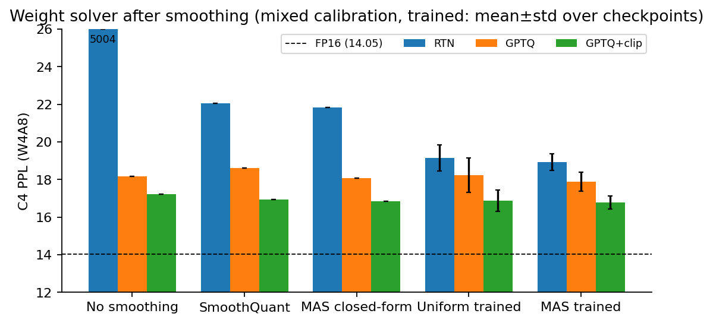
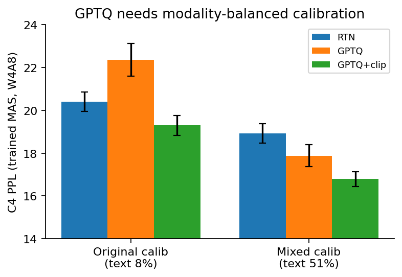

# 改进 F：平滑之后换掉 RTN —— 多模态感知的 GPTQ 权重求解

> 2026-11-23 新增。代码 `quantize/gptq.py`（+ `quantize/masquant.py`、`quantize/int_linear.py`、`main.py` 的接线），
> 启动脚本 `scripts/gptq_ppl.sh`，汇总脚本 `tools/gptq_summary.py`、`tools/run_boot_gptq.py`、`tools/subset_boot.py`，
> 图 `tools/make_fig_gptq.py`。全部原始日志（脱敏）与逐题预测在 `results/gptq/`。
> 硬件：4×B200。所有 PPL 来自**冻结的平滑尺度**（已训练 checkpoint 或闭式解），GPTQ 求解本身是确定性的，
> 因此同一 checkpoint 上 RTN vs GPTQ 是**严格配对**的比较。

## 0. 一句话

MASQuant（以及 SmoothQuant）只回答了"**量化什么**"（平滑后的 $W\!\cdot\!s$），权重本身仍用最朴素的
round-to-nearest（RTN）。我们把 RTN 换成**按模态统计 Hessian 的 GPTQ**，再加上**按 Hessian 误差逐行选裁剪系数**（clip），
格式不变、推理零开销：

- W4A8 TextVQA **63.47 → 70.98（MAS）/ 72.95（无平滑）/ 73.53（统一 scale）**，与 FP16 的差距从 **12.4 点缩到 2.3–2.9 点**；
- C4 PPL（8 个训练好的 MAS checkpoint）**18.92 → 16.79**，每个 checkpoint 都变好；
- 但有一个多模态特有的前提：**GPTQ 的 Hessian 也需要模态平衡的校准集**。在原校准集（文本 token 8%）上，
  分模态 GPTQ 反而让 PPL **变差**（9/9 个 checkpoint，C4 +1.96）——这把改进 A（混合校准）和改进 F 串成了一条线。
- 副产品：一旦权重求解器足够好，"**用什么平滑**"几乎不再重要（无平滑 / SQ / MAS 闭式解 / 统一 / MAS 训练在下游两两大多不显著），
  进一步支持我们此前的结论：W4A8 的主瓶颈在**权重量化**，而不是"分模态"。

---

## 1. 动机

1. **平滑只换了题目，没换解法。** MAS 的前向是 $Q_a(X/s_m)\cdot Q_w(W\!\cdot\!s_m)^\top$，其中 $Q_w$ 是 per-channel 对称 RTN。
   平滑决定了 $Q_w$ 的输入，但 $Q_w$ 本身对每个元素独立舍入，完全不看输入激活的统计。
   而 PTQ 文献里早已知道权重侧的标准做法是 GPTQ（OBQ 的近似）：最小化 $\mathrm{tr}[(W-Q)H(W-Q)^\top]$，$H=\sum_t x_tx_t^\top$。
2. **复现中的线索指向权重侧。** 我们之前已经发现：① 无平滑 RTN 的 W4A8 直接崩溃（PPL 6103），但单层 SQNR 只比 MAS 低 0.3 dB；
   ② W4A8 与 FP16 在 TextVQA 上仍差约 12 点；③ "分模态"与"统一 scale + 训练"打平。三者都提示：剩余误差可能主要来自 4-bit 权重，而非激活。
3. **多模态场景下 GPTQ 不是"直接套用"。** MAS 的每个模态有自己的平滑尺度、自己的一份量化权重 $Q(W\!\cdot\!s_m)$；
   而单权重部署（统一 scale、down_proj、只用文本尺度）中一份权重要服务多个模态。Hessian 用哪些 token、在哪个空间里统计、
   模态间怎么加权，都是需要回答的设计问题（§2.1）。

## 2. 方法

### 2.1 多模态感知的 Hessian

在已确定的平滑尺度 $s_m$ 下，对第 $m$ 份权重求解

$$\min_{Q\in\mathcal{G}}\ \mathrm{tr}\big[(W s_m - Q)\,H_m\,(W s_m - Q)^\top\big],\qquad H_m=\sum_{t\in\mathcal{T}_m}\tilde x_t\tilde x_t^\top,\ \ \tilde x_t = x_t / s_m .$$

- **在平滑空间里统计**：$\tilde x = x/s_m$ 才是这份权重真正看到的输入；
- **只用本模态 token**（`--gptq_hsrc own`，默认）：$\mathcal{T}_m$ = 该份权重实际服务的 token。分模态平滑下文本权重只看文本 token，视觉权重只看视觉 token；
  `--gptq_hsrc all` 则让每份权重都看全部 token（在各自的平滑空间里），用于某个模态 token 太少时补统计量；
- **模态均衡合并**（`--gptq_hmode balanced`）：一份权重服务多个模态时，原始 GPTQ 的 $H$ 按 token 数加权，视觉 token 会主导；
  balanced 先按模态各自归一化再平均（可用 `--gptq_modw` 指定权重）；
- 平滑尺度相同的 tag 自动合并成同一份权重（例如 down_proj 不平滑、`MAS_SINGLE_SCALE=text` 的单权重部署）；
- 逐组顺序求解（qkv → o → gate/up → down），每组的输入来自前面已经 GPTQ 过的组，与 GPTQ 原论文的顺序量化一致。

$\mathcal{G}$ 与原来的 RTN **完全同一个格点**（INT4 per-channel 对称步长 $\max|w|/7$；NVFP4 的 E2M1 码字 + E4M3 块缩放），
所以部署格式、kernel、显存都不变。实现上 $\gamma=1$ 时与原 `UniformAffineQuantizer`/`NVFP4Quantizer` 的格点逐位一致
（自检：NVFP4 100% 一致；INT4 99.66% 一致，差异来自 bf16 下步长计算的舍入，属同一格点的等价实现）。

### 2.2 求解器的两处改进（来自我们在 NVFP4 视频扩散模型上的经验，这里推广到 INT）

- **clip（H 感知的逐行裁剪）**：默认步长 $\max|w|/7$ 隐含"每行最大元素必须无损"。我们对每行在若干 $\gamma$ 下用步长 $\gamma\cdot\max|w|/7$
  各解一次 GPTQ，**按 H 加权误差逐行选优**（不同行之间在该目标下相互独立，所以逐行选择是精确的），并把 RTN 也放进候选，
  保证逐行不劣于 RTN。代价是 GPTQ 次数 ×|γ|。
- **cd（码字坐标下降抛光）**：GPTQ 是单遍贪心，量完的列不再回头。解完后对每个元素固定其余变量、枚举全部格点、
  只接受降 loss 的改动（二次函数闭式求值），严格单调，收敛到 1-opt 局部极小。

### 2.3 用法

```bash
# 在已训练的 MAS checkpoint 上：RTN（对照） / GPTQ / GPTQ+clip
bash scripts/gptq_ppl.sh mas_rtn  0 split_scales outputs/<ckpt>/mas_parameters.pth
bash scripts/gptq_ppl.sh mas_gptq 0 split_scales outputs/<ckpt>/mas_parameters.pth --gptq
bash scripts/gptq_ppl.sh mas_clip 0 split_scales outputs/<ckpt>/mas_parameters.pth --gptq --gptq_clip 1.0,0.95,0.9,0.85
# 不平滑，只用 GPTQ+clip
LET=0 bash scripts/gptq_ppl.sh plain_clip 0 merged_scales none --gptq --gptq_clip 1.0,0.95,0.9,0.85
# 加下游
TASKS=scienceqa_img,textvqa_val LIMIT=1.0 bash scripts/gptq_ppl.sh ... 
# 汇总
python tools/gptq_summary.py logs --json results/gptq/ppl_summary.json
```

其它开关：`--gptq_cd N`、`--gptq_hmode balanced`、`--gptq_hsrc all`、`--gptq_actq`（用量化后的激活统计 H）、
`--gptq_rtn_only`（只做 H 感知 clip、不做 GPTQ，消融用）、`--gptq_fp32_bs`（NVFP4 求解时不量化块缩放）、`--gptq_cache`（缓存求解结果）。
单卡一次 GPTQ 约 6 分钟，GPTQ+clip(4 个 γ) 约 6 分钟（γ 并行成一个大矩阵求解），+cd2 约 30 分钟。

---

## 3. 结果

### 3.1 PPL：每种平滑方式 × 三种求解器（W4A8，混合校准）



| 平滑方式 | RTN | GPTQ | GPTQ + clip | GPTQ + clip + cd2 |
|---|---|---|---|---|
| 不平滑 | 6103 / 5004 | 14.05 / 18.18 | 13.70 / 17.24 | 13.46 / 17.09 |
| SmoothQuant（闭式解） | 23.11 / 22.04 | 15.45 / 18.61 | 15.10 / 16.94 | 13.36 / 16.90 |
| MAS 闭式解（不训练） | 22.91 / 21.82 | 13.96 / 18.07 | **12.93 / 16.85** | 13.00 / 16.99 |
| 统一 scale + 训练（12 个 ckpt） | 18.56±2.06 / 19.16±0.69 | 14.59±1.50 / 18.23±0.91 | 13.52±1.00 / 16.87±0.57 | — |
| **MAS + 训练（8 个 ckpt）** | 18.08±2.40 / 18.92±0.45 | 15.23±2.29 / 17.88±0.51 | 14.24±1.93 / **16.79±0.35** | — |

（格式：wikitext2 / C4；FP16 = 11.11 / 14.05。闭式解配置是确定性的，单次即可；训练配置是同一批冻结 checkpoint 上的配对比较。
MAS 训练组排除了 1 个训练早期发散的 checkpoint（RTN 35.5），它在 GPTQ/clip 下也同样改善：35.5 → 25.6 → 18.4。）

**同一 checkpoint 上的配对差（C4，负 = 变好）：**

| 对比 | MAS 训练 | 统一 scale 训练 |
|---|---|---|
| GPTQ − RTN | −1.78（**9/9** 变好，t=−2.4） | −0.93（11/12，t=−4.1） |
| GPTQ+clip − GPTQ | −1.90（**9/9**，t=−2.3） | −1.36（**12/12**，t=−7.1） |
| GPTQ+clip − RTN | −2.13（**8/8**，每个 ckpt 都在 −1.95 ~ −2.24 之间） | −2.29（**12/12**，−1.96 ~ −2.70） |

要点：
- **GPTQ 救活了"不平滑"**：RTN 下 6103 的崩溃模型，GPTQ 后 14.05，GPTQ+clip 后 13.70，已经**优于论文方法 MAS + RTN（18.08）**；
- **clip 是独立的增益**：消融 `--gptq_rtn_only`（只做 H 感知裁剪、不做 GPTQ）在 4 个 MAS checkpoint 上 C4 18.52 → 17.17（4/4），
  GPTQ+clip 再到 16.48（4/4）——两者互补。
- **cd 抛光基本无收益**：H 加权误差的恢复率从 76% 升到 87%，但 PPL 只在 SQ 上明显改善，MAS 训练（4 个）上 16.48 → 16.53。
  代理误差与端到端脱钩，与我们在 NVFP4 视频模型上观察到的"代理饱和"一致；**默认不开 cd**。
- **"分模态"在新求解器下依然无增益**：MAS 训练 16.79±0.35（8）vs 统一训练 16.87±0.57（12），差 0.08，远小于 std。

### 3.2 多模态特有的发现：GPTQ 的 Hessian 也需要模态平衡的校准集



| 原校准（文本 token 8.1%）的 9 个 MAS checkpoint | wikitext2 | C4 |
|---|---|---|
| RTN | 19.09 ± 1.45 | 20.40 ± 0.46 |
| 分模态 GPTQ（`hsrc=own`） | 20.35 ± 2.03 | **22.36 ± 0.77（0/9 变好）** |
| 共享 Hessian（`hsrc=all` + balanced） | 19.33 ± 2.29 | 22.03 ± 1.01（0/9） |
| GPTQ + clip（4 个） | 17.38 ± 2.76 | 19.29 ± 0.46 |
| 同样 4 个 checkpoint，但 **Hessian 改用混合校准集** | **13.61 ± 0.50** | **17.39 ± 0.16** |

- 原校准集里文本只有 3873 个 token，且大多是重复的对话模板。文本权重的 GPTQ 在**校准集上**恢复了 95% 的误差（混合校准时只有 47–49%），
  但这是**过拟合**：文本 Hessian 秩不足、方向单一，GPTQ 把误差推到了模板里不出现、真实文本里大量出现的方向上。
- 让每份权重都看全部 token（`hsrc=all`）只能部分缓解（视觉 token 的分布与文本不同）。
- **最干净的证据**：同一批（原校准训练出的）平滑尺度，只把 GPTQ 的 Hessian 换成混合校准集，C4 从 19.29 降到 17.39，
  wikitext 从 17.38 降到 13.61。也就是说，**校准集的模态平衡对"求解器"比对"平滑尺度"更重要**。
- 这一条是本改进与改进 A 的连接点：论文的校准集对 MAS 训练已经不够（改进 A），对更强的权重求解器则是**有害的**。

### 3.3 下游：全量 ScienceQA + TextVQA（配对 bootstrap，10000 次）

所有配置都用同一个混合校准训练出的 MAS checkpoint（或对应的闭式解），在 TextVQA 前 2000 题与 ScienceQA 2000 题上同题配对
（`tools/subset_boot.py`；FP16 与 MAS+RTN 是全量跑的，取同一批 doc_id）：

| 配置 | ScienceQA | TextVQA | 与 FP16 差（TVQA） |
|---|---|---|---|
| FP16 | 80.80 | 75.85 | — |
| SmoothQuant + RTN | 75.25 | 61.05 | −14.8 |
| 统一 scale 训练 + RTN | 78.70 | 64.39 | −11.5 |
| **MAS 训练 + RTN（论文方法 + 我们的混合校准）** | 78.65 | 63.47 | −12.4 |
| MAS 训练 + GPTQ | 78.30 | 70.91 | −4.9 |
| MAS 训练 + GPTQ + clip | 79.15 | 70.98 | −4.9 |
| MAS 训练 + GPTQ + clip，只用文本尺度单权重部署 | **79.70** | 71.88 | −4.0 |
| SmoothQuant + GPTQ + clip | 77.90 | 71.76 | −4.1 |
| 不平滑 + GPTQ | 76.10 | 72.19 | −3.7 |
| 不平滑 + GPTQ + clip | 78.70 | 72.95 | −2.9 |
| MAS 闭式解 + GPTQ + clip | 78.75 | 73.05 | −2.8 |
| **统一 scale 训练 + GPTQ + clip** | 79.30 | **73.53** | **−2.3** |

关键配对差（95% CI）：

| 对比 | ScienceQA | TextVQA |
|---|---|---|
| MAS+GPTQ+clip − MAS+RTN | +0.50 [−0.85, +1.90] | **+7.51 [+5.77, +9.21]** |
| MAS+GPTQ − MAS+RTN（全量 5000 题） | — | **+7.24 [+6.22, +8.30]** |
| 不平滑+GPTQ+clip − MAS+RTN | +0.05 [−1.40, +1.55] | **+9.49 [+7.75, +11.26]** |
| 不平滑+GPTQ+clip − SQ+RTN | **+3.45 [+1.65, +5.25]** | **+11.90 [+10.13, +13.70]** |
| 不平滑+GPTQ+clip − 不平滑+GPTQ | **+2.60 [+1.10, +4.10]** | +0.77 [−0.61, +2.14] |
| 不平滑+GPTQ+clip − MAS 训练+GPTQ+clip | −0.45 [−1.85, +0.95] | **+1.98 [+0.58, +3.37]** |
| 不平滑+GPTQ+clip − 统一训练+GPTQ+clip | −0.60 [−2.10, +0.85] | −0.58 [−1.88, +0.75] |
| 不平滑+GPTQ+clip − MAS 闭式解+GPTQ+clip | −0.05 [−1.50, +1.40] | −0.09 [−1.45, +1.23] |
| FP16 − 统一训练+GPTQ+clip | **+1.50 [+0.30, +2.75]** | **+2.31 [+1.09, +3.54]** |
| FP16 − MAS 单权重+GPTQ+clip | +1.10 [−0.15, +2.35]（不显著） | **+3.98 [+2.70, +5.22]** |

结论：
1. **换求解器是本工作里下游收益最大的单项改进**：TextVQA +7.5 ~ +9.5 点，把与 FP16 的差距从 12.4 缩小到 2.3 ~ 4.9。
   相比之下，"分模态"对"统一"、MAS 训练对闭式解，在 RTN 下都只差 1 点以内。
2. **clip 对 ScienceQA 很重要**：不平滑时只用 GPTQ 的 ScienceQA 掉到 76.10，加 clip 回到 78.70（+2.6，显著）。
3. **平滑方式的选择在好的求解器下基本不重要**：无平滑 / MAS 闭式解 / 统一训练 + GPTQ+clip 两两不显著。
   唯一显著的是"MAS 训练"这个 checkpoint 在 TextVQA 上比其它低约 2 点——**单个 checkpoint**，可能是训练出的尺度与
   GPTQ 的配合问题，需要更多 checkpoint 才能下结论（见 §5）。
4. **MAS + 只用文本尺度的单权重部署 + GPTQ+clip** 在 ScienceQA 上与 FP16 无显著差异（−1.10，CI 跨 0），TextVQA 差 4.0。
   这一配置**一份 4-bit 权重、零旁路**，延续了我们对 CMC 的结论（"不补偿"就够）。

### 3.4 NVFP4（W4A4）：GPTQ 几乎无收益，clip 有害

| NVFP4 W4A4 | RTN | GPTQ | GPTQ（求解时 FP32 块缩放） | GPTQ + clip + cd |
|---|---|---|---|---|
| MAS 闭式解，原校准 | **11.73** / 15.21 | 12.35 / 15.28 | 11.97 / 15.17 | 12.65 / 15.38 |
| MAS 闭式解，混合校准 | 11.81 / 15.14 | 11.81 / 15.07 | **11.73 / 14.99** | 12.07 / 15.10 |
| 不平滑，混合校准 | 12.23 / 15.58 | 12.09 / 15.19 | 12.26 / 15.24 | 12.47 / 15.27 |

- NVFP4 的 RTN 本身已经很接近 FP16（11.11 / 14.05），GPTQ 最多改善 C4 0.15~0.4，**clip 与 cd 一律变差**；
- 原校准集上 GPTQ 又一次变差（11.73 → 12.35），换成混合校准后才中性/略好——与 §3.2 同一现象；
- 块缩放的 E4M3 舍入会扰动 GPTQ 的格点（`--gptq_fp32_bs` 让求解在 FP32 缩放上进行，原校准下 12.35 → 11.97）；
- **结论**：NVFP4 的块缩放（16 元素一组）已经吸收了 GPTQ 想解决的大部分误差，**W4A4-NVFP4 下继续用 RTN 即可**。
  改进 F 是针对 **INT 的 per-channel 粗粒度格点** 的改进。

### 3.5 阴性/中性的消融（如实记录）

| 尝试 | 结果 |
|---|---|
| 用量化后的激活统计 H（`--gptq_actq`，4 个 ckpt） | C4 +0.02（不显著），不需要 |
| 单权重部署下模态均衡的 H（`--gptq_hmode balanced`，4 个 ckpt） | C4 −0.06（不显著）；混合校准下文本/视觉 token 数接近，按 token 加权已经近似均衡 |
| 原校准下共享 Hessian（`hsrc=all`） | 比分模态 GPTQ 好 0.34（C4，5/9），但仍比 RTN 差 1.6；不如换校准集 |
| cd 抛光（2 遍 / 4 遍） | 代理误差恢复率 +10pp，PPL 无一致改善；成本 ×5 |
| γ 网格 | 见 §4 |

## 4. γ 的选择：代理误差与端到端脱钩

GPTQ+clip 在 INT4 下 **94–97% 的行选了原网格的下界 γ=0.85**（H 加权误差最小）。把网格加宽到 `1.0,0.95,0.9,0.85,0.8,0.75,0.7`，
选择立刻继续下移：**80–83% 的行选 γ=0.70（新的下界）**，说明"逐行按 H 误差选 γ"会把 γ 一路推到边界。

固定 γ 的扫描（同一配置只改 γ，单次）：

| 固定 γ | 不平滑（wikitext2 / C4） | MAS 混合校准（wikitext2 / C4） |
|---|---|---|
| 0.95 | 14.48 / 17.06 | 14.22 / 16.86 |
| 0.90 | 13.02 / 16.65 | 13.88 / 16.70 |
| 0.85 | 13.44 / 16.94 | 13.38 / 16.52 |
| 0.80 | 13.12 / 16.32 | 13.93 / 16.43 |
| 逐行选（原网格 1.0~0.85） | 13.70 / 17.24 | 14.24 / 16.79 |
| 逐行选（宽网格 1.0~0.70） | **12.78 / 16.43** | 13.27 / **16.36** |

- γ < 1 确实有效（固定 0.8~0.9 都比逐行选原网格好），说明"最大值必须无损"这个假设在 MAS/W4A8 上不成立；
- **但逐行按 H 误差选 γ 的结果与端到端不一致**：原网格的逐行选择（选择集中在 0.85）比任何单个固定 γ 都差。
  这与我们在 NVFP4 视频扩散模型上观察到的"H-proxy 在 ~70% 处饱和、之后与感知脱钩"是同一现象——
  逐层代理误差只能当初筛，**γ 应该端到端锚定**（宽网格的逐行选择恰好更好，是因为它允许更激进的裁剪）；
- 实用建议：用宽网格 `1.0,0.95,0.9,0.85,0.8,0.75,0.7`（本报告 §3 的训练 checkpoint 表用的还是原网格，数值偏保守）。

## 5. 局限与后续

- 下游只评了每种配置的**一个** checkpoint（每次 ~70 分钟）；"MAS 训练 + GPTQ+clip 在 TextVQA 上比统一训练低 2.5 点"需要更多 checkpoint 才能确认；
- GPTQ 的 Hessian 来自 128 个校准样本（约 4.5 万 token），没有扫描校准样本数；
- 只做了 W4A8（INT）与 W4A4（NVFP4）；GPTQ 对 W4A6 等更激进激活位宽的作用未测；
- `--gptq_cache` 可以复用求解结果（每个 run 约 9 GB），评测多个任务时省时间。
